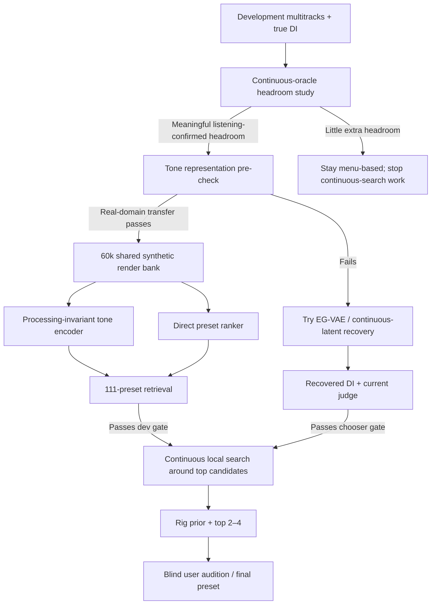

# Research verdict: the best ML path from a commercial song to a Neural DSP preset

## Executive summary

**Evidence labels used throughout:** **[P]** = result supplied by this project; **[V]** = verified in a primary/official source; **[I]** = my inference, recommendation, or quantitative planning estimate. The project facts and previous experiments are taken from the supplied research brief. fileciteturn0file0

**[I] My main conclusion is that the project should stop treating DI reconstruction as the default architecture.** The most promising route is a **content-invariant guitar-tone representation trained specifically on your plugins, followed by prototype-based ranking and, only after that works, gradient-free continuous preset search**. The critical difference from your existing contrastive encoder is not mainly a larger network: it is the **training construction**. Positive pairs must be *the same processing applied to different performances*, while hard negatives must be *different processing applied to the exact same performance*. This directly attacks the failure you measured, where notes and player identity move the representation more than the preset. The strongest new literature supports exactly this diagnosis: a 2026 representation-learning study found source mismatch to be a larger bottleneck than processor mismatch and obtained its strongest processing representations using same-processing/different-source positives plus same-source/different-processing hard negatives; its cross-instrument retrieval result was dramatically stronger than AFx-Rep, Fx-Encoder++, CLAP, MERT and PANNs. citeturn10view0

**[I] Rank two is a direct song/stem-to-candidate ranker, not knob regression.** Train it on aggressively domain-randomised plugin renders embedded in realistic mixes and ask it to rank either the 111 presets or a larger sampled candidate bank. Use **set-valued soft labels** so that several settings can be “correct” when they are perceptually equivalent. Published guitar-effects work shows that effect recognition and parameter estimation are highly learnable in matched synthetic domains, while Open-Amp shows that sufficiently diverse synthetic guitar-effect training can transfer to unseen effect datasets and even real analogue devices. Your own experiments then supply the warning: without deliberate record-domain simulation, this transfer collapses. citeturn7academia48turn23view0

**[I] Rank three is a substantially changed DI-recovery experiment inspired by EG-VAE, using continuous DAC-like latents and explicit content/tone disentanglement rather than exact codec-token prediction.** This is not a recommendation to continue incrementally tuning C′. EG-VAE, published in August 2026, directly targets electric-guitar tone removal, frames the inverse problem as content/tone disentanglement, and reports improvements over task-specific removal and transfer baselines; notably, the authors' demo uses Morgan Amps Suite as an unseen-tone case. citeturn18view0turn17search0 Your E0 result also matters: **[P]** DAC round-trip preserved the oracle almost perfectly, so the codec decoder is not the problem; exact code prediction was the wrong target because the discrete codes were phase-sensitive. fileciteturn0file0

**[I] Vanilla ST-ITO is not a solution to your problem.** ST-ITO is excellent evidence that a learned processing representation plus CMA-ES can control large, arbitrary effect chains, and AFx-Rep is the most useful ready-made baseline I found. But ST-ITO optimises an effect chain applied to a base audio signal. Your product does not possess a dry base signal from the target performance, so directly copying the method merely moves the missing-DI problem elsewhere. citeturn3view0 The useful pieces are its **AFx-Rep baseline, its search strategy, and its idea of inference-time optimisation**; the necessary modification is to score a setting through a *canonical excitation/prototype bank* rather than pretending the song itself can be processed as if it were dry.

**[I] The highest-value experiment is actually a measurement experiment before any large ML run:** determine the true **continuous-setting oracle headroom** with the real DI on development data. **[P]** The current approximately −0.13 to −0.19 oracle gaps correspond to roughly 12–17% lower distance than the chosen starting preset, but that oracle is confined to 111 dry factory presets and is evaluated by a judge known to miss some treble differences. fileciteturn0file0 It therefore does **not** support the claim that “a perfect DI only buys a little.” The correct experiment is to compare, on the same takes:

| Oracle level | What it answers |
|---|---|
| **[P] 111-preset dry oracle** | What is possible inside today's menu? |
| **[I] Continuous dry oracle** | How much is lost by menu discretisation? |
| **[I] Continuous full-chain oracle** | How much more is available from pedals, cab/mics, EQ and time effects? |
| **[I] Listening-confirmed continuous oracle** | How much of the metric gain is actually audible and desirable? |

**[I] My recommended product architecture is ultimately hybrid:** documented rig/tone research gives a **soft prior**, the audio model/search produces the top two to four candidates, and the user's ear resolves the last ambiguous choice. For a one-user personal tool this is not a concession; it avoids pretending that an underpowered objective benchmark can reliably resolve settings that may be perceptually equivalent. A 2025 inference-time-optimisation extension found that incorporating a prior substantially improved parameter estimation in a low-data effects-transfer setting, supporting the use of research as a search prior rather than a hard routing decision. citeturn0academia45

My overall ranking is:

| Rank | Approach | Planning expectation versus today's class start | Confidence |
|---|---|---:|---|
| **1** | **[I] Processing-invariant tone encoder → preset prototypes → top-k → continuous local search** | **~7–15% distance reduction** on in-scope material if real-domain transfer passes | Medium |
| **2** | **[I] Direct domain-randomised song/stem → preset ranker, then local parameter refinement** | **~5–12%** | Medium-low |
| **3** | **[I] EG-VAE-style content/tone disentanglement / continuous-latent DI recovery → existing chooser/search** | **~5–10%**, most plausible on clean/EOB/crunch | Medium-low |
| **4** | **[I] Rig prior + structured routing + top-two/four listening** | Small objective gain, potentially large product reliability gain | High as a wrapper |
| **5** | **[I] Modified ST-ITO with canonical excitations but no learned project-specific encoder** | ~0–8% | Low-medium |
| **6** | **[I] Generic foundation embeddings or hand-engineered DI-free distance as the primary matcher** | ~0%; likely negative | Low |

Those percentages are **planning priors, not literature-estimated effects**. The current data are too underpowered to justify tighter numerical forecasts. **[P]** Your own recent crunch tests had only about 9–37% power, so a precise claimed expected improvement would be false precision. fileciteturn0file0

## What the literature changes about the diagnosis

The most important finding from the research is that several of your “failed ideas” were directionally correct but were trained or evaluated under conditions that made failure very likely.

| Work | What was actually demonstrated | Why it matters here | Licence / usability under your rules | Main caveat |
|---|---|---|---|---|
| **ST-ITO / AFx-Rep, ISMIR 2024** | **[V]** Learned an audio-effects representation from many processors and used CMA-ES at inference to optimise arbitrary chains. AFx-Rep substantially outperformed general audio representations on the authors' processing-style tasks; ST-ITO used a population of 64 and up to 25 search iterations. citeturn3view0 | **[I]** Strong evidence for learned processing spaces + black-box search. | **[V]** Official ST-ITO/AFx-Rep repository is Apache-2.0. citeturn1search5 | **[V]** It starts from a base signal to which effects are applied; it does not magically infer the missing guitar DI. citeturn3view0 |
| **Open-Amp, ICASSP 2025** | **[V]** Trained on synthetic outputs from a broad collection of neural amp/effect captures. A tiny 112,888-parameter contrastive encoder trained with same-device/different-guitar positives transferred well across guitar-effects datasets; on GFX its MLP reached 91.8%, and on the EGFX and EGDB cross-dataset tests it reached 72.0% and 91.1% respectively. citeturn23view0 | **[I]** This is the best evidence I found that synthetic guitar-effect diversity can create a transferable tone representation. | **[I]** The paper/method is usable to reimplement. I would **not** make the project depend on its community capture collection until every capture's redistribution/use licence is whitelisted; the official repository surfaced without a clear repository licence in this review. citeturn24search0 | **[V]** It still evaluates much cleaner domains than mastered commercial mixes. |
| **Representation Learning for Audio Transformations, ISMIR 2026** | **[V]** Directly studies how to make processing representations independent of source content. Its key batch design uses the *same processing on different source audio as positives* and *different processing on the same source as hard negatives*. It reports the source gap as more severe than the processor gap. citeturn10view0 | **[I]** This is almost a controlled explanation of why your encoder can score 74.5% on crossed renders and still fail on records. | **[I]** Use the objective, **not the released dependency stack**: the paper's implementation builds on Stable Audio Open, whose available weights are governed by a separate gated/community licence rather than your permissive-open requirement. citeturn10view0turn15search0 | **[V]** The published training regime is much larger than your Mac budget, including very large pre-rendered latent batches and H100 training. citeturn10view0 |
| **Guitar Effects Recognition and Parameter Estimation, 2021** | **[V]** CNNs learned 13 distortion/overdrive/fuzz identities and settings from rendered guitar data, generally exceeding 80% classification accuracy and obtaining small normalised knob errors in the matched-domain experiment. citeturn7academia48 | **[I]** Supports classification/ranking as an easier target than universal song-to-knob regression. | **[V]** Official implementation is BSD-3-Clause. citeturn8search1 | **[I]** It does not demonstrate synthetic-render → commercial-record transfer. Your kill tests are stronger negative evidence for that step. |
| **Fx-Encoder / Fx-Encoder++** | **[V]** These works explicitly seek processing representations that separate effects from musical content, and Fx-Encoder++ extends the idea to mixtures. citeturn9search9turn1academia43 | **[I]** Relevant architecture/objective precedent. | **[V]** The official Fx-Encoder++ release is CC BY-NC 4.0, so I would exclude its weights/code from a strict permissive-open production dependency. citeturn12search0 | **[V]** Newer 2026 evidence indicates that source shortcuts remain a major problem for these earlier embeddings. citeturn10view0 |
| **EG-VAE, August 2026** | **[V]** Jointly learns guitar tone transfer and tone removal by splitting wet audio into frame-level content and global tone, enforcing tone masking and content/tone perturbation. It reports a 44% Mel-distance improvement over its strongest transfer baseline on seen tones and improves the best removal baseline from 1.21 to 1.10 Mel on seen tones, matching it on unseen tones. citeturn18view0 | **[I]** It is the closest published formulation to your C′/E1 problem and validates disentangling *content* from *guitar processing* rather than predicting phase-locked codec IDs. | **[I]** Reimplement the published method; I did not verify a permissively licensed released checkpoint that satisfies your rules. | **[V]** It is evaluated on isolated guitar, not a mastering-processed commercial mixture; the inverse remains ill-posed because clipping/saturation discard information. citeturn18view0 |
| **DeepAFx-ST** | **[V]** Differentiable-effects style transfer is a strong methodological precedent. | **[I]** Useful paper, not a dependency. | **[V]** The official Adobe release uses the Adobe Research licence rather than a permissive open-source licence, so the released package/weights do not meet your requirement. citeturn0search1 | Requires a differentiable chain and does not solve your unknown-source problem by itself. |
| **DAC** | **[V]** High-fidelity general audio codec with 44.1-kHz models; official code and weights are MIT. citeturn25search0 | **[P]** Your E0 already proved that its decoder can preserve the tone-ranking information required by your oracle. fileciteturn0file0 | **[V]** MIT code and weights. citeturn25search0 | **[P]** Exact residual-code prediction is phase-sensitive and failed E1. The continuous latent is the interesting target, not codes. fileciteturn0file0 |

Two findings deserve particular emphasis.

**[V] First, source-content shortcuts are now a published, measurable failure mode in effects representations.** The 2026 transformation-representation work reports that AFx-Rep and general-purpose embeddings degrade badly when source identity differs, while its stronger training constructions explicitly break the correlation between musical source and processing. citeturn10view0 **[P]** That is exceptionally consistent with your observation that log-mel/MFCC/general encoders move more with the notes than with the preset, and with your contrastive model succeeding on synthetic crossed renders while failing render-to-record transfer. fileciteturn0file0

**[V] Second, synthetic training is not inherently the problem.** Open-Amp deliberately generates effects training data synthetically and nevertheless transfers its learned encoder to unseen guitar-effects datasets; it also enrols unseen analogue pedals into a synthetic-trained latent space. citeturn23view0 **[I]** The more precise diagnosis of your failed translator and encoder is therefore: **synthetic data that varies the wrong factors, plus insufficient modelling of the record-production domain, is the problem.** Rendering more random Neural DSP settings without changing the factorisation of the training task would probably repeat the failure.

## Ranked approaches and why

| Rank | Approach | Why I rank it here | Data / compute | Main failure mode | Cheapest decisive test |
|---|---|---|---|---|---|
| **1** | **[I] Processing-invariant encoder + setting prototypes + continuous local search** | **[V]** Current literature directly supports same-processing/different-source contrastive learning and shows source mismatch is the central bottleneck. citeturn10view0turn23view0 **[P]** It attacks the exact thing your previous encoder did not solve: note/player dominance and record transfer. fileciteturn0file0 | **[I]** Start with ~60k four-second plugin renders, not >200k; on-the-fly mix/master/separator augmentation. Small raw-audio encoder. | Real records may still be too far from every synthetic domain; separator artifacts can masquerade as “tone”. | **[I]** Run AFx-Rep plus a re-trained 100k–1M-param encoder on existing crossed renders and measure *cross-source real-record ranking*, not render retrieval. |
| **2** | **[I] Direct target-audio → candidate ranking, with set-valued labels** | **[V]** Direct effects recognition works very well when the synthetic domain matches. citeturn7academia48 **[I]** Ranking eliminates unnecessary knob identifiability and lets several equivalent settings be correct. | **[I]** Share the rank-one render bank; little extra rendering. | Domain gap can simply migrate from embedding space to the classifier. | **[I]** Train only on the 111 dry menu first. It must beat the fixed start and a shuffled-audio control on leave-one-band-out real development data before any continuous knob head is added. |
| **3** | **[I] EG-VAE-style tone removal / continuous latent recovery** | **[V]** EG-VAE is now direct evidence that joint guitar content/tone factorisation can outperform specialised tone-removal baselines. citeturn18view0 **[P]** Your DAC E0 upper-bound result says a codec latent route is viable if phase-locked discrete codes are avoided. fileciteturn0file0 | **[I]** 40–80k paired dry/wet clips for pilot; heavier model and one-to-three days of M-series training budget. | The inverse is intrinsically many-to-one; a perceptually plausible DI may still contain exactly the wrong nonlinear detail for ranking presets. | **[I]** E1′ only: predict continuous DAC latent through frozen decoder with waveform/spectral losses. Do not build the whole EG-VAE unless E1′ beats C′ in *chooser behaviour*. |
| **4** | **[I] Research prior + top-k audio model + human selection** | **[P]** Routing improved when based on the part rather than genre, and the user's ears reversed the main/second choice in two of three end-to-end cases. fileciteturn0file0 **[V]** Prior-informed ITO has published evidence of improved parameter estimation. citeturn0academia45 | Negligible ML cost. | Research is often ambiguous, studio chains are undocumented, and a documented live rig may not equal the recording rig. | Hide model scores and ask the user to pick between two or four loudness-controlled candidates on a fixed excerpt. |
| **5** | **[I] ST-ITO-style search with stock AFx-Rep and canonical guitar excitation** | **[V]** AFx-Rep is a strong processing embedding and ST-ITO demonstrated black-box optimisation of dozens of controls. citeturn3view0 | No training initially; hundreds of plugin renders per song. | AFx-Rep was not trained specifically to be invariant to guitar notes/player, so your exact content shortcut can persist. | Average each candidate's AFx-Rep over 8–16 different DIs and see whether a real amp recording ranks the judge oracle ahead of the fixed start. |
| **6** | **[I] Hand features, MERT/CLAP/PANNs/BEATs/OpenL3/AudioMAE as the primary matcher** | **[P]** Project tests are already negative. fileciteturn0file0 **[V]** ST-ITO found general representations weaker than dedicated processing representations, and the 2026 processing study reports severe source-content bias in generic encoders. citeturn3view0turn10view0 | Cheap. | Notes, instrumentation and mix semantics dominate tone. | No further main-line experiment; retain only as ablations. |

### Why the first approach is different from your existing contrastive encoder

**[P]** Your crossed-render encoder already proves that a neural representation can identify settings across players *inside the renderer domain*: 74.5% versus 14% chance. Its failure is therefore not “contrastive learning does not work.” It is that **the representation does not remain tone-dominant once the source distribution changes from plugin renders to recorded amps/mics/mastered songs**. fileciteturn0file0

**[V]** The newer processing-representation literature supplies a more aggressive construction. Rather than merely putting different performances through the same preset and calling them positive, each mini-batch should deliberately contain the following two pair types: same processing on different source performances as positives, and *the identical source waveform through nearby but different processing* as hard negatives. citeturn10view0 **[I]** This forces the encoder to spend capacity on exactly what changes when a knob/preset changes, while receiving direct gradient pressure to ignore notes, timing and player.

For this project I would also make the loss **continuous rather than purely preset-ID based**. **[I]** Two settings that your true-DI judge and listening both regard as essentially indistinguishable should not be forced far apart merely because their XML values differ. Conversely, settings that differ by a small knob movement but cause a large audible gain-stage transition should be treated as hard negatives.

A useful scoring formulation is:

\[
S(\theta\mid y)=
w_z\,d\!\left(z(y),\mu_\theta\right)
+w_f\,d\!\left(f(y),f_\theta\right)
-\lambda\log p(\theta\mid\text{rig research})
\]

where **[I]** \(z(y)\) is the learned processing embedding of the target song/stem, \(\mu_\theta\) is the *content-averaged embedding prototype* of plugin setting \(\theta\), \(f\) contains a small set of interpretable drive/EQ/spatial features, and \(p(\theta\mid\text{rig research})\) is only a soft prior.

The key concept is the prototype:

\[
\mu_\theta =
\frac{1}{K}\sum_{k=1}^{K}
z\!\left(F_\theta(x_k)\right)
\]

**[I]** The \(x_k\) are not the target's DI. They are a fixed diverse bank of guitar DI excerpts. If the encoder has genuinely removed performance identity, averaging across 8–16 \(x_k\) estimates “what setting \(\theta\) sounds like” without needing the target performance. That converts your missing-DI problem from an impossible waveform reconstruction problem into a representation-invariance problem, which is much better supported by recent evidence.

## Concrete experimental programme for the top approaches

The sequence matters. **[I] Do the continuous-oracle headroom experiment first, then run a cheap representation pre-check, then generate the larger synthetic bank.** Do not spend the held-out sets while fundamental positive controls are still failing.

### Processing-invariant encoder, prototypes and local search

**[I] Data generation.** Begin with **about 60,000 four-second renders**, roughly half Morgan and half Tone King, stratified over clean, edge-of-breakup and crunch. This is approximately 67 hours of processed guitar audio, but at your demonstrated 8,000–10,000-render/hour throughput it is only roughly 6–8 renderer-hours before scheduling overhead. **[P]** Your existing renderer already sustains that order of throughput. fileciteturn0file0

I would sample settings approximately as follows: **[I]** 25% exact factory/product candidates; 25% local perturbations around the strongest current starts and top factory presets; 40% stratified/LHS-style continuous samples across plausible clean/EOB/crunch settings; 10% “contrast settings” deliberately crossing gain/channel/pedal boundaries. Do not waste the bank uniformly sampling implausible extremes.

**[I] Every setting needs multiple performances and every performance needs multiple nearby settings.** A training batch should make it impossible to classify the processing by memorising a riff. Split synthetic evaluation by **DI player/session**, not merely by clip, exactly as bands are the unit of independence for your real data.

**[I] Do not pre-render 100–200k ten-second stereo WAVs.** At 44.1 kHz, raw storage would exceed your 65 GB free space. Render shorter mono or mid/side training clips into compressed shards, or render → extract/crop → FLAC immediately. Better still, retain dry source + XML/settings manifests and keep only one or two compressed wet views; almost all mix/master corruption can be generated during training.

The crucial synthetic-to-record augmentation should happen **after** the expensive plugin render and therefore costs no additional Neural DSP renders:

**[I]** Mix the processed guitar into real non-guitar backing stems at varied SNRs; apply realistic EQ, broadband compression, limiting, gain, stereo placement, convolutional room coloration and lossy-codec perturbation; sometimes sum a second guitar; and pass a subset through the **same htdemucs_6s path used in production**. Train both the original synthetic mixture and the separated result to map to the same tone representation. This makes separator artefacts an explicit nuisance variable rather than an unseen test-time domain.

**[I] The model need not be huge.** Open-Amp obtained useful cross-dataset effects representations from a 112,888-parameter raw-audio convolutional encoder, so start in the roughly 0.2–3M parameter range rather than importing a 100M+ music foundation model. citeturn23view0 The receptive field should span several seconds so compression, sustain, modulation and time effects are observable. Do **not** normalise each example in a way that erases every level cue: provide a loudness-normalised audio view for robustness while also passing the pre-normalisation RMS/LUFS and dynamic-envelope statistics as side information.

**[I] Training objective.** Combine:

\[
L =
L_{\text{processing-contrast}}
+\alpha L_{\text{hard-negative}}
+\beta L_{\text{rank}}
+\gamma L_{\text{class}}
\]

with same-setting/different-DI positives, same-DI/different-setting hard negatives, a local ordering loss based on your same-take judge on synthetic/plugin pairs, and coarse auxiliary labels for amp/channel, clean/EOB/crunch, pedal state and time-effect family. The auxiliary tasks are regularisers, not the final product output.

**[I] Mac training budget:** for this small encoder, budget roughly **12–36 hours** on an unspecified Apple M-series machine for the full experiment, after a 1–3-hour reduced-data pilot confirms memory and throughput. This is an engineering estimate rather than a published Apple benchmark.

**[I] Cheapest positive control, before making any new large bank:** run the Apache-2.0 AFx-Rep checkpoint on your existing crossed renders and real-development amp tracks. citeturn1search5 For each candidate preset, average AFx-Rep over many different DIs to form a prototype. If this simple content-averaging trick materially improves real-record agreement over your current encoder, that is strong evidence for the architecture even if AFx-Rep itself is insufficient.

**[I] Development gates should be hierarchical:**

| Gate | Requirement |
|---|---|
| Synthetic cross-source retrieval | Setting identity must remain strong when player/session is unseen. |
| Source-leakage probe | A classifier predicting player/song from the tone embedding at fixed processing should be near chance relative to a preset/settings probe. |
| Domain corruption | Retrieval should survive mix/master and separator-in-loop views with modest degradation. |
| Real multitrack ranking | Agreement with the true-DI judge must clearly exceed your historical ≤0.38 DI-free agreement and a song-blind constant. **[P]** fileciteturn0file0 |
| Product objective | Leave-one-band-out development must beat the current class start, not the obsolete start used by earlier confirmations. |
| Shuffled control | Shuffling target audio between parts must destroy most of the gain. |

**[I] I would not spend a held-out set unless the real-development band-weighted mean is at least about −0.05 versus the *current* shipped start, the shuffled control is clearly worse, and improvement is distributed over several bands rather than being one-song dominated.** A nominal −0.02 with a wide interval is not a reason to consume more held-out data.

At product inference, first rank the 111 menu prototypes. Only if this succeeds should you add continuous search. For continuous optimisation I suggest **16 candidates × 10 CMA-ES generations × 4 canonical DI excerpts = about 640 plugin renders per local search**, plus a few alternative amp/channel starts. **[I]** At your batch renderer's aggregate throughput this is entirely compatible with “minutes per song.” A 2024 ST-ITO implementation demonstrates that CMA-ES is workable even for much larger effects parameter spaces, although its exact 64×25 search budget is unnecessarily expensive here. citeturn3view0

### Direct preset ranking with realistic domain randomisation

**[I] This experiment should share the same 60k base renders.** Do not build a second dataset.

The first model should rank only the **111 dry presets plus the shipped class starts**. It should not predict every knob. **[V]** Guitar-effects recognition literature supports classification as a strong matched-domain task, while your previous song-to-settings regression shows why continuous parameter regression is an unnecessarily hard first target. citeturn7academia48 fileciteturn0file0

Instead of a one-hot label, construct a **soft equivalence set**. For a synthetic example generated by setting \(s\), evaluate a modest neighbourhood of settings across several DI performances and derive

\[
q(s') \propto
\exp[-D(s,s')/\tau],
\]

where **[I]** \(D\) is an output-audio distance averaged across several source DIs. This lets the model say that two settings are both acceptable when their acoustic outputs are nearly indistinguishable. It also stops wasting capacity on identifying knob values that the audio cannot uniquely determine.

For real development multitracks, **[I]** the true DI can supply a second source of *soft teacher labels*: render the menu using the true DI, score the candidates with the current/v3 aligned judge, and train the ranker to put high probability on the judge's top region rather than treating one preset as absolute truth. Never derive these labels from held-out bands.

The ranker should have a **dual view**:

\[
p(s\mid y)=
g\big(
E_{\rm stem}(\operatorname{Demucs}(y)),
E_{\rm mix}(y),
r_{\rm rig}
\big).
\]

**[I]** The separated view is guitar-focused but artefact-prone; the full mix is uncontaminated by separator processing but contains interfering instruments. The model should learn when the two disagree rather than committing to one representation. **[P]** A median separator SNR around 1.2 dB is far too poor to treat the separated stem as ground truth. fileciteturn0file0

**[I] Mac budget:** approximately **8–24 hours** after the shared representation/data pipeline exists. Incremental Neural DSP rendering should be zero for the first experiment and at most ~20–30k later if the candidate space needs denser local coverage.

**[I] Positive control:** on synthetic mixtures made from previously unseen DI sessions, the correct preset or an equivalent setting must be in top-5 almost all of the time under severe content changes. More importantly, on pseudo-records built by putting a known plugin-rendered guitar into a genuine backing mix and then mastering/separating it, the ranker must recover the planted processing substantially above chance.

**[I] Development stop rule:** stop this branch if, after the positive controls pass, leave-one-band-out real development still does not beat the current fixed class start, or if the gain vanishes when you change the backing-mix distribution. That would mean the remaining gap is real-amp/plugin mismatch rather than a learnable mixing nuisance.

### Continuous-latent tone removal and DI reconstruction

**[P]** E0 is the strongest reason not to abandon input recovery completely: a DAC round-trip of the actual DI preserved essentially all of the menu-oracle result, with four codebooks already sufficient. fileciteturn0file0 **[V]** DAC's official 44.1-kHz code and checkpoints are MIT-licensed. citeturn25search0

**[I] But E1 should remain closed.** Predicting exact RVQ indices is the wrong abstraction because the code sequence carries phase and waveform identity that the wet target does not determine. The next experiment should be **E1′ only**:

\[
y_{\rm wet}
\rightarrow
\hat z_{\rm continuous}
\rightarrow
D_{\rm DAC}(\hat z)
=
\hat x_{\rm DI}
\]

with the DAC decoder frozen and losses on the decoded audio rather than token identity.

A practical loss is:

\[
L =
L_{\rm MRSTFT}
+\lambda_{\rm mel}L_{\rm mel}
+\lambda_{\rm env}L_{\rm envelope}
+\lambda_{\rm choose}L_{\rm chooser},
\]

where **[I]** the last term, if tractable, penalises reconstructed DIs that cause the wrong preset ordering. The point is no longer “recreate every DI sample.” The point is “preserve exactly enough excitation information that the correct processing can be identified.”

**[V]** EG-VAE provides an even more principled extension: encode the wet guitar into local content \(z_t\) and global tone \(s\), deliberately restrict the capacity of \(z_t\), swap content/tone during training, supervise pitch and preset factors, and train a “tone-masked” decoding path to produce the dry guitar. citeturn18view0 **[I]** I would borrow this factorisation only after E1′ passes; otherwise the project would jump immediately into a much larger research programme.

Use **40–80k dry/wet training pairs** initially. Add your Neural DSP chains, additional open-licensed physical/DSP distortions, room and mastering perturbations, and separator-in-loop examples. The development test should measure both reconstruction and *downstream selection*.

The most important gates are not “mel loss improved”:

| Test | Pass condition |
|---|---|
| **[I] Continuous-latent sanity test** | E1′ decoded Mel error should at minimum beat C′'s project-reported 2.29 rather than E1's 3.44. **[P]** fileciteturn0file0 |
| **[I] Mid-band coherence** | Material improvement over C′'s approximately 0.44–0.50 in the 1–3 kHz region on clean parts. **[P]** fileciteturn0file0 |
| **[I] Oracle preservation** | Feeding E1′ through the 111-preset chooser should preserve a materially larger fraction of the true-DI oracle than C′. |
| **[I] Perceptual DI check** | The “dirty DI” characteristic heard in C′ should reduce in blind comparisons. |
| **[I] Real product gain** | Must beat the shipped starts on band-independent real development; a prettier DI without better picks does not count. |

**[I] Budget roughly one to three days of M-series training for a serious latent model, depending strongly on the Mac model and crop length.** This is why it ranks behind the tone-encoder/ranker route.

For all three approaches, **[I] do not use set 6's three in-scope crunch parts as a stand-alone “deciding” confirmation.** That cannot repair the power problem. Pre-register a single next held-out analysis using all still-unspent, in-scope clean/EOB/crunch parts permitted by the ledger across the eligible sets, with **band as the independent unit**. **[P]** If this still produces fewer than roughly ten independent bands, label the result an estimation exercise with an interval, not a definitive pass/fail. Your own power audit already shows why. fileciteturn0file0

## Song representation and data strategy

### The representation I would actually use

**[I] Do not choose one giant pretrained music embedding.** Use a small, purpose-trained processing encoder plus explicit nuisance controls and a small physical-feature vector.

The recommended target representation is:

\[
R(y)=
[
z_{\rm tone}^{\rm mix},
z_{\rm tone}^{\rm stem},
f_{\rm drive},
f_{\rm EQ},
f_{\rm dynamics},
f_{\rm time},
f_{\rm stereo},
q_{\rm transcription},
q_{\rm separator}
].
\]

The learned \(z_{\rm tone}\) does most of the work. The hand features should make failures diagnosable and help with processing dimensions for which contrastive learning is weak.

| Representation | Recommendation | Evidence / reason | Licence status relevant here |
|---|---|---|---|
| **Project-trained processing encoder** | **Primary** | **[V]** Open-Amp and the 2026 transformation-representation work show that dedicated effects objectives transfer far better than general semantic embeddings and that content shortcuts can be trained against explicitly. citeturn23view0turn10view0 | **[I]** Train your own weights; no licence issue beyond chosen dependencies. |
| **AFx-Rep** | **Baseline and possible initialiser, not final answer** | **[V]** Strongest ready effects representation in ST-ITO's comparisons; trained on a broad processor set. citeturn3view0 | **[V]** Apache-2.0 official implementation. citeturn1search5 |
| **Open-Amp encoder architecture** | **Strong architecture reference** | **[V]** 112,888 parameters and good cross-dataset guitar-effects transfer. citeturn23view0 | **[I]** Reimplement the architecture/objective unless repository and capture licences are individually confirmed. |
| **RLAT-style transformation objective** | **Use the objective, not the released foundation stack** | **[V]** Best evidence found for reducing source-content leakage; especially strong on cross-source/cross-instrument retrieval. citeturn10view0 | **[I]** Do not depend on the Stable Audio Open checkpoint because its release terms/gating do not satisfy your stated constraint. citeturn15search0 |
| **MERT / CLAP / BEATs / PANNs / OpenL3 / VGGish / AudioMAE** | **Ablation/floor only** | **[V]** Dedicated processing encoders outperform general audio representations in ST-ITO; the 2026 study shows particularly severe source bias under cross-source evaluation. citeturn3view0turn10view0 **[P]** Your own tests are consistent with this. fileciteturn0file0 | **[I]** Since they are not shortlisted, do not introduce any checkpoint until its exact current model-card licence has been re-verified. |
| **DAC latent** | **For content reconstruction, not tone similarity** | **[P]** Round-trip retains chooser information; exact discrete-code prediction fails. fileciteturn0file0 | **[V]** MIT code and weights. citeturn25search0 |
| **Basic Pitch** | **Useful for coarse note normalisation / segmenting** | **[I]** It can provide pitch/MIDI evidence so comparisons can be conditioned on similar notes rather than using a pitch-blind global spectrum. | **[V]** Official package is Apache-2.0, includes Mac/CoreML support and multiple inference runtimes. citeturn25search6 |
| **Fx-Encoder++** | Method reference only | **[V]** Purpose-built processing representation and mixture extraction. citeturn1academia43 | **[V]** Official release is CC BY-NC 4.0; exclude under the project's strict open rule. citeturn12search0 |
| **DeepAFx-ST encoder** | Method reference only | Processing-style transfer precedent. | **[V]** Official Adobe Research licence is not the permissive licence required here. citeturn0search1 |

### Note-normalised tone

**[I] Your finding that notes dominate MFCC/log-mel distances is not a reason to stop using spectral information; it is a reason to condition spectral information on musical content.**

Rather than attempting perfect tablature transcription, use Basic Pitch or another permitted transcription system to estimate **coarse F0/chroma/chord occupancy**. citeturn25search6 Then compare candidate and target only among acoustically similar excitation regions.

A practical version is a **pitch-conditioned prototype bank**. Index your owned DIs by pitch range, chord density, attack type and playing intensity. For a detected target segment, select canonical DI clips with approximately matching note/chord content, render only those through each candidate and average the score. This avoids asking a neural synthesiser to recreate the exact guitarist while removing much of the gross pitch-envelope mismatch that broke your previous distances.

**[I] Exact “render the transcribed performance” should be a later refinement, because distorted/separated-guitar transcription will itself be noisy.** EG-VAE notes that guitar transcription accuracy degrades with processing variation, which is another reason to use coarse conditioning rather than treating transcription as truth. citeturn18view0

### Physical and signal features

These are useful as **auxiliary dimensions, diagnostics and search terms**, not as the final metric.

| Tone dimension | Recommended measurements | Important confound |
|---|---|---|
| **[I] Drive / clipping** | Crest factor; short-term spectral-flatness change versus level; high-frequency spectral broadening; odd/even and non-harmonic energy conditioned on detected fundamentals; envelope input/output compression proxy | Chords themselves create dense spectra; separator artifacts look like distortion |
| **[I] EQ / cabinet** | Pitch-conditioned spectral envelope, tilt, band ratios, spectral centroid/roll-off relative to F0/chroma | Different notes and pickup positions shift the envelope |
| **[I] Dynamic nonlinear behaviour** | Regression of band energy and spectral brightness versus local performance level; attack compression; sustain ratio | Picking technique is a nuisance variable |
| **[I] Transient / sustain** | Attack-time distributions, decay slopes, high-frequency attack excess, envelope kurtosis | Performance style dominates without aggregation |
| **[I] Noise** | Quiet-window high-band noise/hiss estimates | Mix noise and cymbals contaminate full mix |
| **[I] Delay** | Envelope/autocorrelation peaks and repeated-onset structure at plausible echo lags | Repeated musical notes can look like delay |
| **[I] Reverb** | Energy-decay statistics, late/early energy and multiband decay proxies | Commercial mix room/reverb is not necessarily guitar-plugin reverb |
| **[I] Modulation** | Periodicity of spectral notches, stereo phase/width variation, modulation-spectrum peaks | Vibrato and chorus are easy to confuse |
| **[I] Stereo field** | Mid/side energy, inter-channel coherence, frequency-dependent width | Mastering and doubled guitars may dominate |

**[I] This feature vector is especially valuable for decomposing search:** first optimise amp/channel/gain/cab with learned tone + drive/EQ terms, then optimise delay/reverb/modulation with the spatial/time terms. Searching the entire signal chain at once invites the optimiser to use reverb or EQ to compensate for a wrong amplifier.

### Full mix versus separated stem

**[I] Use both.** **[P]** htdemucs_6s gives only about 1.2 dB median SNR against the guitar amp track on development, and the guitar output does not distinguish acoustic from electric guitar. fileciteturn0file0 That makes it too unreliable to be your sole representation.

The model should see:

1. **[I] Full mix:** preserves the real, unprocessed-by-separator target but contains drums, vocals and bass.
2. **[I] Guitar stem:** reduces unrelated instruments but adds separator hallucinations, bleed and acoustic/electric ambiguity.
3. **[I] Agreement/confidence features:** when both views imply the same tone, confidence rises; when they disagree, use the part-specific time range, web prior and conservative top-k output rather than overconfident knob prediction.

### New and reconsidered data

The best newly useful source is not another amp-pair corpus but **open rig metadata**.

**[V] GuitarToneAdapt currently publishes a downloadable 1,252-entry dataset of song/artist/part tone records, including amp, pedals, pickups, approximate settings, confidence values and source citations, under CC BY 4.0 and without signup. The publisher explicitly warns that the settings are researched starting points rather than official recall sheets. citeturn27search0** **[I]** This fits your project extremely well as a **search prior**: use it to infer clean/EOB/crunch, likely amp family, gain region, pedal topology, pickup class and whether delay/reverb are likely. Do not train it as exact knob truth.

Several other sources are useful but do not all clear your constraints:

| Source | Status for this project |
|---|---|
| **Guitar-TECHS** | **[V] Usable and already known.** It contains about 5 h 12 min across single notes, techniques, chords, scales and excerpts and is CC BY 4.0. citeturn22search11 **[I]** Its main value is excitation diversity and representation testing, not real-song tone labels. |
| **GOAT** | **[V] Scientifically excellent:** 5.9 h of high-quality DI from multiple guitars/players plus 29.5 h of amplified augmentation and tablature. citeturn22search0turn22search1 **[V]** Access is requested through Zenodo rather than unrestricted, so it conflicts with the brief's “no gated weights/data dependencies” rule as written. citeturn22search0 |
| **SynthTab** | **[V]** Extremely large synthetic guitar/tab corpus and its paper demonstrates that synthetic pretraining can improve cross-dataset guitar transcription. citeturn21academia24 **[V]** The released dataset is CC BY-NC 4.0 and roughly 2 TB, so it is both licence-incompatible with your strict rule and impractical for your disk budget. citeturn21search0 |
| **GuitarFlow** | **[V]** 2025 work shows flow-based style transfer can make symbolic/sample-rendered electric guitar more realistic with less than six hours of training data. citeturn21academia23 **[I]** Interesting evidence for synthetic excitation, but I did not verify a permissive licence on the surfaced official repository, so do not make it a dependency. citeturn21search2 |
| **ToneTwist AFx** | **[V]** Now has a sizeable organised collection of dry/wet effect data and many amp/pedal records, with the NablAFx modelling framework available publicly. citeturn27search6turn27academia48 **[V]** NablAFx software itself is published under an OSI-approved licence according to its package metadata. citeturn27search8 **[I]** The surfaced Zenodo dataset records still did not state a sufficiently clear umbrella data licence, so your previous “licence unclear” rejection should remain in force unless each intended record's rights field is checked. |
| **Open-Amp / community amp captures** | **[V]** Excellent scientific evidence that large effect diversity helps transfer. citeturn23view0 **[I]** Do not scrape ToneHunt/NAM/GuitarML captures wholesale. Build an explicit allow-list of captures whose individual licence permits your use, otherwise reimplement the augmentation idea using your real plugins and simple open DSP. |
| **GuitarToneAdapt** | **[V] New first-class resource:** CC BY 4.0, 1,252 documented famous-tone entries. citeturn27search0 **[I]** Use exclusively as metadata/prior; it is not an isolated-audio ground truth corpus. |

**[I] DI-only datasets that were previously dismissed should also be reconsidered for one narrow role.** A DI-only corpus is useless for validating song-to-preset accuracy, but it is valuable for forcing a processing encoder to see more players, phrases, pickup balances and note combinations. Open-Amp itself uses otherwise clean guitar material exactly this way. citeturn23view0 The licence still needs to satisfy your rules; the methodological point is that “DI only” is not a reason to reject a source from *synthetic representation training*.

**[I] MIDI/tab-based physical synthesis should be low-weight augmentation, not the core DI corpus.** Simple plucked-string synthesis can greatly expand note/chord combinations but will not reproduce pickup transients, muting, fret noise, palm-mute envelopes or nonlinear pickup behaviour. Its useful role is to make “these notes imply this tone” an even less profitable shortcut for the model, not to make production-quality DIs.

## Measurement, the oracle, and the real headroom

### Verdict on the existing judge

**[I] Keep `aligned_distance`, but demote it from “definition of guitar-tone closeness” to “instrumented paired-data proxy.”**

It has three things going for it. **[P]** It compares candidate renders made from the same performance, its clean-to-crunch behaviour was listening-validated, and the average-guitar formulation produced extremely strong 23/24 disagreement agreement with listening plus perfect repeat/swap checks. fileciteturn0file0 Those are meaningful accomplishments.

It also has three structural limitations. **[P]** It requires same-take DI for its cleanest interpretation, it can be treble-deaf on some heavy material, and all headline oracle results so far are constrained by a 111-preset dry menu. fileciteturn0file0

Therefore:

**[I] It is a good training teacher and development oracle. It is not yet sufficient as the final product metric.**

The proposed symmetric-floor v3 is worth calibrating, but **[I] do not select v3 because it gives larger numerical gaps.** Select it only if listening tests show that its pairwise ordering better predicts perceived tone similarity, especially for EQ/treble differences where v2 is weak.

### Why “perfect DI only buys a little” is not supported

**[P]** On set 5 crunch, the best of 111 menu presets with true DI reaches roughly −0.13 versus the shipped crunch start; development gaps are around −0.13 to −0.19. fileciteturn0file0

Mathematically, a mean log ratio \(r\) corresponds to a distance ratio \(e^r\). Thus:

\[
e^{-0.13}\approx0.878,\qquad
e^{-0.19}\approx0.827.
\]

**[I]** Those are approximately **12% and 17% lower measured distance**, respectively. They answer:

> “How much better can the best member of this 111-preset dry menu score under this judge when supplied with the correct excitation?”

They do **not** answer:

> “How much better could the best Neural DSP setting, including continuous amp controls, pedals, cab/mics, EQ, delay, modulation and reverb, sound to a listener?”

That second quantity remains **unmeasured**.

**[I] The current menu oracle is therefore a lower bound on reachable parameter-space headroom, not an upper bound.** Conversely, one should not assume continuous search will automatically produce a huge gain: the target amp, microphone, production chain and guitar may be outside the plugin family, so a true physical ceiling also exists.

### The continuous-oracle experiment

This should be the next major experiment.

**[I] Use 15–25 development parts spanning clean, edge and crunch, with one or two fixed 10-second segments each.** Optimise on the first half and evaluate on the second half so the optimizer cannot exploit a single transient or note.

Run four conditions:

1. **[P] Current shipped starting preset.**
2. **[P] Existing 111-menu oracle.**
3. **[I] Continuous dry-chain oracle:** amp/channel, gain/EQ, pedals, cab/mics and post-EQ, with time effects disabled.
4. **[I] Continuous full-chain oracle:** add modulation, delay and reverb.

A sensible initial budget is **16 CMA-ES candidates × 12 generations × three promising initial amp/preset regions = 576 renders per part per search tier**. For 20 parts this is only 11,520 renders per tier; even both dry and full-chain searches plus validation are comfortably below 50k. **[I]** That is cheap relative to the project's previous synthetic runs and far below the 200k threshold that would require special justification. ST-ITO provides precedent for using substantially larger CMA-ES populations on effect chains with dozens of parameters. citeturn3view0

**[I] Search the discrete topology separately.** Do not ask one continuous optimiser to jump between Morgan amps, Tone King channels and pedal on/off configurations. Enumerate a handful of plausible topologies from menu ranking/rig prior and run continuous optimisation inside each.

Then listen blindly to:

- menu oracle versus continuous dry;
- continuous dry versus continuous full;
- v2-best versus v3-best when they disagree;
- start versus continuous oracle.

**[I] This tells you whether the project's bottleneck is “we cannot identify the right tone” or “the plugin family cannot get much closer anyway.”** No ML architecture decision is as valuable until this is known.

### A better DI-free product metric

The ideal metric is not a universal perceptual-audio-quality metric. **[I] It should answer a much narrower question:**

> Given two guitar recordings with potentially different notes, players, recording chains and separation artefacts, how similar are their *guitar-processing characteristics*?

General perceptual metrics do not solve that automatically. **[V]** CDPAM is important methodological evidence because it shows that contrastive pretraining plus human triplet judgments can produce a perceptual metric that correlates with listeners across multiple perturbation datasets. citeturn26academia12 **[I]** But CDPAM is a general/speech-oriented perceptual-difference metric, not a drop-in guitar-tone oracle.

I recommend building the product metric in two stages:

**[I] Stage A:** self-supervised/synthetic processing representation using hundreds of thousands or millions of *augmented views* derived from tens of thousands of expensive plugin renders.

**[I] Stage B:** fit only a small calibration head to the user's listening preferences. Because this is ultimately a one-user personal system, that user's notion of “sounds like the record” is more important than population-average codec-quality judgments.

A calibration trial should show a target excerpt plus two loudness-controlled candidate guitar renders and ask only:

> “Which candidate's guitar tone is closer to the target?”

**[I] Start with roughly 200–400 pairwise trials distributed across many songs/settings, with around 10% hidden repeats and swapped-order repeats.** Do not attempt to train a deep network from that label count; calibrate weights or a shallow preference head over the already-trained processing embedding and interpretable features.

**[V]** ITU-R BS.1534 remains the standard reference for controlled multi-stimulus intermediate-audio-quality assessment, while BS.2132 specifically covers multiple-stimulus assessment without a given reference. citeturn26search1turn26search0 **[I]** You need not reproduce a formal laboratory MUSHRA campaign for a personal tool, but its principles—controlled playback, randomised order, repeated trials, anchors and level management—are directly applicable.

A metric should not replace listening until it can predict **held-out target-song pairwise choices**, not merely render-vs-render distinctions. **[I] A useful practical target would be >75% agreement with stable repeated human choices on held-out songs, with failures inspected by category.** More important than one aggregate number is that it not systematically fail on clean-vs-crunch, bright-vs-dark or dry-vs-spatial differences.

### What to report statistically

**[I] Keep band weighting.** Your band's-independence rule is correct.

For development, report the mean log ratio, a band-clustered interval and a distribution of per-band effects. For the one final held-out spend, pre-register:

- current shipped preset as baseline;
- exact model checkpoint;
- exact routing/prior rule;
- whether the second candidate is part of the automatic system or a human-choice system;
- the primary metric and v3/listening secondary metric;
- all eligible in-scope held-out bands before seeing their results.

**[I] Do not use “10% improvement” as a universal binary scientific truth.** It was a useful project target, but with the present band counts a model can have a real 5–8% product benefit and fail a 10% bar simply from low power, while one-song domination can produce the opposite mistake. The interval, band distribution, shuffled control and listening corroboration together are more informative.

## Dead ends, limitations, and final recommendation

The following paths are sufficiently contradicted by either your experiments or the literature that I would not spend another substantial render/training cycle on them without a genuinely new hypothesis.

| Path | Verdict |
|---|---|
| **Exact DAC-code prediction from wet audio** | **Stop. [P]** E1 failed even relative to raw recording and the audit found extreme sub-millisecond phase sensitivity in first-codebook assignments. fileciteturn0file0 **[I]** Continuous latent prediction is a different experiment and remains justified. |
| **Incremental C′ architecture/loss tuning** | **Stop as a main programme. [P]** Longer training, more guitars, GLU/bottleneck repairs, SI-SDR, real-amp training source, residual pass-through and low-pass variants failed to materially change the picks. fileciteturn0file0 **[I]** Continue only through a qualitatively different disentangled/latent objective. |
| **Global MFCC/log-mel/statistical distances** | **Stop as final scorer. [P]** They failed to beat a constant and notes dominated processing. fileciteturn0file0 **[I]** Keep pitch-conditioned spectral features only as auxiliary dimensions. |
| **PANNs/MERT/CLAP/general foundation embeddings as the main tone distance** | **Stop. [P]** Project results are weak; **[V]** dedicated processing-representation studies independently show generic embeddings underperform on effects similarity and source mismatch. fileciteturn0file0 citeturn3view0turn10view0 |
| **Song → continuous knobs by plain regression** | **Deprioritise heavily. [P]** It extracted some part-specific information but only reached a small, fragile improvement in the PR12 proof-of-concept. fileciteturn0file0 **[V]** Strong guitar parameter-estimation results exist mainly under matched controlled processing. citeturn7academia48 |
| **Vanilla ST-ITO on the target song** | **Do not run. [V]** ST-ITO assumes a base signal whose processing chain is being optimised toward the reference; stacking the desired processing on an already wet guitar does not remove the original tone. EG-VAE explicitly identifies this limitation in existing effects-transfer formulations. citeturn18view0turn3view0 |
| **Search continuous settings before validating the metric** | **Stop. [I]** An optimiser will exploit systematic weaknesses of a treble-deaf or content-sensitive score faster than manual preset ranking will. Continuous optimisation is valuable only after the search objective predicts listening. |
| **Genre/band/song-level routing as tone evidence** | **Stop. [P]** It misrouted 10 of 22 clean parts toward crunch/heavier. The part-specific correction was better but was written in-sample. fileciteturn0file0 |
| **Treating separator output as ground truth guitar** | **Stop. [P]** ~1.2 dB median SNR and acoustic/electric mixing are too weak. fileciteturn0file0 **[I]** Use it as one noisy view and train the corruption into the model. |
| **Full reimplementation of the 2026 RLAT system** | **Do not reproduce literally. [V]** Its strongest configuration relies on a much larger compute/data pipeline and Stable Audio Open representation. citeturn10view0 **[I]** Copy the batch construction and transformation objectives into a small open raw-audio encoder instead. |
| **CC BY-NC / Adobe-Research / gated checkpoints because the use is personal** | **Reject under the stated project rule. [I]** Personal use may be legally compatible with some non-commercial licences, but your brief explicitly asks for open-source/permissively open dependencies, so changing that definition mid-project would undermine reproducibility. Fx-Encoder++ and DeepAFx-ST therefore remain method references only. citeturn12search0turn0search1 |

The largest remaining uncertainty is **not model architecture**. It is whether a processing representation learned from your plugins can cross the last domain boundary into commercial recordings once you explicitly break source-content shortcuts and train on realistic mixtures/separator corruption. **[V]** Open-Amp says synthetic effects training can transfer; the 2026 representation study says source mismatch is the dominant obstacle; **[P]** your prior experiments say your current augmentation/representation has not crossed it yet. citeturn23view0turn10view0 fileciteturn0file0

That makes the most rational programme:

**[I] First, measure continuous-oracle headroom.** Spend roughly 25–50k development renders and a focused listening session. This settles whether continuous knobs/time effects offer enough upside to justify search.

**[I] Second, run a representation kill test before another large training cycle.** Use AFx-Rep and the existing crossed-render data to test candidate prototypes averaged across many performances. Then train a tiny Open-Amp/RLAT-inspired encoder with the correct hard-negative construction on a reduced dataset. The decisive quantity is **real-record candidate ranking**, not synthetic preset accuracy.

**[I] Third, if that pre-check works, make one shared ~60k-render bank and train both the processing-invariant encoder and the direct preset ranker.** All expensive render generation, domain randomisation, train splits and separator views should be shared. Scale toward 100–120k renders only if the real-development curve is still improving. Nothing in the present evidence justifies jumping directly beyond 200k.

**[I] Fourth, add continuous local search only around the top few candidates.** Do not search from scratch over the entire Neural DSP parameter space. The encoder/ranker and web rig prior should select plausible amp/channel/topology first.

**[I] Fifth, preserve top-two-to-four auditioning as a product feature even if the automatic winner improves.** **[P]** Your own Hotel California / Long Road Out of Eden runs already show that a nearby alternative can be perceptually right when the model's nominal main path is wrong. fileciteturn0file0 For a personal system, exposing two high-quality, genuinely different choices is likely more valuable than forcing a low-confidence model to pretend that a 0.01 metric difference uniquely identifies the record.

**[I] Sixth, run E1′/EG-VAE-style recovery only if the DI-free representation route fails its real-domain gate.** It remains scientifically credible, particularly after the August 2026 EG-VAE result, but the inverse problem is intrinsically harder and your project has already spent considerable evidence showing how easily waveform reconstruction improves without improving the chooser. citeturn18view0

The central strategic shift is therefore:

> **[I] Do not try to reconstruct the guitarist first. Learn what the processing sounds like when the guitarist changes.**

That formulation uses your strongest asset—the ability to generate essentially unlimited, perfectly labelled transformations with the real Neural DSP plugins—while directly confronting all five failure modes in the brief: **the render-to-record domain gap, no song DI, too few crunch bands, note-dominated similarity, and separation artefacts**. It also produces an honest measurement path: first establish how much tonal headroom actually exists, then build a DI-free metric whose success criterion is not synthetic accuracy but agreement with real recordings and ultimately the user's ears.