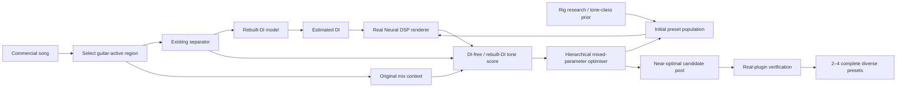
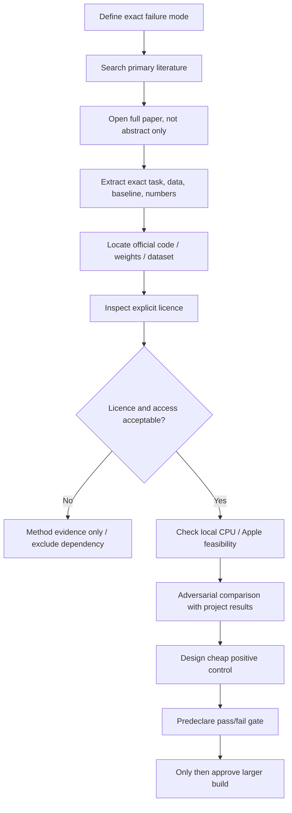
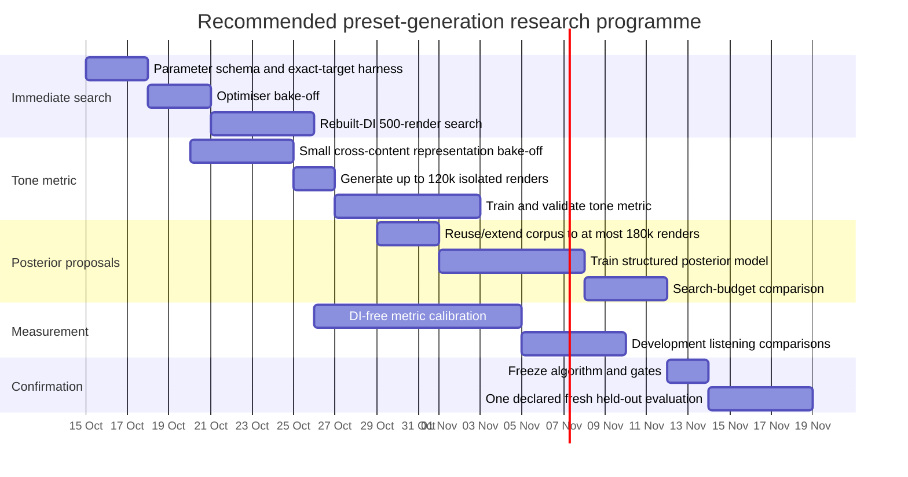

# Generating Complete Neural DSP Guitar Presets from Commercial Song Audio

## Executive summary

The topic is no longer unspecified: the uploaded brief defines a precise research problem. The system must take a commercial song, optionally isolate a time range and use documented rig information, then **generate a complete Morgan Amps Suite or Tone King Imperial MKII preset with every stored control populated**. It must not merely choose from the 111 factory presets; several acoustically equivalent presets are acceptable; inference must run locally on Apple silicon; the user never supplies a DI; and new dependencies must be open and locally runnable. The brief also establishes unusually valuable infrastructure: the actual Neural DSP plugins can generate synthetic `(DI, settings → audio)` triples at roughly 10,000–14,000 ten-second renders/hour, provided each render uses the new `isolate` path; the same isolated setting is repeatable to about `1e-4` under the current distance. fileciteturn0file0

**The central recommendation is not to start by training a larger inverse model or a full differentiable clone.** The highest-information next experiment is to take the project's strongest existing no-DI bridge—the rebuilt-DI model—and use it for **full-control inference-time optimisation against the real Neural DSP plugin**, with a covariance-aware black-box optimiser, hierarchical treatment of categorical controls, and a weak prior over plausible settings. The existing rebuilt-DI route has already produced an 8.5% clean-PR12 improvement over its template and about 55% of the menu oracle's gain, while a fresh clean/crunch comparison was `−0.087` against older starts. More importantly, those experiments only *ranked a fixed menu*. They have not answered whether an imperfect reconstructed DI is good enough for **continuous generation**, which is the current question. fileciteturn0file0

This recommendation is strongly aligned with ST-ITO, which showed that a learned production-style representation plus gradient-free inference-time optimisation can control arbitrary, including unseen and non-differentiable, audio effects. ST-ITO used CMA-ES with a population of 64 for up to 25 iterations, and its AFx-Rep representation reached 0.86 zero-shot production-style classification accuracy versus 0.74 for MFCCs and 0.56 for CLAP. The important caveat is that the paper's nominal search can consume roughly 1,600 objective evaluations—too expensive for the desired 100–500-render product budget—and it did not solve guitar-tone matching from commercial mixes. citeturn30academia47turn30search5

I rank the approaches as follows:

| Rank | Approach | Verdict | Expected product value | Why it ranks here |
|---|---|---|---|---|
| **A** | **Rebuilt DI → real-plugin hierarchical black-box optimisation** | **Verified and promising** | Highest near-term probability of beating today's start; working hypothesis **5–12% distance reduction**, not a promised effect size | Uses the strongest task-specific signal already demonstrated, searches the real plugin rather than a surrogate, directly tests generation rather than menu choice |
| **B** | **Content-invariant guitar-tone metric → real-plugin optimisation** | **Verified evidence, exact application unverified** | Potentially the best long-term no-DI architecture; development gate **≥7–10%** | Open-Amp and ST-ITO support cross-content/effect-specific representations; designed explicitly around the project's render→record and note-dominance failures |
| **C** | **Structured posterior/inverse model → proposal set → real-plugin refinement** | **Promising but unverified** | More likely to reduce render budget than to win alone | Sound2Synth/FlowSynth demonstrate high-dimensional inverse control in easier domains; posterior output handles several correct presets |
| **D** | **Note-normalised descriptors/transcription → search objective or metric ensemble** | **Promising but unverified** | Cheap diagnostic/auxiliary signal, not yet a primary solution | Directly attacks “notes dominate tone”; Basic Pitch is open and Apple-friendly; previous handcrafted-feature failures are a serious warning |
| **E** | **Conditioned differentiable front-end surrogate → gradient proposals → real-plugin correction** | **Promising but unverified** | Useful only if its gradients and candidate ranking survive a stringent pre-check | NablAFx supports strong conditioned nonlinear models, but DiffMoog-style inversion evidence and this project's coupled landscape make pure gradient matching risky |

The proposed product architecture therefore becomes a **hybrid**, not a single estimator:

Every real-plugin render in that loop must allocate isolated render resources; otherwise the measured 2–3 second carry-over contaminates the objective. fileciteturn0file0

The most important research sequence is:

**First**, spend roughly 500 renders per development part to learn whether reconstructed-DI search can generate settings. At the measured renderer throughput, 500 isolated renders correspond to only about 2.1–3.0 minutes of pure renderer time before orchestration/scoring overhead. fileciteturn0file0

**Second**, if the objective rather than the optimiser proves to be the bottleneck, train a custom guitar-tone representation using approximately **120,000 real-plugin renders**: 60,000 settings, each through two substantially different DI excerpts. Pairing *different playing content under the same settings* is deliberate: Open-Amp trained effect representations with pairs consisting of different clean-guitar clips processed through the same device, and reported strong cross-dataset transfer. citeturn30search2

**Third**, only after that representation has passed a cross-content validation should a high-dimensional inverse/posterior model be trained. It should generate proposals rather than be trusted as the final answer. The project's existing direct regressor improved its template by only 3.6% by band median and concentrated its gain on two parts, while Sound2Synth's much stronger high-dimensional inversion results came from a controlled synthesiser setting rather than mixed commercial recordings. fileciteturn0file0

**Do not prioritise** a full Neural DSP neural surrogate, pure parameter regression, factory-preset recognition, a generic music embedding, or unqualified optimisation directly against a separated stem. The first two duplicate known failure modes; MERT/CLAP/wav2vec2 and a contrastive tone encoder already failed to transfer adequately here; and external work on instrument-specific effect representations shows that separation artefacts can seriously damage effect retrieval. fileciteturn0file0

The schedule below is therefore a **six-week illustrative research programme**, not a deadline—the brief specifies none.

The first practical decision gate should be written before looking at new held-out results: on the 25-part/15-band development set, require a band-weighted mean log-distance ratio of at least **`−0.07` versus today's starting preset**, improvement on at least **10 of 15 bands**, and no obvious tone subclass with catastrophic degradation. That `−0.07` is a proposed engineering bar, not a literature-derived expected result.

The remainder of this report provides the evidence, licence audit, precise experiments, statistical plan, and reusable research/output templates.

## Research framing and evidence base

**Research question.** The real inverse problem is

\[
p^\* \in \arg\min_{p\in\mathcal P} D\!\left(y_{\text{song}},\; F(x,p)\right),
\]

where \(F\) is the *actual* Neural DSP plugin, \(p\) is a mixed categorical/continuous vector covering every active preset control, and \(x\) is unknown because the commercial recording does not provide its guitar DI. In addition, the solution is non-identifiable: there may be many \(p\)'s whose outputs are perceptually equivalent. The project therefore needs to solve three separate problems: infer or neutralise performance content \(x\), obtain a perceptually defensible song-side distance \(D\) that does not require the true DI, and explore a sharp, highly coupled 30–60-dimensional control surface efficiently. The brief's measured search behaviour—wrong microphones being compensated by other controls, coordinate search stalling at 10–46% of the starting distance even when the exact target is reachable—is direct evidence that the third problem is not a routine independent-knob regression task. fileciteturn0file0

**Why existing negative results do not kill generation.** Almost all previous failed systems in the project were choosers over 111 dry factory presets. A 74.5%-accurate render-domain preset recogniser, a sound-description model that worked when the notes were shared, PANN rerankers, handcrafted MFCC/mel features, generic representations, and the rebuilt-DI menu ranker tested representations and transfer, not high-resolution control generation. The one ongoing generation experiment is explicitly described as a weak lower bound, and its first PR12 cell found amp/input/mic knobs around 7% closer than the best menu preset on the held half before the EQ stage regressed. It would therefore be a category error to conclude from chooser failure that continuous search cannot work. fileciteturn0file0

**The closest literature analogue is synthesiser inversion, but its assumptions are easier.** Sound2Synth tackled 155 Dexed controls—87 continuous, 66 classification and two fixed—and reported MFCC-distance results of 6.32 for its single-modal estimator and 5.36 for a multimodal variant, versus 14.70 for PresetGen VAE and 21.96 for hill climbing. That is important evidence that high-dimensional mixed-parameter inverse control is learnable. The caveat is decisive: training and evaluation used controlled synth sounds, including a fixed note configuration, rather than an unknown guitar performance embedded in a mastered mix. Its official repository currently exposes no repository licence field and did not release the reported pretrained checkpoints, so its **method** is useful but its implementation should not become a dependency under the project's rules. citeturn16view1 fileciteturn8file0L2-L10

FlowSynth provides a complementary result: an audio latent and a synthesiser-parameter latent can be coupled with normalising flows, enabling inverse control and exploration of multiple settings rather than forcing a single point estimate. Its official repository is MIT-licensed, but the historical implementation is tied to an old environment and a commercial Diva VST, so this project should reimplement the flow concept around its own parameter schema rather than port the complete application. citeturn23academia21 fileciteturn12file0L2-L10

**Audio-effect inversion gives an even more relevant warning: optimise the sound, not necessarily the knobs.** BE-AFX explicitly compared parameter-supervised estimation with an autoencoder trained through an audio-domain reconstruction criterion. Its central conclusion is that the method giving a better processed-audio match can have *worse parameter error*. That is exactly what should be expected when microphone placement, EQ, gain staging and tone controls compensate for each other. The implication for Neural DSP is that “recover the original knob values” is the wrong primary target except on synthetic positive controls; acoustic equivalence should be primary. citeturn30academia48

The earlier guitar-effect parameter-estimation literature is also encouraging but lower-dimensional. A convolutional guitar-FX system studied 13 overdrive/distortion/fuzz effects and reported classification above 80%; normalised parameter MAE was below 0.05 in 12 of 16 settings and RMSE below 0.1 except one setting, with average gain MAE around 0.040 and tone/EQ MAE around 0.038. Those results establish that nonlinear guitar-effect controls leave learnable signatures, but they do **not** establish that 30–60 interacting amp, microphone, pedal, EQ and long-memory effect controls can be recovered from a mastered song. citeturn21view0turn21view1

**ST-ITO is the strongest direct precedent for operating the real plugin.** It deliberately avoids requiring a differentiable effect implementation: a learned production-style metric scores the processed signal, and a gradient-free optimiser searches the actual effect controls. Its AFx-Rep pretraining used 63 open/free VST3 effects and a large synthetic processing corpus; the paper tested, among other setups, a 73-parameter five-VST chain and an unseen 36-parameter pedalboard. CMA-ES used a population of 64 and up to 25 generations. That is conceptually extremely close to Neural DSP generation, although the project's required 100–500-evaluation regime demands stronger warm starts, lower-dimensional stages or smaller populations than the published ST-ITO configuration. citeturn30academia47turn30search0

ST-ITO's official repository is Apache-2.0 and remained active in 2026; the README provides inference-time optimisation and AFx-Rep embedding examples. Neither the paper nor the repository documentation I checked establishes Apple-MPS support for the complete stack, so the safest use is as an algorithmic/reference implementation, with any production representation trained locally in a minimal PyTorch stack. fileciteturn2file0L2-L10 fileciteturn3file0L2-L10

A 2025 follow-up on inference-time optimisation adds a particularly relevant insight: **a weak parameter prior can improve search**. In a 130-parameter DiffVox effect chain with 365 vocal presets, the authors used 65 eligible MedleyDB vocal tracks and reported AFx-Rep parameter MSE changing from 7.756 without the prior to 5.168 at one nonzero prior setting—about the reported one-third reduction. The analogy here is not that guitar presets follow the same Gaussian distribution; rather, the result supports regularising search toward plausible regions while retaining enough freedom to escape a factory preset. citeturn26view0

**Synthetic diversity appears more valuable than synthetic volume alone.** Open-Amp generated guitar-effect data from many neural amp/pedal captures and trained an encoder with a powerful invariant: a positive pair consists of *different clean-guitar excerpts passed through the same effect*. In cross-dataset effect-classification experiments, its Open-Amp-trained representation achieved 91.8% on GFX, 72.0% on EGFX, 91.1% on EGDB and 99.8% on its Open30 benchmark. That directly suggests how to stop notes from dominating a Neural DSP representation: never let “same settings” positives simply reuse the same performance. citeturn19view0turn20view0

Open-Amp itself cannot be adopted as code under the stated licence rule: the official repository I inspected has **no declared repository licence**, despite being public. Its method is publishable/reimplementable evidence, not an approved software dependency. fileciteturn6file0L2-L10

**Differentiable surrogates are technically viable, but full inverse optimisation through them is not automatically viable.** NablAFx compares LSTM, TCN, graph-convolution, state-space and grey-box nonlinear effect models across compressors/limiters, overdrive, distortion and fuzz. Its subjective evaluation found state-space models strongest overall, with TCN/convolutional approaches also competitive; objective metrics had only moderate correlations with human ratings, reinforcing that waveform/spectral fidelity alone is not a sufficient perceptual validation. NablAFx is MIT-licensed. citeturn30academia49turn30academia50 fileciteturn7file0L2-L10

The inverse side is riskier. DiffMoog experiments reported substantial non-convergence and highly non-convex spectral-loss landscapes; signal-chain loss alone could fail systematically, while more complex FM chains became difficult to optimise. This is consistent with the project's empirical “sharp coupled valley” rather than contradicting it. A differentiable clone is therefore useful only after demonstrating that its **local gradients and candidate rankings agree with the real plugin**, not simply that its waveform error looks small. citeturn10view2

**Separation is not a solved front end.** The project's `htdemucs_6s` guitar stem has only about 1.2 dB median SNR against the known amp track on development data. fileciteturn0file0 Independent effect-representation work gives the same warning from another direction: the Fx-Encoder++ study's instrument-conditioned evaluation dropped markedly when oracle isolated instruments were replaced by separator outputs—for one reported retrieval condition, R@10 fell from 39.4 with target-instrument oracle audio to 20.5 with music-source separation and 9.9 with universal source separation. Its implementation licence is CC BY-NC rather than a permissive software licence, so it is evidence rather than a proposed dependency. citeturn8view1turn4search1

### Research workstreams

The generic “unspecified topic” in the initial request is therefore best resolved into the following five concrete workstreams rather than unrelated hypothetical topics.

| Workstream | Scope and key questions | Sources/methodology | Estimated research window | Deliverable |
|---|---|---|---|---|
| **Full-control real-plugin optimisation** | Is a rough reconstructed DI sufficient for generating—not choosing—settings? Which mixed optimiser converges within 100–500 renders? | Internal true-DI controls; ST-ITO; CMA-ES/evolutionary optimisation; weak priors | 3–7 days | Go/no-go result and working complete-preset searcher |
| **DI-free guitar-tone representation** | Can a representation preserve amp/cab/effect character while suppressing pitch/rhythm identity and separation artefacts? | Open-Amp-style cross-content positives; AFx-Rep methodology; domain randomisation | 2–3 weeks | Validated tone embedding plus retrieval/search benchmark |
| **Amortised posterior generation** | Can a model propose several plausible complete settings and reduce real-plugin calls? | Sound2Synth; FlowSynth; structured classification + normalising flow / mixture density | 2–3 weeks after metric | Proposal model producing 4–16 complete candidates |
| **Differentiable surrogate** | Can a conditioned model emulate the nonlinear front-end accurately enough that its *gradients/rankings* are useful? | NablAFx; conditioned TCN/state-space models; real-plugin correction | 2–4 weeks | Surrogate pre-check; either proposal engine or documented kill |
| **DI-free evaluation and listening calibration** | What score predicts “closer guitar tone” without the true DI? How are several equivalent presets rewarded? | Synthetic equivalence tasks; development multitracks; pairwise listening calibration | Parallel, 1–2 weeks | Product metric v3 plus listening protocol |

### Research workflow and evidence standard

The literature/database workflow used here, and recommended for future rounds, is:

For academic search, prioritise title and citation-chain searches through Google Scholar-style indexing, arXiv, IEEE/ICASSP, ISMIR, AES and DAFx using combinations such as `"audio effect parameter estimation"`, `"inference-time optimization audio effects"`, `"guitar effects parameter estimation"`, `"synthesizer sound matching"`, `"normalizing flow synthesizer control"`, `"blind estimation audio effects"`, `"differentiable black-box audio effects"`, `"content invariant timbre representation"`, and `"guitar amp conditioned modeling"`. For artefacts, use **official project repositories and original dataset records**, not third-party mirrors. For new datasets, original Zenodo/project records should outrank aggregator pages for licence and provenance.

The recommended inclusion rule is: primary source inspected; quantitative evaluation available; task has meaningful overlap with either mixed-parameter inversion, guitar effects, no-reference production style, black-box search, or conditioned amp modelling; artefact licence is explicit if it is to become a dependency; and there is a plausible local CPU/MPS path. Exclude or quarantine a dependency when weights are gated, a repository has no licence, an audio collection has only a code licence but unclear recording rights, the method depends on a commercial service, or its only evidence is same-content synthetic matching.

A reusable extraction record should contain:

| Field | Example |
|---|---|
| Citation / URL | ST-ITO, arXiv 2410.21233 |
| Exact problem | Reference-style matching through arbitrary non-differentiable effects |
| Parameter dimensionality | 73-parameter chain; unseen 36-parameter setup |
| Input relation | Input and style reference, not missing-DI commercial-guitar inversion |
| Training data | Synthetic effect processing over multiple source datasets |
| Baseline | CLAP, MFCC, DeepAFx-ST-style systems |
| Exact result checked | AFx-Rep style classification 0.86 versus CLAP 0.56 |
| Code / licence | Official repo, Apache-2.0 |
| Apple/CPU status | Not source-verified for full stack |
| Domain-match score | Medium |
| Principal failure risk here | Notes, separator domain and much tighter evaluation budget |
| Cheap project test | 500-render known-target recovery |
| Decision | Adapt method, do not copy assumptions |

That extraction format doubles as the requested annotated-bibliography template.

## Ranked technical approaches

### Comparative ranking

The “expected gain” column below deliberately distinguishes **evidence** from **targets**. The project does not yet contain enough independent crunch bands to support a precise forecast for a new generator, so numeric gains that have not been measured are labelled as hypotheses or development bars.

| Rank | Family | Output | Evidence most relevant to this problem | Expected gain / benefit | Requirements | Principal risk | Cheapest decisive test |
|---|---|---|---|---|---|---|---|
| **A** | Rebuilt-DI + real-plugin black-box search | 2–4 complete presets | Existing rebuilt-DI menu ranking; first generated-knob cell; ST-ITO arbitrary-effect search; prior-regularised ITO fileciteturn0file0 citeturn30academia47turn26view0 | **Hypothesis:** 5–12% vs current start; gate at ≥7% | Existing DI rebuilder; renderer; 300–500 renders/song | Rough DI may distort exactly those high-frequency/nonlinear cues needed to set gain/mics | 20 synthetic known-setting targets plus 25 dev parts |
| **B** | Learned content-invariant tone metric + real-plugin search | 2–4 complete presets | Open-Amp cross-content contrastive learning; ST-ITO/AFx-Rep; separator-failure evidence citeturn19view0turn30academia47turn8view1 | **No credible forecast yet**; target ≥7–10% | ~120k new plugin renders; small encoder; searcher | Synthetic→recording gap may survive despite augmentation | Cross-DI retrieval and 100-target search test before full training |
| **C** | Structured inverse/posterior proposals + real-plugin rerank | Distribution / 4–16 candidate presets | Sound2Synth high-dimensional inversion; FlowSynth normalising-flow control; BE-AFX non-identifiability citeturn16view1turn23academia21turn30academia48 | Main value: **40%+ fewer renders at equal quality**; quality gain secondary | ~180k renders or reuse B data; conditional model | Model learns synthetic labels but not commercial-song inverse mapping | Best-of-4 synthetic gap closure; then compare 250 vs 500 render search |
| **D** | Note-normalised timbre/descriptors | Score feature / proposal prior | Basic Pitch provides open audio-to-MIDI; directly addresses note confounding fileciteturn11file0L2-L10 | Diagnostic; no gain forecast | Basic Pitch; harmonic/dynamics features | Distortion and separation can corrupt transcription; handcrafted features already failed | Cross-note same-setting retrieval on development DIs |
| **E** | Differentiable front-end surrogate | Gradient-generated proposals, then real-plugin correction | NablAFx nonlinear emulation; differentiable black-box literature; DiffMoog inverse failure evidence citeturn30academia49turn10view2 | Could cut plugin evaluations substantially if rank fidelity ≥0.90 | 60k–100k renders; TCN/state-space model | Tiny surrogate error can induce wrong gradients; delay/reverb memory increases cost | 100-candidate surrogate-vs-plugin ranking test |

### Approach A — rebuilt DI plus real-plugin optimisation

This should be the first experiment because it isolates the unanswered question with the fewest new assumptions. The user already has evidence that reconstructed DI contains enough information to rank menu presets better than a constant start; the next test is whether search magnifies that useful information or instead exploits reconstruction artefacts. fileciteturn0file0

A hierarchical search should treat the parameter space as four coupled groups rather than 60 independent coordinates:

| Stage | Controls | Reason |
|---|---|---|
| **Topology** | plugin/amp/channel, major switches, pedal on/off, mic identities, stereo modes | Discrete choices produce discontinuities and define which continuous controls matter |
| **Core nonlinear tone** | input, drive, amp volume/gain/power/tone, compressor | These controls jointly determine drive and dynamic response |
| **Cab and spectral** | mic positions/distances/levels/pan/phase, room, EQ, HPF/LPF | Strong compensation between mic geometry and EQ means they should not be independently frozen too early |
| **Temporal/spatial** | spring, tremolo/chorus, delay, reverb and their filters/times | Long-memory effects should be introduced after core tone is plausible, then jointly re-open a subset of core parameters |

This is more suitable than the current coordinate search because CMA-style covariance adapts to correlated directions. ST-ITO provides source-verified precedent for CMA-ES on arbitrary effect controls, while the project's own control experiment already demonstrates why independent coordinates are inadequate. citeturn30academia47 fileciteturn0file0

The weak prior should come from a mixture of the product starting preset, neighbouring clean/crunch start, factory-distribution statistics, and documented song rig. Research should alter the *prior probability* of a topology, not hard-lock it: the project's earlier research router sent 10 of 22 clean parts toward crunch/heavier settings when it inferred tone from genre/band-level descriptions, demonstrating how dangerous textual rig evidence becomes when treated as ground truth. fileciteturn0file0

**Verification block.** Sources checked: the full project brief; ST-ITO's primary paper and official repository; and the 2025 prior-regularised ITO paper. Source-verified facts include ST-ITO's arbitrary non-differentiable control formulation and CMA-ES search, and the 130-parameter prior experiment. citeturn30academia47turn26view0 Artefacts: ST-ITO code is Apache-2.0; Neural DSP itself is a local licensed renderer explicitly permitted by the brief. fileciteturn2file0L2-L10 Reproduction here: **not performed**, because this research environment has neither the user's commercial plugins nor its private multitracks/rebuilder; no claim is being upgraded from literature evidence to local reproduction. Adversarial failure: the rebuilt DI's 1–3 kHz coherence is only 0.44–0.50 and it becomes unrelated above 3 kHz, so optimisation may chase its dirt rather than the record. fileciteturn0file0 Verdict: **verified and promising**, because the unknown can be killed with a few hundred renders rather than another large training run.

### Approach B — a guitar-specific, content-invariant tone metric

The representation should be trained to answer **“would these two sounds imply similar processing if their notes and players were different?”**, not “are these two audio clips globally similar?”. The positive pair should therefore be `(DI_A → θ, DI_B → θ)`, with different bands/players/registers where possible. Hard negatives should include different settings whose broad spectra are similar but whose nonlinear response, mic balance or temporal effects differ.

Open-Amp is the closest published support for that pairing strategy, while ST-ITO shows why a specialised production-effect representation can outperform generic audio embeddings. citeturn19view0turn30academia47 The project already established the inverse point empirically: CLAP, MERT and wav2vec2 became near-chance when the notes differed, and its own contrastive encoder transferred poorly from renders to real recordings. fileciteturn0file0

The critical addition over the earlier project encoder is **domain randomisation toward the song pipeline**. A single plugin render should yield many training views without consuming additional plugin renders: mix it into real non-guitar backing tracks at random levels; run representative mastering EQ/compression; encode to MP3/AAC-like degradations; convolve with mild room responses; add stereo context; and, for a deliberately selected subset, pass the synthetic mixture through the actual separator. Labels remain tied to \(θ\), so these are free views of the same processing state.

The metric should not be trained solely with “same exact settings = positive”. Continuous controls require graded supervision. A second head can learn an **ordinal audio-tone distance** from same-DI synthetic pairs scored by the current judge: given \(θ_1, θ_2\), predict which is closer to a reference or approximately preserve distance rank. That uses the reliable part of `aligned_distance` during training without requiring it at song inference.

**Verification block.** Open-Amp's full paper was inspected; its synthetic effect encoder used different one-second clean-guitar excerpts under the same device as positives and showed strong cross-dataset classification. citeturn19view0turn20view0 ST-ITO's production-style advantage was source-verified. citeturn30academia47 The official Open-Amp repository has no declared licence and is therefore **not an approved dependency**. fileciteturn6file0L2-L10 ST-ITO's repository is Apache-2.0. fileciteturn2file0L2-L10 Reproduction: not performed for the same plugin/data-access reason. Adversarial failure: this project has already trained a render-domain contrastive encoder with 74.5% preset identification and watched it fail on records; therefore a high synthetic validation accuracy is **not** a pass condition. fileciteturn0file0 Verdict: **promising but unverified** until the cross-domain retrieval gate below passes.

### Approach C — structured posterior generation

A direct model should be asked for **a posterior over presets**, not one mean vector. Categoricals—amp, channel, mic, switches, pedal enable flags—should have explicit categorical heads. Continuous parameters should be conditional on those topological choices and modelled with either a conditional normalising flow or a modest mixture-density head. Inactive knobs can still be written to deterministic canonical values in the preset file; when their effect is enabled, their posterior becomes active.

This is where FlowSynth is conceptually more suitable than ordinary MSE regression: invertible/conditional density modelling supports several plausible controls for one target representation. citeturn23academia21 Sound2Synth demonstrates that a neural inverse can operate over a parameter space even larger than Neural DSP's active controls, but its fixed/content-controlled synthesiser setup makes it evidence for **representation capacity**, not for commercial-song transfer. citeturn16view1

The model's product role should be narrow: produce perhaps 16 complete presets, render them through the actual plugin, keep the best four, then use 150–250 extra evaluations to refine the best one or two basins. This avoids repeating the project's previous mistake of treating a synthetic regressor as an oracle.

**Verification block.** Full primary Sound2Synth and FlowSynth sources were checked; the former's high-dimensional results and the latter's conditional/invertible control formulation are source-backed. The Sound2Synth repository has no declared licence and its reported checkpoints were not released, so use the idea only. fileciteturn8file0L2-L10 FlowSynth code is MIT but its original application depends on old tooling/commercial Diva, so reimplementation is preferable. fileciteturn12file0L2-L10 Reproduction: not performed. Adversarial failure: the user's own synthetic PR12 regressor already extracted part-specific information yet improved only 3.6% by band median and failed its 10% target. fileciteturn0file0 Verdict: **promising but unverified as a warm-start mechanism; not recommended as a stand-alone answer**.

### Approach D — note-normalised representation

This route explicitly estimates performance content, then compares tone conditional on it. For example, Basic Pitch can estimate note events and bends from a guitar stem; candidate and target features can then be aggregated by pitch/register or harmonic index instead of by raw absolute-frequency statistics. The feature vector might include harmonic spectral slope, odd/even energy, high-order harmonic growth, attack/decay shape, crest factor, short-term compression slope, modulation periodicity, and estimated delay/reverb tails.

Basic Pitch's official repository is Apache-2.0 and describes it as a lightweight audio-to-MIDI system with polyphonic pitch-bend support; the repository has documented Apple-focused deployment paths, making it materially easier to test locally than many MIR stacks. fileciteturn11file0L2-L10

The approach is intentionally ranked below learned cross-content metrics because the project already found that handcrafted mel/MFCC statistics, fingerprints and masked spectra were controlled more by the notes than the tone. fileciteturn0file0 Transcription could remove part of that nuisance variable, but driven guitar, chords and separator artefacts are precisely the conditions in which note estimation can be least reliable.

**Verification block.** Basic Pitch's official repository and licence were inspected; Apache-2.0 is explicit. fileciteturn11file0L2-L10 No source was found that validates the complete proposed “transcribe then Neural-DSP-tone-match” method; this is an inference from the availability of note content estimates and the known nuisance-variable problem. Reproduction: not performed. Adversarial failure: wrong notes create wrong normalisation and could make the score *less* stable than the current spectral metric. Verdict: **promising but unverified**, and only worth a cheap representation bake-off before integration.

### Approach E — differentiable surrogate

A conditioned surrogate should be restricted initially to **input/pedals/amp/cab/EQ**, not the entire chain. Long delays, 60-second Morgan reverb decays, stereo time effects and modulation increase temporal receptive-field and state requirements dramatically; they can remain in the true-plugin outer search. The front-end surrogate could use a modest conditioned TCN or state-space design inspired by NablAFx.

NablAFx is useful evidence that nonlinear amplifiers/distortion/compressors can be emulated with differentiable black- and grey-box models across multiple devices; its repository is MIT-licensed. citeturn30academia49turn30academia50 fileciteturn7file0L2-L10 But the target criterion should not be “surrogate MR-STFT loss is low”. It should be **search fidelity**: does the surrogate preserve the ordering and useful descent directions among nearby real-plugin settings?

**Verification block.** NablAFx paper/code were checked; DiffMoog's published difficulties with inversion through non-convex synthesiser landscapes were also checked. citeturn30academia49turn10view2 CPU/MPS execution of the exact NablAFx training recipes was not verified from source documentation, so a small native PyTorch implementation is safer for the Mac. Reproduction: not performed. Adversarial failure: an emulator can sound nearly correct but have gradients pointing toward settings that are wrong for the real plugin; this problem becomes especially dangerous in the project's already measured compensating valleys. Verdict: **promising but unverified**, and lower priority than search/metric work.

## Concrete implementation plans

### Plan A — rebuilt-DI hierarchical search on the actual plugin

**Objective.** Answer the most consequential unknown: *does rough DI recovery become sufficient when the candidate space is continuous and the real plugin is searched, rather than when 111 factory presets are merely ranked?*

**Inputs.** Use the development amp track as target when diagnosing the mechanism, then the existing `htdemucs_6s` guitar stem plus original-mix context for realistic development. Feed the target/stem through the existing rebuilt-DI model. All plugin rendering must use `isolate`; this is non-negotiable because the non-isolated state leaves previous audio faintly present for 2–3 seconds. fileciteturn0file0

**Complete parameterisation.** Build a schema that maps every stored Morgan/Tone King field to one of: categorical topology, bounded continuous, binary, log-scaled time/frequency, or inactive-conditioned control. Every output preset writes **all fields**. An off pedal still receives deterministic knob values; an unused second mic still receives deterministic valid values. Thus candidate identity is stable and presets remain reproducible even when controls are currently acoustically inactive.

**Search budget.** A practical first product-sized search is:

| Phase | Evaluations | Design |
|---|---:|---|
| Diverse starts / topology probes | 32 | Product starts, neighbouring clean/crunch start, rig-informed topology, alternative amp/channel/mic/pedal states |
| Core joint optimisation | 288 | Four surviving topologies × about 72 evaluations; small-population CMA-ES or covariance-aware evolution |
| Spectral + time-effect refinement | 144 | Two leading basins × about 72, with EQ/cab/FX plus a reopened subset of nonlinear controls |
| Cross-half / repeat / diversity verification | 36 | Reject overfitting and select distinct near-optimal basins |
| **Total** | **500** | All real-plugin renders isolated |

At 10,000–14,000 ten-second renders/hour, 500 renders imply approximately 2.1–3.0 minutes of renderer time; feature extraction, process coordination and sequential optimisation increase wall-clock time, but “minutes per song” remains realistic. fileciteturn0file0

**Do not optimise the 9-band EQ as an isolated final coordinate block.** The first running generation cell found that the preceding knob stage improved the held-half result by about 7%, whereas the subsequent EQ stage worsened it by about 10%. One cell is not evidence that EQ is harmful; it is evidence that *conditional freezing followed by independent EQ search can overfit or walk off the joint valley*. fileciteturn0file0 Re-open mic/tone/input variables during spectral refinement.

**Objective.** During development, maintain two scores:

\[
J_{\text{product}}(p)
  = D\!\left(y_{\text{stem}},F(\hat x_{\text{DI}},p)\right)
\]

for realistic search, and

\[
J_{\text{oracle-eval}}(p)
  = D_{\text{aligned}}\!\left(y_{\text{amp}},F(x_{\text{true DI}},p)\right)
\]

only for hidden diagnosis/evaluation. The optimiser never sees the second score in the realistic condition.

A robust product score should combine two halves rather than allowing a single transient or separator artefact to dominate; one option is the median/trimmed mean across 2–4 shorter active windows. Candidate selection on one half and verification on the other should be retained because it already provides a useful guard against search overfit. fileciteturn0file0

**Known-target positive control.** Create 20 synthetic targets spanning Morgan/Tone King, clean/EOB/crunch, several mics and both dry/time-effect cases. Render each target from a development DI that is hidden from the search. Give the algorithm only the processed audio, run the same DI reconstruction and 500-render search, then evaluate with the true DI. Predeclare:

\[
\text{gap closure}
=
1-\frac{D(p_{\text{found}},p_{\text{target audio}})}
        {D(p_{\text{start}},p_{\text{target audio}})}.
\]

Pass the optimiser/objective mechanism if median gap closure is **≥70%**, and at least 16/20 cases close **≥50%**. These are proposed engineering gates. Run an otherwise identical **true-DI search oracle**: if true-DI search succeeds but rebuilt-DI search fails, the objective/rebuilder is the problem; if both fail, the optimiser/control parameterisation is the problem.

**Real-development gate.** On the fixed 25-part/15-band development set, compare against *today's* starting preset rather than historic baselines. Advance only if band-weighted mean log ratio is **≤−0.07**, at least 10/15 bands favour generation, and the held-half result has the same sign. This gate is deliberately above “barely measurable”.

**Stop conditions.** Stop rather than expanding the render budget if true-DI positive controls fail, if rebuilt-DI known targets are below 50% median gap closure, or if search repeatedly finds pathological spectral extremes that win the current metric but lose listening checks. Do not spend a held-out set to debug any of those failures.

**Multiple presets.** Keep all candidates inside an acoustic tolerance \(\epsilon\) of the best score, then favour **parameter/topology diversity while constraining output-audio similarity**. For example, keep one PR12-like, one AC20-like and one distinct mic solution only when all remain within the quality tolerance. This turns non-identifiability from an evaluation nuisance into a product feature.

### Plan B — custom content-invariant tone representation and search

**Render corpus.** Generate **60,000 unique settings × two different DI excerpts = 120,000 renders**. At the measured throughput that is approximately 8.6–12 rendering hours. fileciteturn0file0 Stay below the 300,000-render threshold.

Settings should not be sampled entirely i.i.d. uniform. Use approximately:

- 50% low-discrepancy broad coverage over legal ranges;
- 30% local perturbations around factory/product/known-good regions;
- 20% plausible combinations informed by normal amp/pedal routing and the existing clean/crunch starts.

The exact percentages are design proposals. The important principle is that broad coverage and *locally dense* coverage are both represented.

For each setting, select two DIs from different bands whenever the data permits. The band should remain the independence unit in train/validation splits. The project has 136 DI parts and about 28 bands, so pairing across bands is practical even though only 25 in-scope development parts are used for product decisions. fileciteturn0file0

**Augmentation.** Do not spend extra plugin renders for domain randomisation. From each wet render generate several feature views:

1. direct wet guitar;
2. wet guitar mixed into a non-guitar backing;
3. compressed/EQ/mastered variants;
4. codec/noise/room variants;
5. on a subset, actual separator output after constructing a synthetic mix.

The separator condition is essential rather than cosmetic because published instrument-FX retrieval work shows a substantial oracle-isolation versus separator gap, and the project's separator SNR is already poor. citeturn8view1 fileciteturn0file0

**Model.** Prefer a small train-from-scratch log-mel CNN/TCN over a large pretrained music encoder. Output a 128–256-dimensional unit-normalised embedding. Use two losses:

\[
L = L_{\text{sup-contrast}} + \lambda L_{\text{ordinal}},
\]

where supervised contrastive positives share processing settings but not playing content, and the ordinal term preserves the ordering of same-DI tone differences derived from synthetic audio. Categorical topology labels can be auxiliary heads but should not dominate.

This deliberately avoids another dependency on pretrained weights whose licences/platform support must then be audited.

**Cheap representation gate before full 120k training.** Generate only 8,000–12,000 renders first. For each target setting, render target content from DI A and candidate content from DI B. Ask whether the representation retrieves the same or acoustically nearest setting among 128 candidates. Pass only if:

- same-setting **top-5% retrieval ≥80%** on unseen bands;
- performance does not collapse when pitch register changes;
- separator-processed targets retain at least **70% of direct-wet retrieval performance**;
- rank correlation with hidden same-DI `aligned_distance` is clearly positive on clean **and** crunch.

These are project gates, not published benchmarks.

**Full search gate.** If the representation passes, plug it into the Plan-A real-plugin search. It must either beat Plan A on final quality or materially rescue categories where the rebuilt DI is known to be dirty. If it performs no better than Plan A, retain it only if it reduces sensitivity to separator/rebuilder failure.

**Storage.** Avoid retaining 120,000 ten-second WAVs. Store settings, source identifiers and float16 features or regenerate audio from seeds/settings. An 80-bin ten-second float16 log-mel representation is on the order of a few hundred kilobytes or less depending on hop size; feature-only storage keeps the experiment compatible with the 65 GB free-disk limit. This is an engineering estimate; the actual feature geometry should be measured before generation.

### Plan C — structured posterior proposals plus real-plugin correction

Run this only after Plan B's representation or another song-side input has passed a transfer test.

**Data.** Use up to **90,000 settings × two DIs = 180,000 plugin renders**, approximately 12.9–18 renderer hours at the stated throughput. fileciteturn0file0 Much of Plan B's corpus can be reused, so 180,000 should be treated as the maximum total corpus rather than automatically generating another 180,000.

**Architecture.** A shared audio encoder feeds:

- categorical logits for plugin/amp/channel/mics/switches/pedal enable states;
- topology-conditioned continuous heads for controls;
- a conditional normalising flow or mixture-density model for strongly non-identifiable continuous parameters.

The model outputs 16 samples rather than one point. FlowSynth supports the use of normalising flows for synth-control exploration, while Sound2Synth demonstrates that mixed high-dimensional control prediction is feasible under controlled conditions. citeturn23academia21turn16view1

**Training loss.** Parameter supervision is appropriate here because synthetic settings are known, but it should not be the only notion of goodness. Add an embedding/audio consistency objective if Plan B succeeds. That is important because BE-AFX demonstrates that a parameter-closer solution is not necessarily an audio-closer one. citeturn30academia48

**Synthetic gate.** On unseen DIs/settings, report candidate-1 and best-of-4/16 performance in **audio distance**, not just knob error. Require best-of-4 median gap closure **≥70%** from the standard start before trying it on records.

**Product gate.** Compare:

- 500-render Plan A from generic starts;
- 250-render search warm-started from posterior proposals.

The posterior model earns its complexity if it reaches statistically indistinguishable quality with **≥40% fewer actual plugin evaluations**, or if it improves final band-weighted log ratio by at least 0.03 at equal render budget. Otherwise it is not a product dependency.

### Why Plan E is not in the first three

A surrogate would require a second hard modelling problem before attacking the actual one. More importantly, surrogate quality must be assessed in the **directions that the optimiser uses**, not merely in held-out waveform error. Given the project's 10–46% residual even from exact targets and DiffMoog's documented inversion difficulties, it has worse expected information-per-engineering-day than simply querying the actual plugin, whose throughput is already excellent. fileciteturn0file0 citeturn10view2

Only build it if real-plugin calls prove to be the bottleneck after Plans A–C.

## Song representation and closeness measurement

### Recommended song representation

The song should not be reduced to one embedding from one separated stem. Use a **three-view representation**.

**Tone view.** The separator's guitar stem is the most concentrated observation of the target guitar, but its artefacts must be treated as a nuisance domain, not truth.

**Context view.** Preserve the original stereo mix over the same frames. A candidate can be judged for whether it restores the guitar's spectral/spatial relationship to the backing rather than matching separator artefacts exactly.

**Content view.** Use the existing rebuilt DI as an estimate of the notes, dynamics and articulation. Even with poor high-frequency coherence, it has already proved more useful for menu ranking than direct generic embeddings. fileciteturn0file0

Optional note events from Basic Pitch form a fourth metadata view rather than the primary audio representation. Its repository is Apache-2.0, making it an acceptable experiment under the open-source constraint. fileciteturn11file0L2-L10

At inference, score 2–4 guitar-active subwindows and robustly aggregate rather than trusting a single ten-second average. This also helps temporal effects: a long reverb tail, slapback delay or tremolo may be obvious in one section but poorly identifiable in another.

### Cheap representation bake-off

Before training another inverse model, compare every representation under the same **content-swap benchmark**:

1. Choose development DIs A and B from different bands.
2. Sample a target setting \(θ_t\) and 127 distractor settings.
3. Render \(θ_t\) on DI A as the target.
4. Render all candidates—including \(θ_t\)—on DI B.
5. Rank candidates using each song-side representation.
6. Evaluate retrieval and ranking against the known setting and hidden same-content true-DI distance.
7. Repeat with backing-track mixing and separator corruption.

The representations worth testing are: rebuilt-DI spectral score; AFx-Rep if its weights pass licence review or a locally trained analogue; Plan-B cross-content encoder; Basic-Pitch-conditioned harmonic descriptors; and simple ensembles of those. Generic CLAP/MERT/wav2vec2 need not be rerun unless serving as frozen negative controls because the project has already found them near chance when notes differ. fileciteturn0file0

### Critique of the current judge

The current `aligned_distance` is useful but cannot be the sole definition of product quality.

First, it requires the same take's DI, which fundamentally excludes commercial-song inference. fileciteturn0file0

Second, its level removal is sensible for isolating timbre but means output gain correctness is invisible. The product should therefore report a separate loudness/output-level error, even if tone matching remains level-normalised.

Third, the known “treble deafness” and tendency to favour spectral extremes make it specifically vulnerable to exactly the controls being generated: bright switches, microphone choice/position, treble controls, LPF and the high graphic-EQ bands. fileciteturn0file0

Fourth, a time-frequency absolute spectral discrepancy does not explicitly encode nonlinear level dependence, attack compression, modulation trajectories, stereo delay structure or reverb-tail behaviour. NablAFx's broader finding that common objective losses have only moderate agreement with human ratings supports treating any one signal metric as provisional rather than perceptual ground truth. citeturn30academia49

Fifth, scoring a candidate against a separated target can reward reproduction of separator artefacts. The Fx-Encoder++ separation results show that this is not a theoretical concern. citeturn8view1

### A DI-free closeness measure worth building

A practical product metric should be an **ensemble trained/calibrated around pairwise decisions**, not a single hand-written formula:

\[
D_{\text{product}} =
w_1 D_{\text{tone-embed}}
+w_2 D_{\text{spectral}}
+w_3 D_{\text{dynamics}}
+w_4 D_{\text{temporal}}
+w_5 D_{\text{context}} .
\]

Here:

- \(D_{\text{tone-embed}}\) is the Plan-B content-invariant representation distance;
- \(D_{\text{spectral}}\) is a multiresolution, frequency-balanced spectral-envelope term;
- \(D_{\text{dynamics}}\) measures crest/attack/sustain and level-dependent harmonic changes;
- \(D_{\text{temporal}}\) captures delay/reverb/modulation envelopes;
- \(D_{\text{context}}\) measures the guitar's relation to the original mixture.

Do **not** set these weights solely by intuition. On development data, collect perhaps 100–150 stratified pairwise listening judgements covering clean/crunch, mic differences, bright/dark EQ, overdrive, compression, reverb/delay and deliberately pathological “metric winners”. Fit a very small monotonic logistic/Bradley-Terry calibration from metric deltas to listener preference. Reserve a subset of judgements for validation and repeat a fraction to estimate listener consistency.

The project's prior blind check—17 of 21 choices agreeing with the product preference, `p=0.004`, albeit in-sample and with one listener—shows that a modest but disciplined listening protocol is feasible. fileciteturn0file0

### Scoring several right answers

There are three different questions and they should not be conflated:

\[
\textbf{Top-1 quality} = D(y,\hat y_1)
\]

is the product default and must remain the primary KPI.

\[
\textbf{Best-of-K quality} = \min_{k\le K}D(y,\hat y_k)
\]

measures the value of offering two to four alternatives.

A third metric should measure **equivalent-solution coverage**. Define a quality set

\[
Q_\epsilon = \{p : D(y,F(p)) \le D_{\min}+\epsilon\}.
\]

Among candidates in \(Q_\epsilon\), reward parameter/topology diversity only when the rendered outputs remain mutually close. This captures the desired outcome: different amp/mic/pedal explanations that all sound approximately like the record. Parameter error to an original hidden preset is secondary because BE-AFX-style evidence and the project's coupled controls imply that multiple knob configurations can be acoustically equivalent. citeturn30academia48

### Statistical confirmation

The band, not the part, should remain the independence unit as declared in the brief. fileciteturn0file0 Report the existing band-weighted mean log ratio and confidence interval, preferably augmented by a hierarchical bootstrap that samples bands first and parts within bands.

A fresh held-out test needs enough independent bands to be informative. For a one-sided 5% paired test, illustrative power for standardised band-level effects is:

| Independent bands | \(d=0.8\) | \(d=1.0\) | \(d=1.2\) |
|---:|---:|---:|---:|
| 5 | 44% | 58% | 71% |
| 9 | 71% | 86% | 95% |
| 11 | 79% | 92% | 98% |
| 15 | 90% | 98% | >99% |

These are analytical power calculations, not estimates of the generator's true effect size. In particular, the five-part unused MedleyDB set cannot by itself support a strong confirmatory conclusion. Before touching a fresh held-out set, estimate the band-level standard deviation from development/historical data, state the smallest worthwhile log-ratio improvement, and choose as many still-unspent independent bands as the ledger permits. If fewer than roughly 9–11 truly independent bands are available, report the test as underpowered and emphasise the interval rather than binary significance.

## Open artefacts, datasets, and licence audit

The brief's open-source rule is stricter than “available on GitHub”. Public code without a licence is **not** an approved dependency, and neural amp captures cannot inherit the training framework's software licence. That distinction materially changes the recommendation.

### Papers, code, models and datasets

| Resource | What it contributes | Link | Licence / rights status checked | Size / scale | Apple silicon / CPU status | Decision |
|---|---|---|---|---|---|---|
| **ST-ITO / AFx-Rep paper** | Learned production-style metric + arbitrary black-box ITO | [arXiv 2410.21233](https://arxiv.org/abs/2410.21233) | Paper is primary research; method may be reimplemented; software licence separately verified below | 63 effects in pretraining; tested high-dimensional chains citeturn30academia47 | Paper is platform-agnostic | **Core methodological source** |
| **ST-ITO code** | CMA-style search, AFx-Rep loading, experiment reference | [GitHub](https://github.com/csteinmetz1/st-ito) | **Apache-2.0**; repository pushed in 2026 fileciteturn2file0L2-L10 | Python repo | Complete MPS compatibility not source-verified | **Usable code reference; audit weight files separately** |
| **Gaussian-prior ITO paper** | Shows prior regularisation can improve high-dimensional ITO | [arXiv 2505.11315](https://arxiv.org/abs/2505.11315) | Paper/method source; code dependency not required | 130-parameter DiffVox chain, 365 presets, 65 eligible vocal tracks citeturn26view0 | Reimplement prior term locally | **Use method, not a new dependency** |
| **Open-Amp paper** | Synthetic-effect diversity; cross-content contrastive pairing | [arXiv 2411.14972](https://arxiv.org/abs/2411.14972) | Paper/method source | 59 amp + 101 pedal captures in reported experiment; hundreds of synthetic devices in downstream experiment citeturn19view0 | Method platform-neutral | **Strong evidence for data design** |
| **Open-Amp code/models** | Synthetic framework / pretrained encoder | [GitHub](https://github.com/Alec-Wright/OpenAmp) | **No repository licence declared** in official metadata fileciteturn6file0L2-L10 | Repo roughly hundreds of MB metadata-wise | Not relevant until licensing resolved | **Exclude as dependency; reimplement concept** |
| **Guitar FX recognition / parameter estimation** | Evidence that guitar nonlinear controls are estimable | [arXiv / paper resources](https://arxiv.org/abs/2012.03216) | Paper/method inspected; downstream code/data licence was not fully re-audited in this round | 13 effects, roughly 250 h reported processed material citeturn21view0turn21view2 | Method reimplementation straightforward | **Evidence only unless artefact licence rechecked** |
| **BE-AFX** | Audio-loss blind effect estimation; knob/audio mismatch | [arXiv 2310.11781](https://arxiv.org/abs/2310.11781) | Paper/method source; do not assume code licence without separate audit | EQ/compressor/clipper/full-chain experiments citeturn30academia48 | DSP approach portable | **Use evaluation principle** |
| **NablAFx** | Conditioned differentiable nonlinear effect models | [GitHub](https://github.com/mcomunita/nablafx) / [paper](https://arxiv.org/abs/2502.14405) | **MIT** repository licence fileciteturn7file0L2-L10 | Multiple black/grey-box architectures | Full MPS recipe not source-verified; plain PyTorch components can be reimplemented | **Approved reference; optional code dependency after MPS smoke test** |
| **ToneTwist AFx repository** | Training corpus used by NablAFx | [GitHub](https://github.com/mcomunita/tonetwist-afx-dataset) | Repository `LICENSE` is **MIT** fileciteturn4file0L2-L10; this does **not by itself prove all aggregated audio has MIT rights** | Multi-device dataset | Audio itself platform-neutral | **Do not ingest wholesale until every constituent recording licence is audited** |
| **Sound2Synth** | High-dimensional direct inverse control | [GitHub](https://github.com/Sound2Synth/Sound2Synth) / [paper](https://arxiv.org/abs/2205.03043) | Official repo has **no declared licence**; reported checkpoints unavailable fileciteturn8file0L2-L10 | 155 synth parameters; ~30k train/val samples in paper | Historical macOS code does not establish current M-series support | **Method only** |
| **FlowSynth / universal audio synthesiser control** | Normalising-flow posterior/control space | [GitHub](https://github.com/acids-ircam/flow_synthesizer) / [paper](https://arxiv.org/abs/1907.00971) | **MIT** repository licence fileciteturn12file0L2-L10 | Experiments up to dozens of synth controls | Old environment; original application uses commercial Diva | **Reimplement flow idea; do not port whole stack** |
| **Basic Pitch** | Optional note/register normalisation | [GitHub](https://github.com/spotify/basic-pitch) | **Apache-2.0** fileciteturn11file0L2-L10 | Lightweight transcription model | Official project supports modern macOS paths; exact environment should still be smoke-tested | **Approved cheap experiment** |
| **Guitar-TECHS** | Real DI + amplified/mic guitar, MIDI/string metadata | [Official project](https://guitar-techs.github.io/) / [Zenodo](https://zenodo.org/) | **CC BY 4.0** on the official dataset record citeturn27search9turn27search16 | About 5 h 12 min; official current description indicates **three professional players**, not one | WAV/MIDI data are platform-neutral | **Add to real-domain training/evaluation pool** |
| **Marshall JVM410H dataset** | Real DI reamped through a physical amp at multiple settings | [Zenodo record 7970723](https://zenodo.org/records/7970723) | **CC BY 4.0** citeturn28view0 | About **4.4 GB**; one performance across multiple amp settings | Platform-neutral | **Useful sensitivity/control corpus; limited player diversity** |
| **Neural Amp Modeler trainer** | Open modelling ecosystem / possible source of model architecture ideas | [Official NAM trainer](https://github.com/sdatkinson/neural-amp-modeler) | Trainer/software is **MIT**; individual `.nam` captures have creator-specific rights rather than inheriting the framework's licence citeturn29search0turn29search6 | Ecosystem-scale | Local inference is possible in principle | **Do not bulk-use ToneHunt/community captures without per-capture licence proof** |
| **Fx-Encoder++** | Instrument-aware FX representation and separator sensitivity evidence | Paper/project sources | **CC BY-NC** implementation artefact in the checked repository, so it is not treated as a permissive production dependency citeturn4search1 | Trained on large multitrack data | Heavy reported training setup | **Evidence only** |

Two licence points deserve emphasis.

First, **ToneTwist should no longer be described simply as “licence unclear” at the repository level**: the repository itself now carries an MIT licence. fileciteturn4file0L2-L10 That still does not establish that every bundled/linked recording inherits MIT rights, so the safe decision remains “audit underlying audio before training”.

Second, the brief describes Guitar-TECHS as one player, but the current official dataset description indicates **three professional players**. citeturn27search9turn27search16 That makes it somewhat more valuable for player-invariance tests than the older internal note implied, though it is still small compared with the band's own multitracks.

### Source classes and what they are good for

| Source class | Strength | Limitation | Priority here |
|---|---|---|---|
| **Project's own band-independent experiments** | Exact domain, exact plugins, exact metric/product constraints | Small clean/crunch sample and repeated held-out use | **Highest for product decisions** |
| **Primary audio-effect / synth papers** | Quantified methods and controlled baselines | Usually cleaner input/content and different parameter spaces | **Highest for method selection** |
| **Official code repositories** | Real implementation and explicit software licence | Repo licence may not cover weights/data; MPS often undocumented | **Mandatory before adopting dependency** |
| **Original Zenodo/project dataset records** | Best source for provenance, size and licence | Datasets may have few players/devices | **Preferred for new training data** |
| **Community amp captures** | Potentially huge real-amp diversity | Capture-by-capture rights/provenance | **Exclude by default unless explicit compatible licence** |
| **General music embeddings** | Easy pretrained baselines | Existing project evidence shows content dominates | **Negative control, not main direction** |

The core technical literature is overwhelmingly English and should remain the primary source base. Hebrew sources would become relevant mainly for **Israel-specific legal, privacy, consumer or distribution questions** if the project changes from personal research to a distributed product; they do not materially improve the present ML/audio methodology analysis.

## Verification, experiment design, and dead ends

### Verification matrix

The brief requires each proposed family to survive six checks. The following matrix makes the status explicit.

| Approach | Source checked with exact result | Artefact/licence check | Reproduction in this research environment | Adversarial project-specific failure | Predeclared cheap experiment | Verdict |
|---|---|---|---|---|---|---|
| **A: rebuilt-DI real-plugin search** | Existing rebuilt-DI: 8.5% clean PR12 gain; fresh result `−0.087` vs old starts; ST-ITO arbitrary-effect search; prior ITO 130 controls fileciteturn0file0 citeturn30academia47turn26view0 | ST-ITO Apache-2.0; local Neural DSP renderer already authorised fileciteturn2file0L2-L10 | **No**: commercial plugin/private data absent here | Rebuilder loses fine waveform/high-frequency information, and search may amplify that error | 20 known synthetic targets, 500 evals each; ≥70% median gap closure; then 25-part dev gate | **Verified and promising** |
| **B: learned tone metric + ITO** | Open-Amp cross-content training and strong cross-dataset effect classification; AFx-Rep 0.86 style classification citeturn19view0turn30academia47 | Open-Amp code unlicensed → reimplement; ST-ITO Apache-2.0 fileciteturn6file0L2-L10 fileciteturn2file0L2-L10 | **No** | Earlier project contrastive encoder scored 74.5% on renders yet failed real transfer; separator artefacts severe fileciteturn0file0 | 8k–12k cross-DI bake-off; ≥80% top-5% retrieval; ≥70% separator retention | **Promising but unverified** |
| **C: posterior inverse proposal model** | Sound2Synth: 155 controls, 6.32/5.36 MFCC-distance results; FlowSynth supports invertible control citeturn16view1turn23academia21 | Sound2Synth unlicensed; FlowSynth MIT fileciteturn8file0L2-L10 fileciteturn12file0L2-L10 | **No** | Existing direct regressor improved only 3.6%; commercial recording domain far harder fileciteturn0file0 | Best-of-4 ≥70% synthetic gap closure; then ≥40% fewer real-plugin evaluations at equal quality | **Promising but unverified** |
| **D: note-normalised descriptors** | Basic Pitch implementation/licence verified; no direct guitar-preset-matching paper found establishing this chain fileciteturn11file0L2-L10 | Apache-2.0 | **No** | Distortion/chords/separation may break pitch estimates; prior handcrafted features failed | Cross-note retrieval must clearly beat raw spectral descriptors and constant baseline | **Promising but unverified** |
| **E: differentiable surrogate** | NablAFx supports conditioned nonlinear modelling; DiffMoog documents difficult inverse optimisation citeturn30academia49turn10view2 | NablAFx MIT fileciteturn7file0L2-L10 | **No** | Surrogate gradients can disagree with actual plugin even when waveform loss is low | Candidate-rank Spearman ≥0.90 and surrogate error <20% of typical control perturbation effect | **Promising but unverified** |

“No reproduction” is not being concealed as verification: this cloud research session cannot load the user's PACE-authorised Neural DSP instance, private multitrack corpus, preset parser or DI-reconstruction checkpoints. The paper claims above were therefore verified against primary sources and official artefact metadata, while **all task-specific reproduction remains an explicitly designed local experiment**.

### A decisive optimiser bake-off

Before choosing CMA-ES by reputation, test it. The current search budget is unusually cheap because the actual renderer is fast. fileciteturn0file0

On 20 synthetic known targets, compare exactly the same 300-evaluation budget for:

- current coordinate/restart search;
- small-population CMA-ES;
- differential/evolution strategy with mixed-variable mutation;
- TPE/Bayesian optimisation only if its categorical/continuous implementation is locally permissive and practical.

Start all optimisers from identical seeds/topologies. Primary outcome: hidden true-DI audio gap closure on the other half. Secondary: probability of reaching ≥80% gap closure. Do not choose by the same half used for optimiser adaptation.

CMA-ES is the leading prior because ST-ITO successfully uses it for arbitrary effects and because covariance adaptation targets precisely the measured coupled-valley problem. citeturn30academia47 It still has to win this local bake-off.

### Control-space sensitivity experiment

Before another large model, spend perhaps 10,000–20,000 renders mapping which controls matter perceptually and which interact.

Use low-discrepancy perturbations around 100–200 plausible base presets and compute:

- one-factor local sensitivity;
- two-control interaction residuals;
- categorical discontinuity sizes;
- how sensitivity changes across clean/EOB/crunch and guitar DIs.

This can reveal whether 60 nominal dimensions collapse to perhaps 15–25 locally influential axes. It also determines sensible search step scales. Because the actual plugin is the simulator, this experiment avoids surrogate/model assumptions.

### New-data strategy

Synthetic Neural DSP data should be the dominant training source because it uniquely gives exact complete controls and unlimited parameter coverage. Real open data should be used to **regularise content/player/recording diversity and validate transfer**, not to replace the simulator.

Guitar-TECHS is attractive because it provides DI and amplified/microphone signals under CC BY 4.0 and now documents three professional players. citeturn27search9turn27search16 The Marshall JVM410H set is useful for a different purpose: it can test whether learned embeddings preserve monotonic real-amp gain/tone changes under one held performance, but its one-performance structure prevents treating its files as independent players. The Zenodo release is CC BY 4.0 and about 4.4 GB. citeturn28view0

NAM/ToneHunt-style captures are tempting because of their quantity, but the model framework's MIT licence does **not** grant blanket rights over third-party captures. Individual `.nam` models may have separate creator-defined licences. citeturn29search0turn29search6 Under the project's strict rule, bulk scraping them is a dead end unless each included capture has explicit compatible rights.

### Dead ends and deprioritised routes

| Route | Status | Reason |
|---|---|---|
| **Choose the nearest factory preset** | **Ruled out as the product goal** | Explicitly solves the wrong problem; factory set may not contain a close tone. fileciteturn0file0 |
| **Generic CLAP/MERT/wav2vec2 distance** | **Ruled out as primary metric** | Project tests became near chance once notes differed. fileciteturn0file0 |
| **Current handcrafted mel/MFCC/fingerprint score** | **Ruled out as primary metric** | Notes moved features more than tone and none beat a constant. fileciteturn0file0 |
| **Existing synthetic direct regressor as final output** | **Ruled out in present form** | 3.6% median gain failed 10% bar and depended strongly on two parts. fileciteturn0file0 |
| **Current render-only contrastive encoder as final metric** | **Ruled out in present form** | 74.5% render preset identification did not transfer to real recordings. fileciteturn0file0 |
| **Exact DAC-code recovery** | **Ruled out in tested form** | Project found phase-locked codes impractical to predict; continuous latent remains distinct and untested. fileciteturn0file0 |
| **Research/LLM rig edits as a hard controller** | **Ruled out as primary generator** | Existing result leaned slightly worse (`+0.014`) and research routing conflated song/genre with part tone. fileciteturn0file0 |
| **Pure full-plugin surrogate followed by unconstrained gradient descent** | **Deprioritised / effectively ruled out for first build** | Adds surrogate error and a difficult non-convex inverse landscape before exploiting cheap real-plugin evaluations. citeturn10view2 |
| **Bulk Open-Amp code/weights reuse** | **Ruled out until licensing changes** | Official repository has no declared licence. fileciteturn6file0L2-L10 |
| **Sound2Synth code/checkpoint dependency** | **Ruled out** | No repository licence; pretrained checkpoints absent. fileciteturn8file0L2-L10 |
| **Bulk community NAM/ToneHunt corpus** | **Ruled out absent per-capture audit** | Capture rights are separate from the MIT NAM framework. citeturn29search0turn29search6 |
| **Fx-Encoder++ implementation/weights as a production dependency** | **Exclude under strict permissive-open rule** | Checked artefact is non-commercially licensed; its separator result remains useful scientific evidence. citeturn4search1 |
| **RelFx as a core recommendation today** | **Promising lead, unverified** | The recent paper appears directly relevant to dry-reference-free relative FX representations, but I did not successfully complete the full paper/code/licence verification required by this brief; therefore it is deliberately not used to justify a recommendation. |

The last row illustrates the required verification standard: a promising abstract is not enough.

## Execution roadmap and deliverable templates

### Gantt-style research programme

No deadline was specified. The following starts from 15 October 2026 and is a sequencing proposal, not a promise about elapsed wall-clock work.

The strongest stopping discipline is sequential:

**Search first.** If true-DI and rebuilt-DI search both fail known-target recovery, fix optimisation/measurement and do not train a new representation.

**Metric second.** If true-DI search works but rebuilt-DI search fails, run the small cross-content metric bake-off. Do not generate 120,000 renders until the small version demonstrates transfer.

**Posterior third.** Train amortised proposals only after there is a reliable way to tell whether they are acoustically useful.

**Surrogate last.** Build one only if renderer latency, rather than metric quality/search initialisation, proves to be the bottleneck.

### Word and PDF report template

For future research rounds, the `.docx` and exported PDF should use this structure:

**Title and research decision.** One sentence describing the exact product question, date, frozen data ledger and commit/model versions.

**Executive summary.** Decision; best approach; quantified evidence; cost; development gate; biggest unresolved risk.

**Problem and constraints.** Input/output, no-DI rule, local Mac rule, licences, rendering throughput, independence unit.

**Prior results.** Separate menu-ranking results from genuine generation experiments so they cannot accidentally be conflated.

**Literature synthesis.** Organise by mechanism—real-plugin ITO, inverse models, posterior models, surrogate models, content/tone representations, evaluation—not paper-by-paper.

**Ranked approaches.** Include verification verdict, expected benefit, costs, kill test.

**Experiment preregistration.** Fixed development/held-out sets, positive controls, baseline, metric, gate, render budget, stop conditions.

**Licence appendix.** URL, SPDX/licence text, weights/data rights, last checked date, platform status.

**Results and decision.** Report failures unchanged; do not rewrite the gate after seeing the result.

The first section of this report is the requested **filled one-page-style executive-summary example** for the Neural DSP topic.

### Executive-summary fill-in template

> **Decision:** Build / test / reject `[approach]`.
>
> **Product question:** Does `[approach]` generate a complete preset closer than `[current baseline]` on `[scope]` without a song DI?
>
> **Why this approach:** `[two strongest pieces of task-specific evidence]`.
>
> **External evidence:** `[paper, exact experiment and number]`.
>
> **Cost:** `[renders]`, `[disk]`, `[training compute]`, `[dependencies and licences]`.
>
> **Positive control:** `[known-reachable task]`; pass at `[predeclared threshold]`.
>
> **Development gate:** `[band-weighted effect threshold]`, `[number of bands improving]`, `[secondary criterion]`.
>
> **Main failure mode:** `[domain gap / optimisation / separation / data scarcity / metric]`.
>
> **Held-out rule:** `[exact still-unused bands/set and one-use policy]`.
>
> **Decision after test:** `[ship / continue / stop]` with no post-hoc threshold changes.

### Filled literature-review example

A two-page-equivalent concise literature review for this project would read as follows:

**Inverse control of sound-producing systems.** Synthesiser sound matching establishes that high-dimensional audio-control inversion is technically possible. Sound2Synth estimated a Dexed parameter space containing 155 controls and substantially reduced its published MFCC-based sound distance relative to VAE and hill-climbing baselines, while FlowSynth showed how normalising flows can connect audio and control latent spaces and naturally support preset exploration. citeturn16view1turn23academia21 However, both operate in a fundamentally easier causal setting than commercial guitar recordings: the source performance is controlled or directly rendered by the target synthesiser, whereas Neural DSP inversion must separate processing character from an unknown player's notes, guitar, pickups, dynamics, microphones, mix processing and mastering.

**Audio-effect parameter estimation.** Guitar-specific work demonstrates that effect identity and low-dimensional distortion/tone controls can be estimated accurately from synthetic processed guitar, with sub-0.05 normalised MAE reported for most tested settings. citeturn21view0turn21view1 BE-AFX then highlights a crucial ambiguity: a model optimised to reproduce the processed sound can outperform a parameter-supervised estimator acoustically even when its recovered parameters are less accurate. citeturn30academia48 That is highly relevant to Neural DSP because amp gain, input, drives, microphones and EQ create compensating solutions. The research target should therefore be perceptual/acoustic equivalence, not recovery of an unknowable historical studio knob vector.

**Inference-time optimisation.** ST-ITO is the closest published analogue to the desired product architecture because it searches parameters of arbitrary, non-differentiable effects rather than requiring a differentiable plugin. It couples CMA-ES with AFx-Rep, a representation trained specifically on audio-production transformations; AFx-Rep substantially outperformed generic CLAP in the paper's production-style classification benchmark. citeturn30academia47 The direct limitation is efficiency: a population of 64 for as many as 25 generations exceeds a 500-render budget. The appropriate adaptation is therefore hierarchical search with warm starts and a lower-dimensional active subspace, not a verbatim reproduction. Prior-regularised ITO further suggests that a weak plausible-preset prior can reduce high-dimensional search error without reverting to factory-preset retrieval. citeturn26view0

**Representations and synthetic transfer.** Open-Amp provides perhaps the most important training-design clue: positive contrastive pairs used different playing excerpts processed by the same device, forcing the encoder to identify processing rather than musical content, and the resulting representations transferred strongly across several guitar-effect datasets. citeturn19view0turn20view0 This is exactly the invariance missing in representations dominated by pitch/rhythm. Yet the project's own contrastive encoder proves that synthetic success alone is insufficient, so the next encoder must additionally simulate the actual record pipeline: backing-track mixing, mastering, separator corruption and varied input guitars.

**Differentiable modelling.** NablAFx confirms that modern conditioned black-/grey-box architectures can model nonlinear audio processors and that state-space/convolutional models are strong candidates. citeturn30academia49 That does not prove a differentiable surrogate will solve inverse preset matching. Inverse synthesiser work such as DiffMoog reports difficult non-convex gradient landscapes, and the project's exact-target search already shows severe compensating valleys. citeturn10view2 Consequently a surrogate should first have to demonstrate local ranking/gradient fidelity to the real plugin; otherwise its differentiability is irrelevant.

**Evaluation and domain gap.** A song-side metric is the dominant unresolved problem. The project's true-DI `aligned_distance` is useful for hidden evaluation but cannot run at product inference, while generic music embeddings and handcrafted spectral descriptors already failed under changed notes. fileciteturn0file0 Separating the guitar is not a complete solution because both the project's own stem SNR and published effect-representation work show substantial separator damage. fileciteturn0file0 citeturn8view1 The best-supported route is therefore a content-invariant effect representation trained from the actual plugin, calibrated against true-DI synthetic distances and pairwise listening, while preserving the rebuilt DI as a content estimate.

**Synthesis.** The literature does not justify a single feed-forward “song → exact knobs” model. It instead points toward an amortised-plus-search architecture: research provides weak topology priors; a content-invariant encoder or rebuilt DI describes the target; a posterior model optionally proposes several settings; the actual plugin—not a learned clone—renders candidates; gradient-free optimisation refines them; and the user auditions two to four near-equivalent final presets. That architecture directly addresses the known domain gap, interacting controls and multiple-correct-answer structure rather than assuming them away.

### Annotated bibliography template

| Citation | Exact source-verified claim | Domain/data | Quantitative result | Artefact and licence | Apple/CPU status | Caveat for this project | Use decision |
|---|---|---|---|---|---|---|---|
| `[paper]` | `[claim]` | `[dataset/task]` | `[number vs baseline]` | `[URL + SPDX/data licence]` | `[verified / unverified]` | `[why it might fail here]` | `[adopt / reimplement / reject]` |

Every future bibliography entry should contain an **exact source-verified claim** rather than “paper is relevant”.

### PowerPoint template

A ten-slide decision deck is sufficient:

| Slide | Content |
|---|---|
| **Title** | Product question: complete preset generation, not preset selection |
| **Constraints** | No DI, local Apple silicon, all controls, licence and render limits |
| **What prior work actually established** | Chooser failures vs generation evidence |
| **Ranked approaches** | A–E table with verdicts |
| **Plan A** | Rebuilt-DI real-plugin search and 500-render budget |
| **Plan B** | 120k-render content-invariant tone metric |
| **Plan C** | Posterior proposals and best-of-K refinement |
| **Measurement** | DI-free metric, true-DI hidden evaluation, listening calibration |
| **Data and licences** | Green/yellow/red artefact table |
| **Decision gates and roadmap** | Positive controls, `−0.07` development gate, held-out policy |

### Key references

Steinmetz et al., **“ST-ITO: Controlling Audio Effects for Style Transfer with Inference-Time Optimization”**, ISMIR 2024 / arXiv 2410.21233. [Paper](https://arxiv.org/abs/2410.21233), [official code](https://github.com/csteinmetz1/st-ito), code licence Apache-2.0. citeturn30academia47 fileciteturn2file0L2-L10

Wright, Carson & Juvela, **“Open-Amp: Synthetic Data Framework for Audio Effect Foundation Models”**, arXiv 2411.14972. [Paper](https://arxiv.org/abs/2411.14972), [official repository](https://github.com/Alec-Wright/OpenAmp); repository licence was not declared when checked, so methodology only. citeturn19view0 fileciteturn6file0L2-L10

Comunità, Steinmetz & Reiss, **“Differentiable Black-box and Gray-box Modeling of Nonlinear Audio Effects”**, arXiv 2502.14405. [Paper](https://arxiv.org/abs/2502.14405), [NablAFx code](https://github.com/mcomunita/nablafx), MIT. citeturn30academia49 fileciteturn7file0L2-L10

Peladeau & Peeters, **“Blind Estimation of Audio Effects Using an Auto-Encoder Approach and Differentiable Digital Signal Processing”**, arXiv 2310.11781. [Paper](https://arxiv.org/abs/2310.11781). Its central relevance here is the demonstrated divergence between parameter accuracy and processed-audio quality. citeturn30academia48

Comunità, Stowell & Reiss, **“Guitar Effects Recognition and Parameter Estimation with Convolutional Neural Networks”**. [Paper](https://arxiv.org/abs/2012.03216). It provides source-verified evidence that guitar distortion/tone settings are learnable in a much smaller matched-domain inverse problem. citeturn21view0turn21view1

**Sound2Synth: Interpreting Sound via FM Synthesizer Parameters Estimation.** [Official repository](https://github.com/Sound2Synth/Sound2Synth). High-dimensional inversion is scientifically relevant, but the repository has no declared licence and the reported checkpoints were not available; method only. fileciteturn8file0L2-L10

Esling et al., **FlowSynth / Universal Audio Synthesizer Control with Normalizing Flows.** [Official repository](https://github.com/acids-ircam/flow_synthesizer), MIT. citeturn23academia21 fileciteturn12file0L2-L10

Spotify, **Basic Pitch**. [Official repository](https://github.com/spotify/basic-pitch), Apache-2.0. Its role here is optional note/register normalisation rather than direct preset prediction. fileciteturn11file0L2-L10

**Guitar-TECHS**, [official project](https://guitar-techs.github.io/), CC BY 4.0 dataset; useful for real-player DI/amplified-tone transfer tests. citeturn27search9turn27search16

**Marshall JVM410H re-amping dataset**, [Zenodo record 7970723](https://zenodo.org/records/7970723), CC BY 4.0, about 4.4 GB. citeturn28view0

The uploaded project brief remains the authoritative source for the local Neural DSP parameter schema, render throughput, data ledger, current metrics, prior project results and experimental constraints. fileciteturn0file0