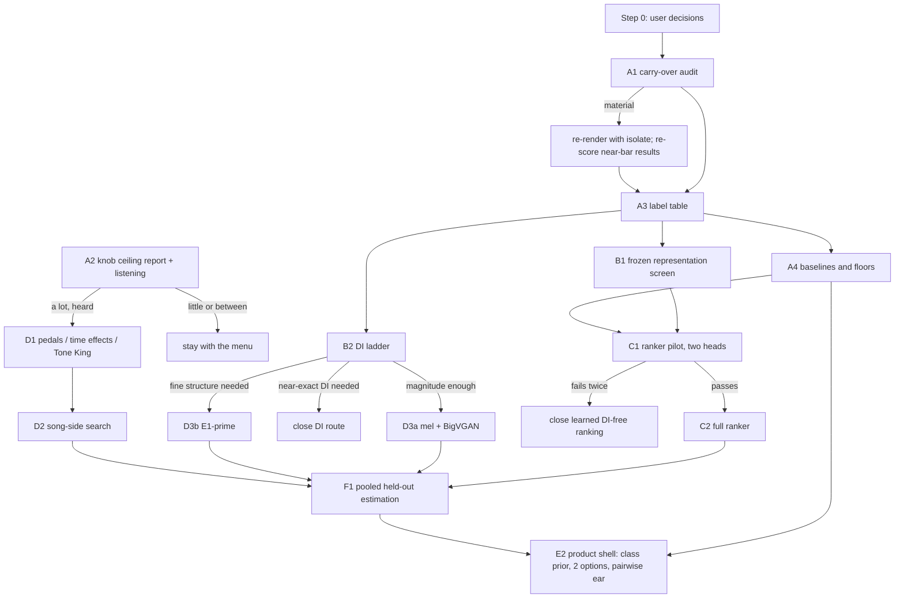

# Song-to-preset ML plan, October 2026 (checked step by step)

**Status: proposed, not declared.** This plan merges two research reports and corrects them
against the repository, the papers and the arithmetic. Under the project's rules each step
still needs:

1. its own committed `<topic>-plan.md`;
2. an independent review;
3. a message to the product session before any render;
4. an audit of its result.

(`docs/README.md:9-13`; `origin/ml/knob-ceiling:docs/knob-ceiling-plan.md:356-362`.)

**Inputs.**

- **Report A:** [`ml-approach-research-2026-10.md`](ml-approach-research-2026-10.md).
- **Report B:** a second agent's report, [`ml-plan-2026-10-checks/report-b.md`](ml-plan-2026-10-checks/report-b.md).
- **The checks behind every step**, in [`ml-plan-2026-10-checks/`](ml-plan-2026-10-checks/):
  - `A1-project-claims.md`: 91 project claims checked;
  - `A2-infrastructure.md`: what exists in the repo and its branches;
  - `A3-arithmetic.md`: power, render counts, disk;
  - `B1-literature-effects.md` and `B2-literature-data-licences.md`: papers, data and licences.

**How to read the tags.**

- **[P]**: the project's own result, with a file path.
- **[V]**: verified at the source during this check.
- **[I]**: inferred, or a proposed threshold. Every gate number below is a proposal for the
  step's own declaration, not a fact.

---

## Summary

1. **Do not start a new model yet.** Three things come first, and none needs a model:
   - **The render-order carry-over audit (A1).** This is a newly found render bug. Several past
     decisions passed or failed by 0.001–0.003, so an error of this kind could flip them.
   - **The knob-ceiling result (A2).** It is already running, and it answers the "perfect DI only
     buys a little" question.
   - **One clean label table (A3).**
2. **Both reports' first experiment is already running** as `ml/knob-ceiling`, so neither is
   repeated here. That branch also showed that Report A's planted-target control cannot pass as
   written: an exact copy of a preset sits in a "sharp-bottomed valley" that the search can't
   reach.
3. **The room is small on development, larger on held-out crunch.**
   - Against today's Morgan starts, the best menu preset is only **−0.10 to −0.13** better (about
     10–12% closer).
   - On C′'s 18 leak-free development parts, C′ is only **0.032** short of that best preset.
   - On held-out set 5 crunch, C′ reached −0.023 against the oracle's −0.129.

   So development tests can show at most about −0.13, and the held-out data is where methods
   differ.
4. **The evidence for learning from renders is thinner than both reports said.** No published work
   shows a guitar model trained on renders working on real records. The two strongest supports
   cited for "train in the song's own conditions" (StemFX; Le Vaillant & Molle) do not isolate
   that lever [V].
5. **Report B's "key difference" is not new.** It proposes same-preset/different-player positives,
   same-player/different-preset negatives, and preset prototypes averaged over many players. The
   project's tone encoder already used all three, and it failed on real recordings [P,
   `docs/tone-encoder-plan.md:39-42,99-101`].
6. **What that encoder never had:**
   - mixing into real backings at a song's level;
   - mastering;
   - the separator in the loop;
   - kept input level;
   - more than 14 bands of players.

   The plan tests those, but only after a zero-render screen (B1), and as a small pilot with a
   kill rule (C1).
7. **A cheap ladder (B2) decides whether rebuilding the DI is worth more days of training.** It
   corrupts the *true* DI in known ways and checks which corruptions break the judge's picks. It
   is cut to ~23k renders and refocused on crunch.
8. **The product frame stays a hybrid.** Research picks the class; two options are shown; the
   user's ear picks by comparing pairs on the song's own notes.
   - **GuitarToneAdapt** (CC BY 4.0, 1,252 entries) is a weak hint only. It has no "crunch"
     label, 38% of entries have no sources, and Long Road Out of Eden is missing [V].
9. **The held-out data supports one pooled estimation test.** That is 39 parts in 11 bands, with
   power 0.92 at −0.10 and 0.45 at −0.05 [I, A3].
   - It cannot meet the project's own rule that "a fresh confirmation needs 20 or more new bands"
     [P, `docs/ROADMAP.md:107`].
   - The user decides how to treat that.
10. **Budget.** About 42k new renders up to the learned-model pilot, and about 115k at most if
    every branch opens. Knob ceiling's ~70k is on top. Disk allows about 35 GB, not 65.

---

## 1. What the checking changed

### 1.1 Facts both reports got wrong or missed

| # | Finding | Effect on the plan | Source |
|---|---|---|---|
| 1 | **Knob ceiling is declared and running.** It is a continuous knob search with the true DI: 25 dev parts, 15 bands, ~70k renders. The exact planted-target control failed under six optimiser versions, so every searched gain is a lower bound. A result of "little" now reads as "undecided" | Report A's plan 3 and Report B's "continuous oracle first" are dropped. A2 waits for its report | [P] knob-ceiling plan, amendments 1–2 |
| 2 | **Render-order carry-over.** Morgan's `reset` leaves earlier state at hiss level. One preset scored 3.42 vs 3.92 depending on the previous render, on a part that starts quietly. Every Morgan menu pipeline on main renders reused, in a fixed order, without `isolate`. No audit is declared | A1 runs before anything that reuses stored distances | [P] knob-ceiling amendment 3; A2 item 2 |
| 3 | **Past decisions sat very close to their bars.** Residual-DI gate 1 passed by 0.001; the set-5 test passed by 0.003; the 3 kHz lowpass missed by 0.0009 | A1 must re-score these | [P] A2 item 2 |
| 4 | **Today's menu room is −0.10 to −0.13, not up to −0.19.** Clean −0.131, crunch −0.104, set 5 crunch −0.129. The −0.16 to −0.19 figures are Tone King only; set 4's −0.196 is against the old starts | Development gates must be modest | [P] A1 §1 |
| 5 | **The E0/E0b percentages describe a 0.032 gap.** C′ scored −0.099 and the oracle −0.131 on 18 parts. E0b (4 codebooks) −0.126 closes 83% of that gap; E0 (9) −0.129 closes 91% | The DI ladder can't use C′-error rungs on these parts: the whole range is below the judge's 0.043 near-tie scale | [P] `ml/egvae-lite:docs/egvae-lite-plan.md:138-142,257-262` |
| 6 | **"43 against 14" under-drive** counts part-amp cases from the old network C, trained under the MPS bug, on half A only. Playing the rebuilt DI quieter was tried: "Under-drive is not the main cause" | The "drive-bias correction arm" is dropped. A C′ bias check stays as a zero-render diagnostic | [P] `docs/underdrive-trim-results.md` |
| 7 | **Report B's #1 mechanism was already built and failed** (row 5 of the summary). 74.5% was against 4.5% chance; the 14% was the log-mel baseline | Its new parts are tested; the old parts are not re-run | [P] `docs/tone-encoder-plan.md` |
| 8 | **The evidence for "train in the test condition" is weaker than claimed.** StemFX "do[es] not quantify" separator effects, tests on true stems, and beats the unprocessed input by 5.7 MUSHRA with no test. Le Vaillant & Molle's mixture-trained model scored 17.3%; the 81.7% comes from the loss. RLAT's "source gap" compares digital plugins only | The learned ranker becomes a pilot with a kill rule (C1), not the centrepiece | [V] B1 §4 |
| 9 | **CMA-ES evidence was misread.** In FXRepBench, CMA-ES at 512 renders equals random sampling at 512 (0.739–0.771 vs 0.770). The objective kept improving to 4,096 calls while audio error was lowest at 2,048 | No optimiser switch. Anti-gaming checks are kept | [V] B1 §2 |
| 10 | **A dry Tone King menu exists:** 125 presets plus Default, with development distances | No menu-building step | [P] `learn/tk_baseline.py` |
| 11 | **MedleyDB DI labelling is exhausted.** All 68 same-take groups were shown to the user, giving 5 parts. Clean DIs could not be told apart by ear | "Label more MedleyDB" is dropped | [P] `docs/validation-set6.md` |
| 12 | **Fewer true-DI menu labels exist than assumed.** Measfix menus cover 52 dev parts (35 clean+crunch in 15 bands), not 136. C′ is leak-free on only 18 parts in 8 bands (fold 2) | A3 builds the full table | [P] A2 items 6, 7 |
| 13 | **Separator facts.** htdemucs_6s has a median SNR of 1.11 dB (sets 1–2) and 0.63 dB (set 3), not 1.2; single-guitar parts 5.86 dB, multi-guitar 0.74 dB. Speed is measured: 15 s wall per 30-s context on CPU | Separator cost is estimated from this | [P] `docs/separator-upgrade-results.md` |
| 14 | **Held-out pooling.** Set 5: 26 in-scope parts in 5 bands. Set 4 unused in-scope: 10 parts in 4 bands (2 clean, 8 crunch). Set 6: 3 parts in 2 bands. No overlap, so 11 bands | F1 is sized on this | [P] A1 §L |
| 15 | **Licences.** • PEACE weights are CC BY-NC (code MIT). • RLAT code and weights are not public. • LAION-CLAP's repo is CC0. • BoTorch ships PairwiseGP (MIT); pycma is BSD-3; Optuna is MIT. • The Open-Amp repo has no licence. • EGDB-NDSP's "Tone King Imperium" is most likely a Quad Cortex capture, not the plugin | PEACE dropped as a frozen candidate; EGDB-NDSP dropped | [V] B1, B2 |
| 16 | **Comunità 2025's metric-vs-listener range is lower.** Overall \|ρ\| is 0.30–0.43, and ≤ 0.36 on overdrive. Report A's "0.4–0.6 ceiling" was wrong | Expect weak DI-free metrics | [V] B1 |
| 17 | **Report B's prior-ITO paper is weak support.** Yu et al. (WASPAA 2025) uses a generic 365-preset vocal prior; its gain only matches using the mean preset, and its listening win is not significant | Research stays a class prior, backed by the project's own routing data | [V] B1 |
| 18 | **Disk.** Usable space is ~35 GB (65 free minus the 30 GB floor kept in practice). A 10-s, 128-band log-mel is ~256 KB in float16, not ~50 KB | Store distances and short FLACs only | [P] A2 item 14; [I] A3 |
| 19 | **"Fresh confirmation needs ≥ 20 new bands"** is a standing project rule | F1 is framed as estimation unless the user changes the rule | [P] `docs/ROADMAP.md:107` |

### 1.2 The two reports after checking

| Topic | Report A | Report B | Verdict |
|---|---|---|---|
| Measure headroom first | Yes, with a planted-target control | Yes, with four oracle levels | **Both right, both duplicate knob ceiling.** A's control rule fails by design (#1). B's four levels are useful; knob ceiling covers the first three except pedals |
| #1 approach | Set-valued ranker trained in song conditions | Content-invariant encoder plus prototypes | **The same render bank, two heads.** B's novelty claim is wrong (#7). A's evidence is overstated (#8). Kept as one gated pilot with both heads (C1) |
| DI rebuilding | A parallel arm, with a 40k-render ladder | Rank 3, E1′ only | **A ladder first, cut to ~23k.** C′-error rungs are dropped (#5); DAC 4/9 are already done. Decides E1′ vs mel+vocoder vs closing |
| Expected gains | Top-1 −0.03 to −0.07 | 7–15% closer | **B's 7–15% exceeds the menu room** (10–12% vs today's Morgan starts) unless knob search adds room. A's range is plausible but unproven |
| ST-ITO | Low | Not vanilla; keep AFx-Rep as a baseline | Agree. The authors call it a one-line limitation with no data [V]. AFx-Rep stays as a frozen B1 row |
| Optimiser | CMA-ES | CMA-ES, 16 × 12 | **No change.** Knob ceiling's coordinate search stays; CMA-ES offers no evidenced gain at equal budget (#9) |
| Mix and stem views | Stem only | Mix plus stem with agreement features | **Take B's dual view** in C1 |
| Search in stages | Time effects as a separate stage | Topology first, then knobs, then time effects | Agree. Already knob ceiling's structure (knobs, then EQ) |
| Personal calibration | Pairwise listening for the hybrid | A 200–400-trial preference head | **Take B's later** (E1d), only once an embedding passes C1 |
| GuitarToneAdapt | — | "New first-class resource" | **Weak hint only** (Summary, item 8) |
| Held-out | One pooled test | One pooled test, labelled estimation if < 10 bands | Agree. 11 bands exist; the 20-band rule applies (#19) |

---

## 2. Where the room is

Every gate below is sized against these numbers.

| Quantity | Value | Source |
|---|---|---|
| Best menu preset vs today's Morgan clean start | −0.131 (13 parts, 8 bands, held-out sets 1–2) | [P] `docs/clean-baseline-results.md:44` |
| Best menu preset vs today's Morgan crunch start | −0.104 (7 parts, 3 bands) | [P] `docs/crunch-baseline-results.md:33` |
| Set 5 crunch: oracle and C′ vs today's start | −0.129 and −0.023 | [P] `docs/set5-test-results.md` |
| Tone King oracle vs its starts | −0.191 clean, −0.164 crunch | [P] `docs/toneking-baseline-results.md:48` |
| Development (18 parts): oracle, C′ seed 0, E0, E0b vs the leave-band-out fixed preset | −0.131, −0.099, −0.129, −0.126 | [P] `ml/egvae-lite` |
| Judge near-tie scale | Median best-vs-second gap 0.043; only 10% of gaps reach 0.15; halves A and B pick different winners 27% of the time | [P] `docs/closeness-review-2026-10-10.md:66-68` |
| Listening-validated difference | ≥ 0.15 | [P] |

**What this means** [I]:

- A menu-picking method can gain at most about 0.10–0.13 on Morgan.
- A development gate of −0.05 against today's start asks for 40–50% of that.
- Differences below about 0.04 are inside the judge's own noise.
- Rebuilt-DI work shows up mainly on held-out crunch, where C′ falls far short. On its development
  parts it is already near the oracle.

---

## 3. Ground rules for every step

Each rule is verified in the repo. Sources are in A2 item 11.

- **Plan before compute:** plan → review → message the product session → run → audit. Changes are
  dated amendments.
- **Every new Morgan render passes `isolate=True`** (knob-ceiling amendment 3). Tone King already
  isolates automatically.
- **Scheduling:**
  - renders share the machine;
  - nothing runs 03:00–04:15;
  - long jobs launch with `setopt no_bg_nice`;
  - the licence daemon is never touched;
  - reused processes are used (about 10 daemon ports per new process).
- **MPS:** no `torch.stft` with gradient inside the MPS graph for signals over 65,536 samples.
  Compute features on CPU. Never run two MPS trainings at once. Clip gradients by hand.
- **Disk:** keep 30 GB free, so about 35 GB is usable. Score renders as they arrive; keep distances
  plus short 16-bit FLACs only where audio is reused.
- **Held-out:** used only by a declared test. Each use goes in the set's ledger. Nobody listens to
  sets 5 or 6 before a declaration.
- **A development-test ledger is created.** The protocol asks for one, and none exists in the
  repo.
- **Judge:** `flat` on measfix, cross-half (choose on one half, score on the other, both ways), is
  the primary judge. Judge v3 is reported beside it until the user adopts it.
- **Licences:** open only (MIT, Apache, BSD, CC0, CC BY). Non-commercial data or weights are used
  only if the user explicitly accepts them.

---

## 4. The steps

### Overview

| Step | Question | New renders | Wall time | Depends on | Decides |
|---|---|---|---|---|---|
| **0** | User decisions (list below) | 0 | — | — | Scope of A3, C1 and F1 |
| **A1** | Did render-order carry-over change past numbers? | 0 (up to ~3.7k if set 3 needs a check) | hours | knob-ceiling menus | Whether stored distances can be reused |
| **A2** | How much do knobs add beyond the menu? | 0 new (~70k already running) | its own | — | Whether search beyond the menu gets budget |
| **A3** | One clean true-DI × menu label table | ~3.3k–7.2k | ~1 h | A1 | Labels and bands for everything after |
| **A4** | Baselines and floors: Recall@k, half noise, second-mic floor, C′ drive bias | 0 | hours | A3 | The bars every model must beat |
| **B1** | Does any frozen open feature recognise presets across players and survive real amps and separation? | 0 | ~1–2 days | A3 | Whether DI-free learning starts, and from which encoder |
| **B2** | What must a rebuilt DI keep for the judge to pick right? | ~23k | ~3 h | A3 | Which DI route, if any, gets training |
| **C1** | Pilot: does a ranker trained in song conditions beat the start and the medoid on real dev recordings? | ~12k | ~1.5 h render + ~8 h separator + training | B1, user approval | Continue to C2 or close learned DI-free ranking |
| **C2** | Full learned ranker | ~33k more | ~4 h + training | C1 passed | Candidate for F1 |
| **D1** | Knob-ceiling extensions: pedals, time effects, Tone King | ≤ 30k | ≤ 4 h | A2 reads "a lot" and listening agrees | Search for songs |
| **D2** | Song-side local search | ~150–600 per song | minutes per song | D1 or A2, plus a working song-side score | Product search |
| **D3** | A rebuilt-DI route: mel+vocoder, or E1′ | ≤ 10k for evaluation | days of MPS | B2's reading | Candidate for F1 |
| **D4** | Time-effect estimators (they exist in the product) | 0 | days | — | Product effects, kept apart from the dry chooser |
| **E1** | Listening: knob ceiling page, v3 calibration, pairwise shortlist, later a personal head | < 1k | sittings | A2, A3 | Which measure to trust at small margins |
| **E2** | Product shell: class prior, 2 options, pairwise ear | 0 | — | A4, E1 | What ships |
| **F1** | One pooled held-out estimation test | ~5k | ~1 h | survivors of C, D, E | The only held-out spend |
| **G** | Data acquisition, in parallel | 0 | — | — | DI diversity for C |

### Step 0: decisions the user owns (before or alongside A1)

These are open in the repo (A2 item 1), and several steps depend on them:

1. **8j: close the rebuilt-DI chooser for the product?** The ROADMAP proposes closing it and keeping
   C′ for research.
   - B2 and D3 still make sense for research if it closes.
   - If the user prefers to stop DI work entirely, skip B2 and D3.
2. **Judge v3 adoption,** after the ~55-trial calibration (E1b).
3. **The 2026-10-10 constraint, "no more chooser or judge tweaks on the 33",** was never formally
   lifted.
   - The label table (A3) includes the 33, and 11 of the 13 pinned crunch parts are in it.
   - Proposal: lift it for *measurement* (A3, A4, B1, B2), and record every development
     decision in the new development ledger.
4. **The direct-ranker target:** "complete guitar" or "a specific part"
   (`docs/research/direct-preset-ranker-proposal-2026-10-09.md`). C1's ridge baseline needs it.
5. **Non-commercial data** (GOAT; CC BY-NC, request access): accept for personal use, or not.
   Default: not, per the brief's licence rule.
6. **How to treat the 20-band rule for F1** (section F1).
7. **Approval of C1's ~12k renders,** after B1.

### A1. Render-order carry-over audit

- **Question.** Did the reused, non-isolated render order move stored menu distances enough to
  change picks or past results?
- **Why.**
  - The same preset scored 3.42 vs 3.92 on a quiet-start part, depending on the previous render;
    the spread was 0.138.
  - Every Morgan menu pipeline on main is exposed: `phase2_set3`, `confirm_run`, `residual_eval`,
    `set3_gap_split`, `set5_test`, `v2_eval`, `songs_check`, `sound_desc`, `render_preset_panel`.
  - Three decisions sat within 0.003 of their bars (§1.1 #3).
  - Every later step reuses stored distances. [P] A2 item 2.
- **Checked.**
  - Amendment 3's text and fix: [P].
  - No audit is declared on any branch: [P] (A2 searched every branch).
  - The unmerged product branch says "the ML session audits its own pipelines": [P].
- **Inputs.**
  - Knob ceiling's fresh, isolated menu distances (`result.json["menu"]`) for 25 parts × 3 amps
    (`songs_check.parts()`), using the same measfix DI and crops.
  - The stored measfix distances for the same parts: `songs-check/distances.json` and
    `rescore/distances.json`.
- **Method.**
  1. Per part × amp × preset × half: the log difference between stored and fresh.
  2. Report its distribution, by half (the effect should sit in half A), and by part.
  3. Flag parts whose guitar is near-silent early in half A (count them with the judge's activity
     mask).
  4. Re-derive the oracle pick per half, and recompute the songs check (−0.114) and the routing
     re-check with the fresh distances.
- **Cost.** 0 renders and a few hours.
  - Set-3 parts are not in knob ceiling. Checking them needs ~33 × 111 ≈ 3.7k isolated renders.
    Do it only if the 25-part check finds a material effect.
- **Gate (to declare).** Reading per cell, then overall:

  | Reading | Condition |
  |---|---|
  | No material effect | ≥ 99% of cells within 0.005, and no oracle pick changes |
  | Material | Otherwise |

  If material:
  - re-render the label table with isolation (A3);
  - list every past result whose margin is smaller than the measured shift;
  - re-score them under a dated amendment.
- **Held-out results.** The set-5 test is also exposed. Re-rendering held-out audio is a held-out
  use: declare it as an amendment with a ledger entry, or report the exposure without
  re-rendering. The user decides.
- **Risks.**
  - The 25 parts are mostly clean (20 clean, 5 crunch), so crunch exposure is less certain.
  - 20 knob-ceiling cells used the 6-s pre-roll fix instead of isolate. They matched within
    1.4e-4, so they can be used.

### A2. Knob ceiling: let it finish, audit it, listen

- **Question.** With the true DI, how much closer do searched knobs, mics, cab and EQ get than the
  best menu preset?
- **Why.** This is the user's main doubt. Both reports wanted it first. It is declared and running
  [P].
- **Checked** [P, knob-ceiling plan]:
  - 25 parts, 15 bands (20 clean, 5 crunch);
  - M, K_M (200 renders), K_S (150) and EQ (100), scored cross-half;
  - the exact control failed, while the realistic control lands 0.075 short on the held half;
  - it does not cover pedals, time effects, Tone King, judge v3 or listening yet.
- **What this plan adds.** Nothing to the run. Ask the ML session to add three report-only items
  to its plan, as a dated amendment **before the report is read**:
  1. the floor-normalised headroom H, using A4's second-mic floor where a part has one;
  2. M and K_M re-scored under judge v3 (~150 renders, since M's audio is not kept);
  3. its declared judge-exploitation check, which applies the best settings to other parts, made
     mandatory if (b) reads "a lot".
- **Reading** (as declared there):

  | Result | Reading | Then |
  |---|---|---|
  | (b) ≤ −0.10 band-weighted, most bands negative, and its listening page agrees | Knob room is real | Open D1 |
  | ≥ −0.04 | "The search found little: undecided" | No more search budget. The optimiser is not the bottleneck to buy (§1.1 #9). Effort stays on choosing within the menu |
  | In between | Reported as a lower bound | D1 only for cells listening confirms |

- **Risks.**
  - The judge may reward settings it likes in general, not this recording. The exploitation check
    and listening guard against that.
  - Crunch is 5 bands, so it is descriptive only.

### A3. One clean label table

- **Question.** Can every in-scope development part get trustworthy true-DI × menu distances,
  rendered with isolation, under both judges?
- **Why.**
  - Baselines, screens, the ladder, ranker labels and development gates all need these labels.
  - Today 35 parts in 15 bands have them, they are exposed to carry-over, and 11 of 13 crunch
    parts are in the over-used 33.
  - Classed development parts: clean 48 in 16 bands, crunch 17 in 8 bands, so about 30 parts and
    2 crunch bands are missing [P, `docs/part-locator-truth.json`; A2 item 7].
- **Checked.**
  - `confirm_run.build_di("measfix")` exists [P].
  - The renderer can isolate [P].
  - Classed parts have usable same-take pairs; the "usable" flags are in
    `docs/validation-datasets.json` [P].
  - Stems exist only for `songs_check.parts()` (25 clean+crunch parts) [P].
- **Method.**
  1. Measfix DI, 10-s crop, the 111 Morgan presets with isolation.
  2. Score under `flat` and v3, on halves A and B.
  3. Also score the 126-preset Tone King menu for crunch parts that lack Tone King distances.
     Tone King renders are ~2× slower and already isolated; this is optional.
  4. Keep 16-bit FLAC of every render (B1's prototypes need the audio). Measure the FLAC size on
     the first 100 renders and stop if the projection exceeds 8 GB.
  5. Create `docs/dev-test-ledger.json`.
- **Cost.** ~30 parts × 111 = 3.3k renders, plus 35 × 111 = 3.9k if A1 says re-render. That is
  ≤ 7.2k renders, about an hour. Disk ~4–8 GB [I].
- **Gate.** None; this is infrastructure.
  - **Check:** where A1 found no carry-over, the new distances must match the stored ones within
    0.005.
- **Risks.** Crunch stays thin: 17 parts in 8 bands, and only 5 of them have stems.

### A4. Zero-render baselines and floors

Each of these reads the A3 table. None renders.

**(a) Shortlist reach.**

- Re-run `research/score_shortlists.within_share` on the measfix label table. Today it exists only
  on the old kill-panel measure [P].
- Compute Recall@k (τ = 0.15) and best-of-k gain for k = 1…6, band-weighted, for:
  - today's class-routed start;
  - start plus the neighbouring class's start, which is the product's current two-option shell;
  - house-k;
  - random-k;
  - the leave-band-out medoid.
- This sets the bar for C1 and E2.

**(b) Half noise.**

- How often halves A and B pick the same oracle, and how much of the between-band spread is
  half-to-half noise.
- This replaces Report A's "crops within parts", which needs new crops; each part has one crop [P].

**(c) Second-mic floor.**

- Judge distance from the second mic to the scored mic, on parts with two simultaneous mics.
  `docs/measuring-closeness.md:231-242` measured this on 23 parts under an older measure.
- Compute H = (d_start − d_best) / (d_start − d_floor) for A2 and every later result.

**(d) C′ drive bias.**

- On the 18 leak-free parts: the gain knob of C′'s pick against the oracle's pick, both halves,
  at the fixed level.
- Descriptive only. The quieter-DI correction was already futile for C [P].

### B1. Representation screen (frozen, open, zero renders)

- **Question.** Does any frozen open feature tell presets apart across players, and still do so on
  a real amp and on a separated stem?
- **Why.**
  - It tests the core of both reports' #1 approaches cheaply, including Report B's averaging of
    each preset over many players.
  - The project's own encoder had this structure and failed on real recordings [P]. Frozen effect
    encoders are weak in the literature:
    - FXRepBench: AFx-Rep's Spearman against true quality is 0.34–0.44 [V];
    - RLAT: AFx-Rep's cross-instrument retrieval is 20.5% [V].
  - None has been tested on amp presets. A zero-render test is the right price.
- **Candidates** (licences verified, B1/B2):

  | In | Excluded |
  |---|---|
  | • AFx-Rep, Apache-2.0, not gated; use only its own checkpoint, not the BEATs, FXencoder or plugins files bundled in the same repo • Fx-Encoder, MIT • EfficientAT mn10, MIT • LAION-CLAP, CC0, as the floor • log-mel and MFCC statistics, as controls • the project's tone encoder, as the reference • the note-normalised block N (Basic Pitch, Apache-2.0) | • PEACE weights (CC BY-NC) • Fx-Encoder++ (CC BY-NC) • MERT and MuQ (NC) • RLAT (not public) • the Open-Amp encoder (no licence) |

  Pooling: mean with standard deviation, and Gram (covariance).
- **Rungs.** Gates are declared first; losers are cut at each rung.

  | Rung | Test | Data (all existing) | Proposed gate |
  |---|---|---|---|
  | R0 | Does the preset move the feature more than the player does? | 16,800 crossed renders (FLAC, 6 s, sampled settings × 7 DI windows) | variance ratio (setting / DI) ≥ 1.5 |
  | R1 | Name the preset across players when every distractor plays the same notes | Kill panels (WAV; the session's own DI level, rule-1 crops, a known mismatch) | top-1 ≥ 2× log-mel on PR12 and SW50R |
  | R3 | **The decisive one.** Embed each part's real amp track. Build each menu preset's prototype by averaging its embedding over renders through *other bands'* DIs (the A3 audio). Pick the nearest prototype. Score it with the part's own true-DI judge | A3 table, ~65 parts | Regret below the medoid's in ≥ 2/3 of bands; most-picked preset < 25% of picks; band-weighted log ratio vs today's start reported |
  | R4 | Does R3 survive separation? | The same, with the htdemucs stem (25 parts with stems) | Loses ≤ 30% of R3's gain over the medoid |

  - **R2, the JVM410H gain sweep, is dropped.** The project holds that data because of its
    CC BY-NC-ND upstream [P/V].
  - **R5, agreement with the judge through content-matched proxy DIs** (≤ 11k renders), is
    optional and runs only for an R4 survivor.
- **Cost.** 0 renders. Compute: one embedding pass over about 25k clips, a few hours on MPS or CPU
  [I].
- **Then.**

  | Outcome | Next |
  |---|---|
  | A row passes R3 and R4 | It becomes C1's encoder initialisation, and the prototype head starts strong |
  | Rows pass R1 but none passes R3 | Expected from history. C1 may still run, but it stays a long shot, because what C1 adds (training in song conditions) is exactly what frozen features lack |
  | Nothing passes R1 | Drop frozen encoders. C1 uses a small CNN from scratch only |

- **Risks.**
  - The kill-panel level and crop mismatch may understate R1.
  - R3 depends on A1 and A3.

### B2. DI requirement ladder (reduced)

- **Question.** Which losses in a DI make the judge pick differently from the true DI?
- **Why.**
  - E0b showed a lossy 4-codebook DAC DI keeps the picks [P].
  - What breaks them is unknown: phase, the 1–3 kHz detail C′ lacks (coherence 0.207 against
    E0b's 0.20 at 1–3 kHz, but 0.47 against 0.72 below 1 kHz [P]), or the high band.
  - The next declared codec step, E2 on `ml/egvae-lite`, costs days of MPS. This answers first,
    with no training.
- **Changes from Report A.**
  - DAC at 4 and 9 codebooks is already done; DAC-4 stays only as a reproduction control.
  - The C′-error and envelope-swap rungs are dropped. On the 18 leak-free parts their whole range
    is ≤ 0.032, below the 0.043 near-tie scale (§1.1 #5).
  - True-DI corruptions need no network, so they run on any label-table part with no leakage, and
    crunch comes first.
- **Rungs (7):**
  1. the true DI (from A3);
  2. DAC-4, the control: must reproduce E0b within 0.01;
  3. DAC-2;
  4. DAC-1;
  5. BigVGAN-v2 44 kHz resynthesis from the true DI's mel (MIT [V]);
  6. Griffin-Lim from the true magnitude;
  7. phase randomised above 1 kHz, and separately above 3 kHz (two renders' worth).
- **Parts.** 30 label-table parts: all 17 crunch parts (8 bands) and 13 clean.
- **Cost.**
  - 30 × 7 × 111 ≈ 23.3k renders, about 3 h, keeping distances only.
  - Resampling: the measfix DI and DAC/BigVGAN run at 44.1 kHz. Any 48 kHz path is resampled and
    stated.
- **Measure per rung.**
  - Edge kept: the rung's pick, chosen on one half and scored on the other with the true-DI judge,
    as a log ratio against today's start, divided by the oracle's.
  - Pick agreement with the oracle.
  - Both band-weighted, with intervals. Crunch is reported separately.
- **Readings (to declare):**

  | Pattern | Reading | Then |
  |---|---|---|
  | Griffin-Lim **and** BigVGAN keep ≥ 80% of the edge | Magnitude is enough | Mel-predict + BigVGAN (D3a) is the cheap DI route; E1′ and E2 are not needed |
  | DAC-2 or DAC-1 keep ≥ 80% but Griffin-Lim keeps < 50% | Fine structure matters | E1′ (D3b) |
  | Phase > 3 kHz keeps ≥ 80% but > 1 kHz keeps < 50% | The 1–3 kHz detail is the failure | Target it in any route |
  | DAC-2 keeps < 50% | The judge needs a near-exact DI | Close the DI route (D3) |
  | DAC-4 misses its control | The pipeline is broken | Interpret nothing |

- **Risks.** 8 crunch bands make this descriptive. It measures the judge's sensitivity, not
  listening. If F1 or listening later disagree with the judge, the ladder's reading weakens.

### C1. Learned ranker pilot (one bank, two heads)

- **Question.** Does a model trained on plugin renders, placed in song conditions, rank the Morgan
  menu for real development recordings better than today's start and the song-blind medoid?
- **Why, honestly.**
  - The project's three learned routes all trained on solo renders, with few players, no
    separator, and level erased [P].
  - The levers with real evidence are tone diversity (EGDB-PG: 22.8 → 79.0 F1 on unseen tones [V])
    and pairs with different notes (RelFx ablation: 1.399 → 1.876 [V]).
  - Separator-in-the-loop and mixture training have weak evidence (§1.1 #8). No guitar
    render-to-record result exists.
  - So this is a **bet**, run as a pilot with a kill rule.
- **The bank (pilot):**
  - **DIs:**
    - DI parts from all 28 development bands; a DI is valid input whatever its class, so this uses
      the 136 parts, not just the classed ones;
    - Guitar-TECHS P1 (CC BY 4.0);
    - the Five-guitar dataset (CC BY 4.0), if its amp DI output is checked to be a true,
      pre-EQ DI (G);
    - split into folds by band.
  - **80 DI clips × 111 presets:** 8.9k renders. A third of the clips get a pre-render input level
    of ±4 dB and a pickup EQ (level is the main drive confound).
  - **3k off-menu targets:** each a DI through random continuous settings, rendered once. Their
    labels come from the same DI's menu renders, so they need no extra renders.
  - **Total:** ~12k renders, about 1.5 h.
- **Labels.** Set-valued: every preset within ε of the best under the judge, with ε set from A4b's
  half noise (around 0.04). A listwise loss on the negative distance carries the full order.
- **Augmentation after rendering** (no renders):
  - mix into band-disjoint real backings (other folds' `backing_instrumental.wav`) at −12 to +3 dB
    guitar-relative. Songs are near 0 dB; the old encoder used −12 to −30 dB bleed [P];
  - bus compression and limiting to −14…−8 LUFS (dasp-pytorch, Apache-2.0, or plain numpy);
  - htdemucs_6s on a precomputed half of the mixtures: ~6k separations, about 8 h CPU, estimated
    from 15 s per 30 s [I]. Run it when the renderer is idle;
  - expect acoustic and electric guitar to mix in the stem [P].
- **Inputs.**
  - Two views: the stem and the mix, with their agreement as a feature (Report B).
  - Level kept: no per-clip normalisation, plus LUFS as a side input.
  - Log-mel computed on CPU (the MPS rule).
- **Heads, on the same bank:**
  - **H1, a set-valued ranker:** 111 scores; multi-label cross-entropy plus a listwise loss.
  - **H2, a prototype encoder** (Report B): contrastive training with same setting / different DI
    as positives and same DI / different setting as hard negatives. It ranks by prototype distance
    with prototypes averaged over other bands' DIs.
  - **Backbone:** a small 1-D CNN like the project's 487k-parameter encoder, from scratch; or B1's
    best frozen row as the initialisation.
- **Baselines.**
  - Today's class-routed start.
  - The leave-band-out medoid.
  - The shuffled-input control (another part's audio).
  - B1's best frozen row.
  - The records-only ridge, octave bands to preset risks (`direct-preset-ranker-proposal`); this
    needs decision 0.4.
- **Pre-checks** (proposed gates):
  1. **Synthetic-song positive control.** Renders from held-apart bands, planted, mixed, mastered
     and separated. Top-5 must contain an ε-equivalent preset at least 60% of the time, and top-1
     regret must be at most half the medoid's. If this fails, the pipeline is broken; it is not a
     transfer failure.
  2. **Domain probe.** A logistic model on the frozen features, separating augmented render stems
     from real development stems, must stay below 75% accuracy.
- **Development gate** (to declare; leave-band-out over the A3 table; product input = stem on the
  25 parts with stems; amp-track input reported as a diagnostic). Either head must meet all of:
  - band-weighted top-1 log ratio ≤ −0.05 against today's class-routed start (about 40–50% of the
    menu room);
  - better than the medoid and the shuffled control;
  - Recall@3 (τ = 0.15) above house-3 and random-3 from A4a;
  - ≥ 60% of bands better.
- **Power note.** 15 bands give about 0.57 power at −0.05 [I, A3]. The gate is a development
  screen, not a claim.
- **Kill.**
  - The positive control passes but the development gate fails: one more augmentation recipe (no
    new renders). If that fails too, **close learned DI-free ranking**.
  - The domain probe stays above 75% after two rounds: stop.
- **Cost.**
  - ~12k renders; ~8 h CPU separation; training a few hours on MPS for the small CNN, overnight to
    fine-tune AFx-Rep [I].
  - Disk: the bank as 6-s, 16-bit FLAC, ~4 GB; separated inputs as float16 log-mels, ~1 GB [I].

### C2. Full learned ranker (only if C1 passes)

- **Scale.** Grow to ~45k renders in total: more DI clips, targets and variants.
- **Proceed only if** the development metric improves from C1 to C2. Gains measured on renders
  alone don't count. If the curve is flat, stop scaling; do not head towards 200k.
- **Tone King.** Add a Tone King head only after Morgan passes. Its menu exists [P], but reused,
  isolated Tone King renders need a repeatability check first (A2 item 4).
- **The survivor goes to F1.**

### D1. Knob-ceiling extensions (only if A2 reads "a lot" and listening agrees)

- **Pedals.** On/off and knobs. The PR12 crunch start's two pedals can't be turned off in knob
  ceiling [P].
- **Time effects.** A separate stage, scored dry and wet separately. The judge barely sees effects
  (+0.001 [P]), so listening decides.
- **Tone King cells.**
- **Optimiser.** Keep the project's coordinate search with restarts. There is no evidenced gain
  from CMA-ES at equal budget [V].
- **Cost.** ≤ 30k renders. Same cross-half, exploitation-check and listening rules as A2.

### D2. Song-side local search (only if D1 or A2 is positive, and a song-side score works)

- **Method.** Search from the chosen preset, scoring through the rebuilt DI (if D3 passes) or a
  DI-free score (if C passes).
- **Gate.** On development, the searched result must beat the menu pick on ≥ 60% of parts,
  scored by the true-DI judge.
- **Cost.** ~150–600 renders per song: minutes per song.

### D3. A rebuilt-DI route (chosen by B2's reading)

- **D3a, mel prediction plus BigVGAN-v2,** if magnitude is enough. The cheapest route, and it
  avoids phase.
- **D3b, E1′.** Predict DAC's continuous latent from the stem, with a mel loss through the frozen
  decoder.
  - Kammoun et al. support a continuous *training target* but re-quantise before decoding [V], so
    decode through 4-codebook re-quantisation as one arm.
  - Coordinate with `ml/egvae-lite`, whose declared next step is E2.
- **Gate.** The `ml/egvae-lite` E2 rule against C′:
  - "earns held-out use": band mean ≤ −0.015, with the 90% upper bound below +0.03;
  - "futile": lower bound above −0.02.
- **Room.** On development the room is only ~0.032, so the real test is held-out crunch, in F1.
- **Cost.** Days of MPS for D3b, hours for D3a. ≤ 10k renders for evaluation.

### D4. Time-effect estimators (independent)

- **What exists.** `match/invert.py` already has delay, reverb (RT60 in the probe regime) and
  tremolo estimators; tremolo from recordings is not done (D-M7) [P]. Report A's "never run" was
  too strong.
- **Method.** Check them on development amp tracks against what the session shows, and by ear.
  Keep them out of the dry chooser.
- **Cost.** No renders.

### E1. Listening

- **(a) Knob ceiling's page.** Already planned there.
- **(b) Judge v3 against `flat`.** About 55 trials chosen where their picks differ, with hidden
  repeats and swaps.
  - Agreement of 0.75 needs 23 decided trials for 80% power [I, A3].
  - A listener with 0.8 repeat consistency can't exceed ~0.89 agreement.
  - This settles decision 0.2.
- **(c) Pairwise choice on the song's own notes,** through the rebuilt DI, for the two-option
  product. Includes a taste-only control (the same pair without the song).
  - The project's four-way page through other riffs did not beat a song-blind taste [P].
  - Two-way choices went 17/21 [P].
- **(d) Report B's personal preference head.** 200–400 pairwise trials, fitted as a shallow head.
  Only after an embedding passes C1.

### E2. The product shell

- **Class.** From the part's documented sound, the rule re-checked in-sample at −0.081 [P].
- **Options.** Show two: today's start plus the neighbouring class's start, or the model's top 2
  if C2 beats that pair on Recall@2 (A4a).
- **Choice.** The user picks by pairwise comparison on the song's notes (E1c).
- **GuitarToneAdapt as a weak hint** [V, B2]:

  | Problem | Detail |
  |---|---|
  | Skewed labels | 77% "distorted", no "crunch" label; crunch must be inferred from gain (4.5–6 in 393 entries) |
  | Weak sourcing | 38% have no sources; 47% have confidence ≥ 0.7 |
  | Test songs | Hotel California has the solo only; Long Road Out of Eden is absent |
  | Label noise | "Take It Easy" is "distorted" at gain 3 with no sources |

  - Use only entries with confidence ≥ 0.7 and sources, as a tie-breaker. Never use it as knob
    truth.
  - Offline check: the product's routing text against GuitarToneAdapt's tone type and gain on
    songs in the file. It needs no audio and measures agreement only.
  - CC BY attribution applies if anything derived is redistributed.

### F1. One pooled held-out estimation test

- **Material.** No band overlaps [P, A1 §L]:

  | Set | Parts | Bands | Use |
  |---|---|---|---|
  | Set 5 | 26 | 5 | Second use |
  | Set 4, unused in-scope | 10 (2 clean, 8 crunch) | 4 | First use |
  | Set 6 | 3 crunch | 2 | First use |
  | **Total** | **39** | **11** | |

  - Crunch is 9 bands, 2 of them with a single low-confidence part.
- **Input type matters.**
  - A test from stems needs a mix: set 5 has mixes for only 3 crunch bands, and set 6 only for
    Little Tybee, because Port St Willow and Big Troubles are in MUSDB18-train [P].
  - Count stem-eligible bands at declaration; expect about 8–10 [I].
- **Power** (band SD 0.101, which is crude) [I, A3]:

  | Bands | Power at −0.10 | Power at −0.05 |
  |---|---|---|
  | 11 | 0.92 | 0.45 |
  | 8 | 0.81 | 0.35 |

  - −0.05 needs 27 bands.
- **The 20-band rule.** The ROADMAP says a fresh confirmation needs ≥ 20 new bands. The user
  chooses:
  - **(i)** declare F1 as **estimation**: a band-weighted interval plus a pre-declared Bayesian
    reading ("helps" if P(effect < 0) > 0.9 and the posterior mean ≤ −0.05; "futile" if
    P(|effect| < 0.03) > 0.8), with no confirmation claim; or
  - **(ii)** relax the rule for this test.
- **Outcomes.**
  - Primary: band-weighted log ratio of what the product would output (best of 2 for the hybrid,
    top-1 for an automatic pick) against today's class-routed start.
  - Secondary: Recall@2 and Recall@3; judge v3; a declared listening subset after the key is
    hashed.
- **Rules.**
  - Survivors only. Ledger entries in sets 4, 5 and 6.
  - Port St Willow is analysed with and without (its reference is probably an electrical drive
    path [P]).
  - Sets 1–2 are not used; they have already had 5 uses.

### G. Data, in parallel (no renders)

| Source | Action | Why |
|---|---|---|
| Five-guitar dataset (Zenodo 4988354, CC BY 4.0, 730 MB) | Download. Check whether the amp's DI out is pre-EQ | 1 more player and 3 guitars for C's DI pool (clean only) [V] |
| GOAT (CC BY-NC 4.0, restricted) | Only if the user accepts non-commercial data (decision 0.5) | New players [V] |
| EGDB-NDSP | **Drop** | "Tone King Imperium" is most likely a Quad Cortex capture [V] |
| TONE3000 captures | Optional: hand-pick ≤ 50 cc-by or cc0 captures for a real-amp robustness check of C. No bulk download (API terms) | [V] |
| New recordings of guitarists (DI plus mic'd amp) | User decision (ROADMAP step 9) | The only route to the 8–12 new crunch bands the project needs [P] |

---

## 5. Budget and schedule

| Block | New renders | Cumulative |
|---|---|---|
| A1–A4 | 3.3k–7.2k (+3.7k if set 3 needs an audit check) | ≤ 11k |
| B1 | 0 (R5 optional ≤ 11k) | ≤ 11k |
| B2 | ~23k | ≤ 34k |
| C1 | ~12k | ≤ 46k |
| C2 | ~33k | ≤ 79k |
| D1 | ≤ 30k | ≤ 109k |
| D3 evaluation | ≤ 10k | ≤ 119k |
| E1, F1 | ~6k | ≤ 125k |

- **Knob ceiling** (~70k) is already scheduled and sits outside this table. Everything together
  stays under the 200k flag.
- **Order on the machine.**
  - Knob ceiling holds 6 render processes today (6–9 h or more).
  - A1, A4 and B1 need no renders and can run while it renders (B1's embeddings on MPS).
  - A3 renders next, then B2, then C1.
  - Separation (CPU) runs when the renderer is idle, never 03:00–04:15.
- **Rates.** About 8k renders an hour is assumed: crossed renders ran at ~7.5k/h on 3 processes;
  knob ceiling projects ~8–12k/h on 6 [P].

## 6. Decision tree

## 7. Dead ends (updated after checking)

| Do not | Why | Source |
|---|---|---|
| Re-run a continuous headroom pilot | Knob ceiling is that experiment | [P] |
| Require exact recovery of a planted preset | It fails by design: a sharp-bottomed valley | [P] knob ceiling amendments 1–2 |
| Switch to CMA-ES for "better search" | Equal-budget CMA-ES = random sampling; objective gaming after ~2k calls | [V] FXRepBench |
| Correct under-drive by playing the rebuilt DI quieter | Tried: futile | [P] `underdrive-trim-results.md` |
| Re-run the old contrastive recipe (solo renders, mel augmentation, 14 bands) | Failed on real recordings | [P] |
| Label more MedleyDB DIs by ear | Exhausted; clean labels unusable | [P] `validation-set6.md` |
| Predict exact DAC codes (E1) | Codes are phase-locked; failed | [P] |
| Use PEACE, Fx-Encoder++, MERT, MuQ, RelFx or DeepAFx-ST weights | Non-commercial licences | [V] |
| Depend on RLAT's code or the Open-Amp encoder | Not public; no licence | [V] |
| Use EGDB-NDSP to check Tone King renders | Likely a Quad Cortex capture | [V] |
| Use top-1 held-out gates on ≤ 6 bands | Sign-flip p ≥ 2^−k; power below 0.5 even at −0.10 | [I] A3 |
| Use coherence as the mechanism metric | E0b keeps the picks at C′'s 1–3 kHz coherence | [P] |
| Use JVM410H as a positive control | Held for licence | [P] |
| Treat GuitarToneAdapt as knob truth | Unsourced entries, no crunch label | [V] |

**Two dead ends from Report A were overstated and are reopened as stated** [P, A1 §1 #10]:

- **"C-family DI network: no move"** covered runs made under the MPS bug. C′, trained after the
  fix, beat C on set 5.
- **"CLAP/MERT near chance"** is a literature result. The project tested only PANNs.

## 8. What this plan could still get wrong

- **The Mac's disk and stored renders were not seen.** Everything about `~/ndsp-presets` comes from
  code and docs (A2). A1 and A3 must confirm the files exist before relying on them.
- **The band SD of 0.101 is crude:** about 4 crunch band means. Power figures could be off by
  ±10 points [I].
- **The gate numbers are proposals:** 0.005, 1.5×, 2×, 25%, 30%, 60%, 75%, 80%, −0.05. Each step's
  own declaration fixes them, after review.
- **FLAC sizes and separator speed on MPS are estimates.** A3 and C1 measure them on their first
  100 items.
- **One listener.** Every listening result rests on the user's ears. That suits a personal tool,
  but it limits generality.
- **GuitarToneAdapt's provenance is unstated** (community-researched, possibly machine-assisted).

## Appendix: corrections to the October report

`ml-approach-research-2026-10.md` stays as written; this plan supersedes these points in it:

1. **The ranker's ceiling against today's Morgan starts** is −0.10 to −0.13. −0.19 is Tone King.
2. **E0/E0b "keep 83–91% of the oracle edge"** should read: they close 83% and 91% of C′'s 0.032
   gap to the oracle on 18 development parts.
3. **The planted-target control** cannot pass in its exact form (knob ceiling).
4. **The headroom pilot** is knob ceiling; plan 3 is withdrawn.
5. **The "drive-bias correction arm" and the "new reading" of under-drive:** the mechanism is the
   project's own, and the quieter-DI fix was futile.
6. **FXRepBench** shows no gain for CMA-ES at equal budget, and no learned proposal sits in that
   comparison.
7. **The StemFX and Le Vaillant & Molle evidence** does not isolate training in song conditions.
8. **Comunità 2025's |ρ|** is 0.30–0.43 overall and ≤ 0.36 on overdrive.
9. **PEACE weights** are CC BY-NC.
10. **"Tone King has no menu"** is wrong: 125 presets plus Default exist.
11. **"Label more MedleyDB"** is already exhausted.
12. **"Time unmeasured" for htdemucs** is wrong: 15 s per 30 s on CPU. Its SNR is 1.11 / 0.63 dB,
    not 1.2.
13. **Set 4's in-scope count is 10 parts in 4 bands;** set 5 has 5 bands, not 7.
14. **Log-mel storage** is ~256 KB per 10-s clip in float16, not ~50 KB. The ladder is ~43k renders
    as specified there, not ~40k.
15. **EGDB-NDSP** is not a plugin render.
16. **"Time-effect estimators never run"** is too strong: estimators exist in `match/invert.py`.
17. **"Crunch power 9–37%"** (brief and B) should be 9–18% with the 3 crunch bands that have a mix.
