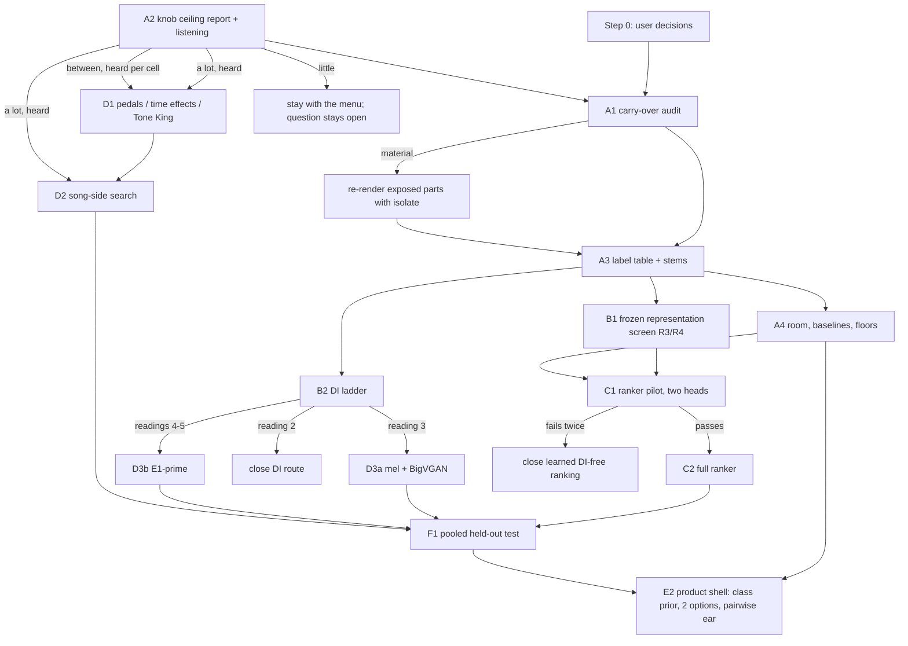

# Song-to-preset ML plan, October 2026 (checked step by step)

**Status: proposed, not declared.** This plan merges two research reports. It corrects them
against the repository, the papers and the arithmetic, and it has been through one independent
review whose 25 required fixes are applied (list in the appendix).

Under the project's rules each step still needs:

1. its own committed `<topic>-plan.md`;
2. an independent review;
3. a message to the product session before any render;
4. an audit of its result.

Sources: `docs/README.md:9-13`; `origin/ml/knob-ceiling:docs/knob-ceiling-plan.md:356-362`.

**Inputs.**

- **Report A:** [`ml-approach-research-2026-10.md`](ml-approach-research-2026-10.md).
- **Report B:** a second agent's report, [`ml-plan-2026-10-checks/report-b.md`](ml-plan-2026-10-checks/report-b.md).
- **The checks behind every step**, in [`ml-plan-2026-10-checks/`](ml-plan-2026-10-checks/):

  | File | What it holds |
  |---|---|
  | `A1-project-claims.md` | 91 project claims checked |
  | `A2-infrastructure.md` | What exists in the repo and its branches |
  | `A3-arithmetic.md` and `arith.py` | Power, render counts, disk |
  | `B1-literature-effects.md`, `B2-literature-data-licences.md` | Papers, data, licences |
  | `R-plan-review.md` | The independent review of this plan |

**How to read the tags.**

- **[P]**: the project's own result, with a file path.
- **[V]**: verified at the source during this check.
- **[I]**: inferred, or a proposed threshold. Every gate number below is a proposal for the
  step's own declaration, not a fact.

---

## Summary

1. **Do not start a new model yet.** Three things come first, and none of them needs a model:
   - **Render-order carry-over audit (A1).** A newly found render bug may have shifted stored
     scores. The scores behind this plan's own reference numbers are exposed to it.
   - **Knob-ceiling result (A2).** The experiment is already running. It answers "does a perfect
     DI only buy a little?"
   - **One clean label table (A3).**
2. **Both reports' first experiment is already running** as `ml/knob-ceiling`, so neither is
   repeated here. That branch also showed that Report A's planted-target control fails as
   written: an exact copy of a preset sits in a "sharp-bottomed valley" that the search can't
   reach.
3. **How much room there is.**
   - **Held out:** the best menu preset is **−0.10 to −0.13** better than today's Morgan starts
     (10–12% closer).
   - **Development:** the room against those starts is unmeasured, because the starts were
     chosen on the development parts themselves. A4 measures it.
   - **C′ on its 18 leak-free development parts:** only 0.032 short of the oracle.
   - **C′ on held-out set 5 crunch:** −0.023, against the oracle's −0.129.
4. **The evidence for learning from renders is thinner than both reports said.** No published
   work shows a guitar model trained on renders working on real records. The two strongest
   supports cited for "train in the song's own conditions" (StemFX; Le Vaillant & Molle) do not
   isolate that lever [V].
5. **Report B's "key difference" is not new.** It proposes:
   - positive pairs: the same preset through different players;
   - hard negatives: the same player through different presets;
   - preset "prototypes" averaged over many players.

   The project's tone encoder already used all three and failed on real recordings [P,
   `docs/tone-encoder-plan.md:39-42,99-101`].
6. **What that encoder never had:**
   - mixing into real backings at a song's level;
   - mastering;
   - the separator in the loop;
   - kept input level;
   - more than 14 bands of players.

   The plan tests these, but only after a zero-render screen (B1) and as a small pilot with a
   kill rule (C1).
7. **A ladder (B2) decides whether rebuilding the DI deserves more days of training.** It
   corrupts the *true* DI in known ways and checks which corruptions break the judge's picks.
   It is cut to ~23k renders and crunch comes first.
8. **The product stays a hybrid.**
   - Research picks the class, and two options are shown.
   - The user's ear picks by pairwise comparison on the song's own notes.
   - **GuitarToneAdapt** (CC BY 4.0, 1,252 entries) is a weak hint only. It has no "crunch"
     label, 38% of entries have no sources, and Long Road Out of Eden is missing [V].
9. **The held-out data supports one pooled test: 39 parts in 11 bands.**
   - It can confirm only effects of about −0.10 or larger: power 0.92 at −0.10, 0.45 at −0.05
     [I, A3]. Below that it is an estimate.
   - Recording new guitarists is ruled out by the brief, so **this test spends the last fresh
     held-out data.** The user decides whether to keep a reserve.
10. **Budget.**
    - About **46k** new renders up to and including the learned-model pilot.
    - About **119k** if every branch opens, with D1 capped at 20k.
    - With knob ceiling's ~70k, about **190k**: under the brief's 200k flag.
    - Usable disk is about 35 GB, not 65.

---

## 1. What the checking changed

### 1.1 Facts both reports got wrong or missed

| # | Finding | Effect on the plan | Source |
|---|---|---|---|
| 1 | **Knob ceiling is declared and running.** It is a continuous knob search with the true DI: 25 dev parts, 15 bands, ~70k renders. The exact planted-target control failed under six optimiser versions, so every searched gain is a lower bound, and a "little" result reads as "undecided" | Report A's plan 3 and Report B's "continuous oracle first" are dropped. A2 waits for its report | [P] knob-ceiling plan, amendments 1–2 |
| 2 | **Render-order carry-over.** Morgan's `reset` leaves earlier state at hiss level. One preset scored 3.42 vs 3.92 depending on the previous render, on a part that starts quietly. At least 17 Morgan pipelines on main render in reused processes, in a fixed order, without `isolate`. No audit is declared | A1 runs before anything that reuses stored distances | [P] knob-ceiling amendment 3; A2 item 2; R-review R4 |
| 3 | **Exposed results include this plan's own reference numbers:** • the clean and crunch baselines on held-out sets 1–2 (−0.131 and −0.104); • the set-4 confirmation; • the set-3 confirmation; • the set-5 test (passed by 0.003). Two other near-bar decisions are no longer live: residual-DI gate 1 (passed by 0.001, since superseded) and the 3 kHz lowpass (missed by 0.0009, adopted, then retired) | A1 counts which parts are exposed; Step 0 asks the user what to do about held-out exposures | [P] A2 item 2; R-review R2, R4 |
| 4 | **The held-out room against today's Morgan starts is −0.10 to −0.13, not up to −0.19.** Clean −0.131, crunch −0.104, set 5 crunch −0.129. The −0.16 to −0.19 figures are Tone King only; set 4's −0.196 is against the old starts | The development room against those starts must be measured (A4a) | [P] A1 §1 |
| 5 | **The E0/E0b percentages describe a 0.032 gap.** C′ scored −0.099 and the oracle −0.131 on 18 parts. E0b (4 codebooks) at −0.126 closes 83% of that gap; E0 (9 codebooks) at −0.129 closes 91%. 0.032 is only about 1.3× the 90% half-width of a band-mean difference on 8 bands (≈ 0.025; E0 vs C′ was −0.029 [−0.054, −0.005]) | The DI ladder drops C′-error rungs: they could resolve at most one or two steps | [P] `ml/egvae-lite:docs/egvae-lite-plan.md:138-144,257-263` |
| 6 | **The "43 against 14" under-drive count** is part-amp cases, from the old network C (trained under the MPS bug), on half A only. The project concluded "Under-drive is not the main cause", after a quieter-DI trim was futile | Report A's "drive-bias correction arm" is dropped on that conclusion. A C′ bias check stays as a zero-render diagnostic | [P] `docs/underdrive-trim-results.md` |
| 7 | **Report B's #1 mechanism was already built and failed** (summary item 5). Its 74.5% was against 4.5% chance; the 14% it cites was the log-mel baseline | Only its new elements are tested | [P] `docs/tone-encoder-plan.md` |
| 8 | **The evidence for "train in the test condition" is weaker than claimed.** • StemFX "do[es] not quantify" separator effects, tests on true stems, and beats the unprocessed input by 5.7 MUSHRA with no significance test. • Le Vaillant & Molle's mixture-trained model scored 17.3%; the 81.7% comes from the loss. • RLAT's "source gap" compares digital plugins only | The learned ranker becomes a pilot with a kill rule (C1), not the centrepiece | [V] B1 §4 |
| 9 | **The CMA-ES evidence was misread.** FXRepBench: CMA-ES at 512 renders equals random sampling at 512 (0.739–0.771 vs 0.770). Its objective kept improving to 4,096 calls while audio error was lowest at 2,048. Its positive lesson: a learned proposal (Head@16) matched Random@512 | No optimiser switch. Keep the anti-gaming checks | [V] B1 §2 |
| 10 | **A dry Tone King menu exists:** 125 presets plus Default, with development distances | No menu-building step | [P] `learn/tk_baseline.py` |
| 11 | **MedleyDB DI labelling is nearly exhausted.** All 68 waveform same-take groups were shown to the user, giving 5 parts; clean DIs could not be told apart by ear. 89 envelope-only pairs were never shown | "Label more MedleyDB" is dropped. Small yield at best | [P] `docs/validation-set6.md`; `docs/set6-di-labelling-plan.md:55-57` |
| 12 | **Fewer true-DI menu labels exist than assumed.** Measfix menus cover 52 dev parts (35 clean+crunch in 15 bands), not 136. C′ is leak-free on only 18 parts in 8 bands (fold 2) | A3 builds the full table | [P] A2 items 6, 7 |
| 13 | **Separator facts.** • htdemucs_6s median SNR 1.11 dB (sets 1–2) and 0.63 dB (set 3), not 1.2. Single-guitar parts 5.86 dB, multi-guitar 0.74 dB. • Speed is measured: 15 s wall per 30-s context on CPU. • The project's stem tests use **no SNR filter**, because the product can't apply one | Separator cost is estimated from this. C1 and B1 use unfiltered stems | [P] `docs/separator-upgrade-results.md`; `docs/set5-test-plan.md:156-157` |
| 14 | **Held-out pooling** (no band overlaps; total 11 bands): • set 5: 26 in-scope parts in 5 bands; • set 4 unused in-scope: 10 parts in 4 bands (2 clean, 8 crunch); • set 6: 3 parts in 2 bands | F1 is sized on this | [P] A1 §L |
| 15 | **Licences.** • PEACE weights are CC BY-NC (code MIT). • RLAT's code and weights are not public. • LAION-CLAP's repo is CC0. • BoTorch ships PairwiseGP (MIT). pycma is BSD-3; Optuna is MIT. • The Open-Amp repo has no licence. • EGDB-NDSP's "Tone King Imperium" is most likely a Quad Cortex capture, not the plugin | PEACE dropped as a frozen candidate; EGDB-NDSP dropped | [V] B1, B2 |
| 16 | **Comunità 2025's metric-vs-listener range is lower.** \|ρ\| is 0.30–0.43 overall and ≤ 0.36 on overdrive. Report A's "0.4–0.6 ceiling" was wrong | Expect weak DI-free metrics | [V] B1 |
| 17 | **Report B's prior-ITO paper is weak support.** Yu et al. (WASPAA 2025) uses a generic 365-preset vocal prior. Its gain only matches using the mean preset, and its listening win is not significant | Research stays a class prior, backed by the project's own routing data | [V] B1 |
| 18 | **Disk.** Usable is ~35 GB: 65 GB free minus the 30 GB floor kept in practice. A 10-s, 128-band log-mel is ~256 KB in float16, not ~50 KB | Keep distances and short FLACs only | [P] A2 item 14; [I] A3 |
| 19 | **"A fresh confirmation needs 20 or more new bands"** (ROADMAP:107) is a power note for one effect size (−0.143 needs ~20 bands, −0.072 needs 40+), not a declaration rule | F1 is declared as estimation, plus confirmation of effects ≥ 0.10 | [P] `docs/fixed-level-rescore-results.md:67-79` |
| 20 | **Recording new guitarists is ruled out** by the brief | F1 spends the last fresh held-out data | `_brief.md:129` |
| 21 | **Sample rate.** The measure DI and the renderer run at 48 kHz; DAC and BigVGAN at 44.1 kHz | B2 resamples 48 → 44.1 → 48, as E0 did | [P] `match/renderer_au.py:68`; `egvae-lite-plan.md:130-131` |

### 1.2 The two reports after checking

| Topic | Report A | Report B | Verdict |
|---|---|---|---|
| Measure headroom first | Yes, with a planted-target control | Yes, with four oracle levels | **Both right, and both duplicate knob ceiling.** A's control rule fails by design (#1). Of B's levels, knob ceiling covers 1 (menu), 2 (continuous dry chain, without pedals) and 4 (its listening page). Level 3 (time effects) is D1 |
| #1 approach | Set-valued ranker trained in song conditions | Content-invariant encoder plus prototypes | **The same render bank, two heads.** B's novelty claim is wrong (#7) and A's evidence is overstated (#8). Kept as one gated pilot (C1) |
| DI rebuilding | Parallel arm, 40k-render ladder | Rank 3, E1′ only | **Ladder first, cut to ~23k.** C′-error rungs dropped (#5); DAC 4/9 already done. Decides E1′ vs mel+vocoder vs closing |
| Expected gains | Top-1 −0.03 to −0.07 | 7–15% closer | **The upper end of B's range exceeds the held-out menu room** (10–12%) unless knob search adds room. A's range is plausible but unproven |
| ST-ITO | Low | Not vanilla; keep AFx-Rep as a baseline | Agree. The authors' "does not work well for guitar tone matching" is a one-line limitation with no data [V]. AFx-Rep stays a frozen B1 row |
| Optimiser | CMA-ES | CMA-ES, 16 × 12 | **No change.** Knob ceiling's coordinate search stays; CMA-ES has no evidenced gain at equal budget (#9) |
| Mix and stem views | Stem only | Mix plus stem, with agreement features | **Take B's dual view** in C1 |
| Search in stages | Time effects as a separate stage | Topology, then knobs, then time effects | Agree. Already knob ceiling's structure (knobs, then EQ) |
| Personal calibration | Pairwise listening for the hybrid | A 200–400-trial preference head | **Take B's later** (E1d), only once an embedding passes C1 |
| GuitarToneAdapt | — | "New first-class resource" | **Weak hint only** (summary item 8) |
| Held-out | One pooled test | One pooled test, labelled estimation if < 10 bands | Agree: 11 bands. Confirms only ≥ 0.10; otherwise estimation (#19) |

---

## 2. Where the room is

Every gate below is sized against these numbers.

| Quantity | Value | Kind | Source |
|---|---|---|---|
| Best menu preset vs today's Morgan clean start | −0.131 (13 parts, 8 bands) | held out (sets 1–2) | [P] `docs/clean-baseline-results.md:44` |
| Best menu preset vs today's Morgan crunch start | −0.104 (7 parts, 3 bands) | held out (sets 1–2) | [P] `docs/crunch-baseline-results.md:33` |
| Set 5 crunch: oracle and C′ vs today's start | −0.129 and −0.023 | held out | [P] `docs/set5-test-results.md` |
| Tone King oracle vs its starts | −0.191 clean, −0.164 crunch | | [P] `docs/toneking-baseline-results.md:48` |
| 18 dev parts: oracle, C′ seed 0, E0, E0b, vs the leave-band-out fixed preset | −0.131, −0.099, −0.129, −0.126 | development | [P] `ml/egvae-lite` |
| Other development oracles | −0.087 (clean, 18 parts) to −0.260 (set 3, leave-band-out) | development | [P] `docs/residual-di-results.md:39`; `docs/fixed-level-rescore-results.md:25` |
| Single-pick near-ties | Median best-vs-second gap 0.043. Only 10% of gaps reach 0.15. Halves A and B pick different winners 27% of the time | per pick | [P] `docs/closeness-review-2026-10-10.md:66-68` |
| Band-mean resolution | Differences of ~0.03 are resolvable on 8 bands (E0 vs C′: −0.029 [−0.054, −0.005]) | band mean | [P] `egvae-lite-plan.md:144` |
| Listening-validated difference | ≥ 0.15 | | [P] |

**What this means** [I]:

- **Held out:** a menu-picking method can gain at most about 0.10–0.13 against today's Morgan
  starts.
- **Development:** today's starts were chosen on the development parts, so their edge there is
  flattered. A4a measures the oracle's edge over today's start, and over a leave-band-out start.
  Development gates are then set as a share of that measured edge, not as fixed numbers.
- **Rebuilt-DI work** shows up mainly on held-out crunch, where C′ falls far short. On its 18
  development parts it is already near the oracle.

---

## 3. Ground rules for every step

Each rule is verified in the repo; sources are in A2 item 11.

- **Plan before compute:** plan, then review, then message the product session, then run, then
  audit. Any change is a dated amendment.
- **Every new Morgan render passes `isolate=True`** (knob-ceiling amendment 3).
  - `isolate` fades in over the first 0.25 s, so trim that from any isolated render used as
    audio (B1 prototypes, C1 bank).
  - Tone King already isolates automatically, but reused Tone King processes need a
    repeatability check before any research batch (A2 item 4).
- **Scheduling:**
  - renders share the machine;
  - nothing runs 03:00–04:15;
  - long jobs launch with `setopt no_bg_nice`;
  - the licence daemon is never touched;
  - reuse processes (about 10 daemon ports per new process).
- **MPS:**
  - no `torch.stft` with gradient inside the MPS graph for signals over 65,536 samples;
  - compute features on CPU;
  - never run two MPS trainings at once;
  - clip gradients by hand.
- **Audio:** the measure DI and the renderer run at 48 kHz. Any 44.1 kHz model is wrapped in a
  48 → 44.1 → 48 kHz `resample_poly` (147/160), as E0 did.
- **Disk:** keep 30 GB free, so ~35 GB is usable.
  - Score renders as they arrive.
  - Keep distances, plus short 16-bit FLACs only where the audio is reused.
- **Held-out data:**
  - used only by a declared test, and each use goes in the set's ledger;
  - nobody listens to sets 5 or 6 before a declaration;
  - re-rendering held-out audio, even for an audit, counts as a use.
- **A development-test ledger is created.** The protocol asks for one and none exists.
- **Judge:** the primary judge is `flat` on measfix, cross-half: choose on one half, score on the
  other, both ways. Report judge v3 beside it until the user adopts it.
- **Licences:**
  - weights and tools: open licences only (MIT, Apache, BSD, CC0, CC BY), per the brief;
  - data: non-commercial research licences are already in use (MedleyDB; Mixing Secrets, which
    covers set 5 and the Cambridge sessions). New NC data is the same kind of use.

---

## 4. The steps

### Overview

| Step | Question | New renders | Wall time | Starts after | Decides |
|---|---|---|---|---|---|
| **0** | User decisions (list below) | 0 | — | — | Scope of A1, C1, F1 |
| **A1** | Did render-order carry-over change stored distances? | ≤ 3.1k (exposed set-3 parts) | hours | knob ceiling's report | Whether stored distances can be reused |
| **A2** | How much do knobs add beyond the menu? | ~150 (v3 re-scores); its ~70k already running | its own | — | Whether search beyond the menu gets budget |
| **A3** | One clean true-DI × menu label table, plus stems | ≤ 7.6k | ~1 h, plus ~20 min separation | A1 | Labels and bands for everything after |
| **A4** | Baselines and floors: room, Recall@k, half noise, second-mic floor, C′ drive bias | 0 | hours | A3 (A4c now) | The bars every model must beat |
| **B1** | Does any frozen open feature recognise presets across players and survive real amps and separation? | 0 | ~1–2 days | R0/R1 now; R3/R4 after A3 | Whether DI-free learning starts, and from which encoder |
| **B2** | What must a rebuilt DI keep for the judge to pick right? | ~23k | ~3 h | A3 | Which DI route, if any, gets training |
| **C1** | Pilot: does a ranker trained in song conditions beat today's start and the medoid on real dev recordings? | ~12k | ~1.5 h render; ~8 h separation; label scoring and training (measured first) | B1, user approval | Continue to C2, or close learned DI-free ranking |
| **C2** | Full learned ranker | ~33k more | ~4 h plus training | C1 passed | Candidate for F1 |
| **D1** | Knob-ceiling extensions: pedals, time effects, Tone King | ≤ 20k | ≤ 3 h | A2 positive, heard | Search for songs |
| **D2** | Song-side local search | ~150–600 per song | minutes per song | D1 or A2 positive, plus a working song-side score | Product search |
| **D3** | A rebuilt-DI route: mel+vocoder, or E1′ | ≤ 10k for evaluation | days of MPS | B2's reading | Candidate for F1 |
| **D4** | Time-effect estimators (they exist in the product) | 0 | days | now | Product effects, kept apart from the dry chooser |
| **E1** | Listening: knob ceiling, judge v3, pairwise shortlist, later a personal head | < 1k | sittings | E1b now | Which measure to trust at small margins |
| **E2** | Product shell: class prior, 2 options, pairwise ear | 0 | — | A4, E1 | What ships |
| **F1** | One pooled held-out test | ~5–9k | ~1 h | survivors of C, D, E | The only held-out spend |
| **G** | Data acquisition, in parallel | 0 | — | now | DI diversity for C |

### Step 0: decisions the user owns (before or alongside A1)

Open in the repo (A2 item 1) or raised by this plan:

1. **8j: close the rebuilt-DI chooser for the product?** The ROADMAP proposes closing it and
   keeping C′ for research.
   - If it closes for the product, B2 and D3 are still research work.
   - If all DI work stops, skip B2 and D3.
2. **Judge v3 adoption,** after the ~55-trial calibration (E1b).
3. **The 2026-10-10 constraint "no more chooser or judge tweaks on the 33".** It was never
   formally lifted.
   - Proposal: lift it for **A3, A4, B1, B2 and C1**, recording every development decision in
     the new development ledger.
   - C1's gate uses set-3 parts: 5 of the 25 usable-stem parts, and more among the A3 parts with
     a mix.
4. **The direct-ranker target:** "complete guitar" or "a specific part"
   (`docs/research/direct-preset-ranker-proposal-2026-10-09.md`). C1's ridge baseline needs it.
5. **Whether to request GOAT access** (CC BY-NC, by request, research only). It is the same kind
   of non-commercial data use as MedleyDB and Mixing Secrets.
6. **How F1 is declared:** as estimation plus confirmation of ≥ 0.10 effects (recommended), or
   otherwise.
7. **Approval of C1's ~12k renders and its CPU budget,** after B1.
8. **Held-out results exposed to carry-over** (set 5's test, the set-4 confirmation, the sets 1–2
   clean and crunch baselines, the set-3 confirmation):
   - re-render each under a declared amendment with a ledger entry, which is a further use of
     that set; or
   - report it as exposed and leave it.
9. **Whether F1 spends all remaining held-out bands, or a declared reserve is kept.** With new
   recordings ruled out, these are the last fresh held-out bands apart from new open data.

### A1. Render-order carry-over audit

- **Question.** Did the reused, non-isolated render order move stored menu distances enough to
  change picks or past results?
- **Why.**
  - The same preset scored 3.42 vs 3.92 on a quiet-start part, depending on the previous render
    (spread 0.138).
  - At least 17 Morgan pipelines on main render this way:
    - `phase2_set3`, `confirm_run`, `residual_eval`, `set3_gap_split`, `set5_test`, `v2_eval`,
      `songs_check`, `sound_desc`, `render_preset_panel`;
    - `phase2`, `oracle`, `evaluate`, `set3_confirmation`, `generate_routing`,
      `render_shortlists`, `starting_preset_listening`, `listening_check`.
  - Exposed results include this plan's own reference numbers (§1.1 #3).
  - Every later step reuses stored distances. [P] A2 item 2; R-review R4.
- **Checked** [P]:
  - amendment 3's text and its fix;
  - no audit is declared on any branch;
  - the unmerged product branch says "the ML session audits its own pipelines";
  - DI construction, crop, lag, latency, halves and judge options match between `songs_check`
    and `knob_ceiling`. The retired 3 kHz lowpass applies only to rebuilt `amp` and `stem`
    kinds, never to `measfix` (R-review R3).
- **When.** Reading knob ceiling's menus reveals its headline (a), M vs S. So either:
  - run A1 after knob ceiling's report; or
  - declare A1 as a knob-ceiling amendment.
- **Method.**
  1. **Count exposure (zero renders).** Using the judge's activity mask, count parts whose
     guitar is near-silent early in half A. Do this over every exposed development part (the 52
     measfix parts, the 18 residual parts, set 3's 33) and over each held-out set's stored crops
     (crops only; no listening, no scoring).
  2. **Separate judge-code drift (zero renders).** Re-score the stored measfix FLACs with today's
     judge code. `analysis/aligned.py` gained the v3 option after the songs-check scoring.
  3. **Measure the carry-over itself (zero renders).** Compare knob ceiling's set-aside no-fix
     menus (`cells-noprerol/`) with its isolated menus for the same cells. Same day, same plugin
     build, same code.
  4. **Compare stored with fresh** on the 25 knob-ceiling parts (5 of them set-3 parts). Use only
     the `measfix_A/B` keys of `songs-check/distances.json`; the `amp` and `stem` keys are
     rebuilt DIs.
  5. **Re-render the flagged exposed development parts outside the 25 with `isolate`**,
     whatever step 4 finds, on the measure side. The defect is part-specific, so a clean
     result on the 25 says nothing about the rest. Set 3's other 28 parts are at most
     28 × 111 ≈ 3.1k renders, or 11 × 111 ≈ 1.2k for the in-scope ones.
  6. **Recompute the measure side** of the songs check and the routing re-check on the covered
     parts. This is descriptive only: their choose-side renders (rebuilt DIs) are also exposed
     and are not refreshed.
- **Gate (to declare).** A cell is one part × amp × preset × half value. "No material effect"
  means both:
  - ≥ 99% of cells are within 0.005;
  - the band-weighted change in every recomputed decision statistic is below 0.001.

  Ignore oracle-pick changes where the stored best-vs-second margin is below the repeat floor
  (about 2e-4).
- **If material:**
  - A3 re-renders the label table with isolation;
  - every past result whose margin is smaller than the measured shift is listed;
  - held-out results follow decision 0.8.

  Residual gate 1 and the 3 kHz lowpass are no longer live decisions, so re-scoring them is
  descriptive.
- **Risks.**
  - The 25 parts are mostly clean (20 clean, 5 crunch).
  - Of the 20 knob-ceiling cells that used the 6-s pre-roll instead of `isolate`, two were
    cross-checked (160 scores, ≤ 1.4e-4). All 20 are usable at a 0.005 tolerance.

### A2. Knob ceiling: let it finish, audit it, listen

- **Question.** With the true DI, how much closer do searched knobs, mics, cab and EQ get than
  the best menu preset?
- **Why.** It is the user's main doubt, both reports wanted it first, and it is declared and
  running [P].
- **Checked** [P, knob-ceiling plan]:
  - 25 parts in 15 bands (20 clean, 5 crunch);
  - M, K_M (200 renders), K_S (150) and EQ (100), cross-half;
  - the exact control failed; the realistic control lands 0.075 short on the held half;
  - not covered: pedals, time effects, Tone King, judge v3, listening (yet).
- **What this plan adds.** Nothing to the run. Ask the ML session to add three report-only items
  as a dated amendment **before its report is read**:
  1. the floor-normalised headroom H, using A4c;
  2. M and K_M re-scored under judge v3: ~150 renders, because M's audio is not kept;
  3. its judge-exploitation check, made mandatory if (b) reads "a lot".

  If the report arrives first, label these additions post hoc.
- **Reading** (thresholds as declared there):

  | Result | Reading | Then |
  |---|---|---|
  | (b) ≤ −0.10 band-weighted, most bands negative, and its listening page agrees | Knob room is real | Open D1, and D2 once a song-side score exists |
  | Band-weighted and part-weighted means both ≥ −0.04 | "The search found little: undecided" (the search falls 0.075 short on the realistic control) | No further search budget now, as a cost choice. The menu question stays open |
  | In between | A lower bound | D1 only for cells that listening confirms |

- **Risks.**
  - The judge may favour certain settings in general; the exploitation check and listening
    guard against that.
  - Crunch has 5 bands, so it is descriptive only.

### A3. One clean label table, plus stems

- **Question.** Can every in-scope development part get trustworthy true-DI × menu distances,
  rendered with isolation and scored under both judges, plus a product-style stem?
- **Why.**
  - Baselines, screens, the ladder, ranker labels and development gates all need these labels.
  - Today only 35 parts in 15 bands have them. They are exposed to carry-over, and 11 of the 13
    crunch parts are in the over-used 33.
  - Classed development parts: clean 48 in 16 bands, crunch 17 in 8 bands. About 30 parts and 2
    crunch bands are missing [P, `docs/part-locator-truth.json`; A2 item 7].
- **Checked** [P]:
  - `confirm_run.build_di("measfix")` exists;
  - the renderer can isolate;
  - classed parts have usable same-take pairs;
  - stems exist today only for `songs_check.parts()` (25 parts, kept by a ≥ 1 dB SNR filter).
- **Method.**
  1. Render the measfix DI, 10-s crop, through the 111 Morgan presets with isolation.
  2. Score under `flat` and v3, halves A and B.
  3. Reuse A1's isolated set-3 renders rather than rendering them twice.
  4. **Pipeline check in every case:** re-render a 3-part overlap with the stored set (333
     renders). It must match within 0.005 after A1's drift correction.
  5. **Stems for every A3 part with a mix:** htdemucs_6s on a 30-s context of the instrumental
     mix, **no SNR filter** (the project's stem-test rule). About 65 × 15 s ≈ 16 min CPU.
     - The separation script isn't committed (A2 item 8). Write it, or recover it from the Mac,
       and commit it.
  6. Keep 16-bit FLAC of every render, with the first 0.25 s trimmed; B1's prototypes need the
     audio. Measure the size on the first 100 renders, and stop if the projection exceeds 8 GB.
  7. Tone King distances for crunch parts that lack them: optional, and only after a reuse +
     isolate repeatability check. Otherwise use fresh processes, at ~5 s each, which wears the
     licence service.
  8. Create `docs/dev-test-ledger.json`.
- **Cost.** ≤ 7.6k renders, about an hour:
  - ~30 new parts × 111 ≈ 3.3k;
  - 35 × 111 ≈ 3.9k if A1 says re-render;
  - 333 for the overlap check.

  Disk ~4–8 GB [I].
- **Gate.** None; this is infrastructure. The overlap check must pass.
- **Risks.** Crunch stays thin: 17 parts in 8 bands.

### A4. Zero-render baselines and floors

Each item reads the A3 table, except (c), which can start now.

**(a) Room and shortlist reach.**

- On C1's evaluation parts, measure the oracle's edge over today's class-routed start, and over
  a leave-band-out start (fixed by leave-band-out, so not in-sample).
- Re-run `research/score_shortlists.within_share` on the measfix table (it exists today only on
  the old kill-panel measure [P]).
- Report Recall@k (τ = 0.15) and best-of-k gain for k = 1…6, band-weighted, for:
  - today's start;
  - start + neighbour class's start (the product's current two-option shell);
  - house-k;
  - random-k;
  - the leave-band-out medoid.
- These are the bars for C1 and E2.

**(b) Half noise.** How often halves A and B pick the same oracle, and how much of the
between-band spread is half-to-half noise. Each part has one crop [P], so this replaces Report
A's "crops within parts", which would need new crops.

**(c) Second-mic floor.**

- The judge distance of a second, simultaneous mic to the scored mic, where a part has one. This
  was measured on 23 parts under an older measure (`docs/measuring-closeness.md:231-242`).
- Headroom H = (d_start − d_best) / (d_start − d_floor).
- When d_best < d_floor (another review put the best preset closer than the second mic), report
  H as "beyond the second-mic floor" and cap it at 1.

**(d) C′ drive bias.** On the 18 leak-free parts: the gain knob of C′'s pick against the
oracle's pick, both halves, at the fixed level. Descriptive only.

### B1. Representation screen (frozen, open, zero renders)

- **Question.** Does any frozen, openly licensed feature tell presets apart across players, and
  still do so on a real amp and on a separated stem?
- **Why.**
  - It tests the core of both reports' #1 approaches cheaply, including Report B's averaging over
    many players.
  - The project's own encoder had this structure and failed on real recordings: one preset took
    18 of 25 picks [P].
  - Frozen effect encoders are weak in the literature: AFx-Rep's Spearman against true quality
    is 0.34–0.44 (FXRepBench) and its cross-instrument retrieval is 20.5% (RLAT) [V]. None was
    tested on amp presets.
  - A zero-render test is the right price.
- **Candidates** (licences verified in B1/B2):

  | Use | Model | Licence and note |
  |---|---|---|
  | In | AFx-Rep | Apache-2.0, not gated. Its own checkpoint only, not the bundled BEATs, FXencoder or plugin files |
  | In | Fx-Encoder | MIT |
  | In | EfficientAT mn10 | MIT |
  | In | LAION-CLAP | CC0; the floor |
  | In | Log-mel and MFCC statistics | Controls |
  | In | The project's tone encoder | Reference |
  | In | Note-normalised block N | Uses Basic Pitch, Apache-2.0 |
  | Out | PEACE weights | CC BY-NC |
  | Out | Fx-Encoder++ | CC BY-NC |
  | Out | MERT, MuQ | Non-commercial |
  | Out | RLAT | Not public |
  | Out | Open-Amp encoder | No licence |

  Pooling: mean with standard deviation, and Gram (covariance).
- **Rungs.** Gates are declared first, and losers are cut at each rung. Picks are made per amp,
  to match the judge's per-amp oracle and the start.

  | Rung | Test | Data (all existing or from A3) | Proposed gate |
  |---|---|---|---|
  | R0 | Does the preset move the feature more than the player does? | 16,800 crossed renders (FLAC, 6 s, sampled settings × 7 DI windows) | Variance ratio (setting / DI) ≥ 1.5 |
  | R1 | Name the preset across players when every distractor plays the same notes | Kill panels (WAV; the session's own DI level, rule-1 crops, a known mismatch) | Top-1 ≥ 2× log-mel on PR12 and SW50R |
  | R3 | **The decisive one.** Embed the part's real amp track. Each preset's prototype is its embedding averaged over renders through *other bands'* DIs (A3 audio). Pick the nearest prototype; score it with the part's own true-DI judge | A3 table, ~65 parts | Regret below the medoid's in ≥ 2/3 of bands, **and** the most-picked preset < 25% of picks (the guard the old encoder broke). Band-weighted log ratio vs today's start is reported |
  | R4 | Does R3 survive separation? | As R3, with A3's unfiltered stems; the 25 usable-stem parts reported as an optimistic subset | Loses ≤ 30% of R3's gain over the medoid |

  - **R2 (the JVM410H gain sweep) is dropped.** The project holds that data because of its
    CC BY-NC-ND upstream [P/V].
  - **R5 (agreement with the judge through content-matched proxy DIs, ≤ 11k renders)** is
    optional. It runs only for an R4 survivor, and only within the budget cap in §5.
- **Cost.** 0 renders. Compute: one embedding pass over about 25k clips, a few hours on MPS or
  CPU [I].
- **Then.**

  | Outcome | Next |
  |---|---|
  | A row passes R3 and R4 | It becomes C1's encoder initialisation |
  | Rows pass R1 but none passes R3 | Expected from history. C1 may still run as a long shot: what it adds (training in song conditions) is exactly what frozen features lack |
  | Nothing passes R1 | Drop frozen encoders. C1 uses a small CNN from scratch |

- **Risks.**
  - The kill-panel level and crop mismatch may understate R1.
  - R3 depends on A1 and A3.

### B2. DI requirement ladder (reduced)

- **Question.** Which losses in a DI make the judge pick differently from the true DI?
- **Why.**
  - E0b showed a lossy 4-codebook DAC DI keeps the picks [P].
  - What breaks the picks is unknown: phase, the 1–3 kHz detail C′ lacks, or the high band.
    C′ and E0b have the same 1–3 kHz coherence (0.207 against 0.20), but below 1 kHz C′ is at
    0.47 against E0b's 0.72 [P].
  - The next declared codec step (E2 on `ml/egvae-lite`) costs days of MPS. This answers first,
    with no training.
- **Changes from Report A.**
  - DAC at 4 and 9 codebooks is done; DAC-8 would be ≈ E0, so it is dropped. DAC-4 stays only
    as a control.
  - C′-error and envelope-swap rungs are dropped (§1.1 #5).
  - The optional symbolic rung is dropped: transcription of driven guitar is too weak (Report
    A, approach 9).
  - True-DI corruptions need no network, so they run on any label-table part with no leakage.
    Crunch comes first.
- **Rungs** (the true DI itself comes from A3):

  | # | Rung |
  |---|---|
  | 1 | DAC-4 (control) |
  | 2 | DAC-2 |
  | 3 | DAC-1 |
  | 4 | BigVGAN-v2 44 kHz resynthesis from the true DI's mel (MIT [V]) |
  | 5 | Griffin-Lim from the true magnitude |
  | 6 | Phase randomised above 1 kHz |
  | 7 | Phase randomised above 3 kHz |

  - Every rung, and the true-DI reference, is resampled 48 → 44.1 → 48 kHz and re-normalised to
    −22.9 LUFS.
- **Parts.** 30 label-table parts: all 17 crunch (8 bands) and 13 clean.
- **Cost.** 30 × 7 × 111 ≈ 23.3k renders, about 3 h, keeping distances only. An optional exact
  E0b reproduction on the 18 residual parts costs another ~2k.
- **Measures.**
  - **Edge kept:** the band-pooled ratio of mean log ratios against the leave-band-out fixed
    preset, with today's start reported beside. Picks are chosen on one half and scored on the
    other with the true-DI judge.
  - **Pick agreement** with the oracle.
  - Scored under `flat` and v3; crunch reported separately.
  - **Anchor:** on the 18 parts, C′ keeps about 0.099 / 0.131 ≈ 76% of the edge on this
    measure, so "≥ 80%" means "better than C′".
- **Control.** DAC-4's pick agreement with the oracle ≥ 90% on B2's parts (E0b: 92%). Optionally
  also E0b's −0.126 within 0.01 on the 18 residual parts.
- **Readings** (to declare; applied in this order, first match wins):

  | # | Pattern | Reading | Then |
  |---|---|---|---|
  | 1 | DAC-4 control fails | Pipeline broken | Interpret nothing |
  | 2 | DAC-2 keeps < 50% | The judge needs a near-exact DI | Close the DI route (D3) |
  | 3 | Griffin-Lim **and** BigVGAN keep ≥ 80% | Magnitude is enough | D3a: mel prediction + BigVGAN |
  | 4 | Phase above 3 kHz keeps ≥ 80%, but above 1 kHz < 50% | The 1–3 kHz detail is the failure | D3b, targeting that band |
  | 5 | DAC-2 or DAC-1 keeps ≥ 80% | Fine structure matters | D3b: E1′ |
  | 6 | Anything else | In between | Report it. No route opens without the user's choice |

- **Risks.**
  - 8 crunch bands make this descriptive.
  - It measures the judge's sensitivity, not listening. If F1 or listening later disagree with
    the judge, the reading weakens.

### C1. Learned ranker pilot (one bank, two heads)

- **Question.** Does a model trained on plugin renders placed in song conditions rank the Morgan
  menu for real development recordings better than today's start and the song-blind medoid?
- **Why, honestly.**
  - The project's three learned routes all trained on solo renders, with few players, no
    separator, and level erased [P].
  - The levers with real evidence are tone diversity (EGDB-PG: 22.8 → 79.0 F1 on unseen tones)
    and pairs with different notes (RelFx ablation: 1.399 → 1.876) [V].
  - Separator-in-the-loop and mixture training have weak evidence (§1.1 #8). No guitar
    render-to-record result exists.
  - So this is a **bet**, run as a pilot with a kill rule.
- **The bank (pilot).**
  - **DIs with a verified role:**
    - the classed development parts (82 parts: clean 48, crunch 17, high-gain 17; a DI is
      valid input whatever its class);
    - Guitar-TECHS P1 (CC BY 4.0);
    - the Five-guitar dataset (CC BY 4.0), once its DI-out is checked to be a pre-EQ DI (G).

    Split into folds by band. The 54 unclassed parts are left out: they include failed
    pairings.
  - **80 DI clips × 111 presets = 8.9k renders.** A third of the clips get a pre-render input
    level of ±4 dB and a pickup EQ; level is the main drive confound.
  - **3k off-menu targets:** a DI clip through random continuous settings in knob ceiling's
    search space (amp knobs, input gain, mics, cab; pedals fixed off). That is about 37 targets
    per clip, each rendered once.
  - **Total:** ~12k renders, about 1.5 h.
- **Labels.**
  - Set-valued: every preset within ε of the best under the judge, with ε set from A4b's half
    noise (around 0.04).
  - A listwise loss on the negative distance carries the full order.
  - **Label scoring is the hidden cost:** a full 111 × 111 matrix per clip plus 3k × 111 for the
    targets is about 1.3M two-half judge evaluations, maybe 1 s each, so ~360 CPU-hours [I].
    - Measure the time per score on the first 1,000.
    - Declare a CPU cap, for example ≤ 48 h wall on 6 cores.
    - Fit under it by labelling in-menu targets only against a top-20 pre-filter (a cheap
      spectral distance) and subsampling targets.
- **Augmentation after rendering** (no renders):
  - **Backings:** mix into band-disjoint real backings (other folds' `backing_instrumental.wav`)
    at −12 to +3 dB guitar-relative. Measure the real guitar-to-backing ratio from the
    development `mix` and `backing` files first; "near 0 dB" is [I]. The old encoder used −12
    to −30 dB bleed [P].
  - **Second guitar:** sum one into some mixes. Multi-guitar stems sit at 0.74 dB SNR, and 54 of the
    61 parts scored there are multi-guitar [P, `docs/separator-upgrade-results.md:14-16`].
  - **Mastering:** bus compression and limiting to −14…−8 LUFS (dasp-pytorch, Apache-2.0, or
    plain numpy), plus codec perturbation.
  - **Separation:** htdemucs_6s on a precomputed half of the mixtures, ~6k separations, about 8
    h CPU [I, from 15 s per 30 s]. Run when the renderer is idle. Training clips are separated
    without the product's 30-s context, a stated mismatch. Expect acoustic and electric guitar
    to mix [P].
- **Inputs.**
  - Two views: the stem and the mix, with their agreement as a feature (Report B).
  - Level kept: no per-clip normalisation, plus LUFS as a side input.
  - Log-mel on CPU.
- **Heads, on the same bank.**
  - **H1, set-valued ranker:** 111 scores; multi-label cross-entropy plus listwise.
  - **H2, prototype encoder** (Report B):
    - contrastive training: same setting / different DI as positives, same DI / different
      setting as hard negatives;
    - ranks by distance to prototypes averaged over other bands' DIs.
  - **Backbone:** a small 1-D CNN like the project's 487k-parameter encoder, from scratch, or
    B1's best frozen row as the initialisation.
  - **Folds:** one model per band fold, 4 folds as in `k3_folds`. Training is a few hours per
    fold on MPS for the small CNN [I]; time it on fold 1 first.
- **Baselines.**
  - Today's class-routed start.
  - The leave-band-out medoid.
  - The shuffled-input control (another part's audio).
  - B1's best frozen row.
  - The records-only ridge from the direct-ranker proposal; needs decision 0.4.
- **Pre-checks.**
  1. **Synthetic-song positive control.** Renders from held-apart bands, planted, mixed, mastered
     and separated. Top-5 must contain an ε-equivalent preset ≥ 60% of the time, and top-1
     regret must be at most half the medoid's. If it fails, the pipeline is broken (not a
     transfer failure): fix and re-run, at most twice.
  2. **Domain probe.**
     - First calibrate it on a real-vs-real control: development stems against other
       development stems from different bands.
     - Then require that augmented render stems are separable from real development stems no
       better than the control + 10 points, with an absolute cap of 75%.
- **Development gate** (to declare; leave-band-out over the A3 parts).
  - **Product input:** the unfiltered stem of every A3 part with a mix. The 25 usable-stem parts
    and amp-track input are reported as diagnostics.
  - **Either head must meet all of:**
    - band-weighted top-1 gain ≥ 40% of the oracle's edge over today's start on the same parts
      (measured in A4a), and ≤ −0.03 in absolute terms;
    - better than the medoid and the shuffled control;
    - Recall@3 (τ = 0.15) above house-3 and random-3 (A4a);
    - ≥ 60% of bands better.
  - **Power:** 15 bands give about 0.57 at −0.05 [I, A3]. The gate is a development screen, not
    a claim.
- **Kill.**
  - The positive control passes but the development gate fails: try one more augmentation recipe
    (no new renders). If that fails too, **close learned DI-free ranking**.
  - The domain probe fails after two rounds: stop.
  - The gain vanishes when the backing pool is swapped for a different one (Report B's stop
    rule): stop.
- **Cost.**
  - ~12k renders; ~8 h CPU separation; label scoring capped by the declared CPU budget; training
    a few hours per fold.
  - Disk: the bank as 6-s, 16-bit FLAC, ~4 GB; separated inputs as float16 log-mels, ~1 GB [I].

### C2. Full learned ranker (only if C1 passes)

- **Scale.** Grow to ~45k renders in total: more DI clips, targets and variants.
- **Proceed only if** the *development* metric improves from C1 to C2. Render-only gains do not
  count. If the curve is flat, stop scaling; do not head towards 200k.
- **Tone King.** Add a Tone King head only after Morgan passes. Its menu exists [P], but reused,
  isolated Tone King renders need a repeatability check first.
- **Disk.** About +11 GB [I] (§5).
- **The survivor goes to F1.**

### D1. Knob-ceiling extensions (only if A2 is positive and heard)

- **Pedals:** on/off and knobs. The PR12 crunch start's two pedals can't be turned off in knob
  ceiling [P].
- **Time effects:** a separate stage, scored dry and wet separately. The judge barely sees
  effects (+0.001 [P]), so listening decides. This is Report B's level 3.
- **Tone King cells.**
- **Optimiser:** keep the project's coordinate search with restarts; CMA-ES has no evidenced
  gain at equal budget [V].
- **Cost:** capped at 20k renders, under A2's rules (cross-half, exploitation check, listening).

### D2. Song-side local search (only if D1 or A2 is positive, and a song-side score works)

- **Method.**
  - Search from the chosen preset, scoring through the rebuilt DI (if D3 passes) or a DI-free
    score (if C passes).
  - FXRepBench's positive lesson: a learned proposal matched 512 random candidates with 16. So
    start from C's top candidates rather than searching wide.
- **Gate.** On development, the band is the unit and scoring is on the held half. The searched
  result must beat the menu pick on ≥ 60% of bands, by the true-DI judge.
- **Cost.** ~150–600 renders per song: minutes per song.

### D3. A rebuilt-DI route (chosen by B2's reading)

- **D3a: mel prediction plus BigVGAN-v2,** if magnitude is enough. The cheapest route, and it
  avoids phase. B2's check notes Distortion Recovery's "28.65 dB SI-SDR" is very likely a sign
  error (no waveform kept), which fits a phase-free route.
- **D3b: E1′.** Predict DAC's continuous latent from the stem, with a mel loss through the frozen
  decoder.
  - Kammoun et al. support a continuous *training target*, but they re-quantise before decoding
    [V], so decoding through 4-codebook re-quantisation is one arm.
  - EG-VAE's latent is a self-trained variant, not the released DAC.
  - Coordinate with `ml/egvae-lite`, whose declared next step is E2.
- **Before any stem-based F1 arm.** C′-family networks have never been run on separated stems
  (A2 item 9), so check on development stems first.
- **Gate.** `ml/egvae-lite`'s E1 rule against C′ (`egvae-lite-plan.md:236-238`) and its original
  futile rule (`:63-67`):
  - "earns held-out use": band mean ≤ −0.015, with the 90% upper bound below +0.03;
  - "futile": lower bound above −0.02.

  On development the room is ~0.032, so the real test is held-out crunch, in F1.
- **Cost.**
  - Days of MPS for D3b, hours for D3a; ≤ 10k renders for evaluation.
  - Do not rebuild C′'s pair caches (~35 GB) while C2's data is on disk.

### D4. Time-effect estimators (independent)

- **What exists.** `match/invert.py` has delay, reverb (RT60, probe regime only) and tremolo
  estimators. Tremolo from recordings is not done (D-M7) [P]. Report A's "never run" was too
  strong.
- **Known result.** RT60-based reverb on played material was at chance: 4 against 5 of 12
  (`match/invert.py:64-71`; `round-2-full-plugin-estimation.md:125`).
- **Ground truth.** Dry amp tracks carry no song effects. So use:
  - the session's effect returns, or the full mix's guitar where the part is exposed;
  - the user's ear.
- **Rule:** never mixed into the dry chooser. No renders.

### E1. Listening (development material only)

- **(a)** Knob ceiling's page, already planned there.
- **(b) Judge v3 against `flat`.**
  - About 55 trials chosen where their picks differ (set-3 v3 cells exist, so the page can be
    built now), with hidden repeats and swaps.
  - Agreement of 0.75 needs 23 decided trials for 80% power [I, A3].
  - A listener with 0.8 repeat consistency can't exceed ~0.89 agreement.
  - Settles decision 0.2.
- **(c) Pairwise choice on the song's own notes** through the rebuilt DI, for the two-option
  product, with a taste-only control (the same pair without the song). The four-way page
  through other riffs did not beat a song-blind taste [P]; two-way choices went 17/21 [P].
- **(d) Report B's personal preference head:** 200–400 pairwise trials, fitted as a shallow
  head. Only after an embedding passes C1.

### E2. The product shell

- **Class.** From the part's documented sound.
  - The re-check's −0.081 is a paired drop in *routing regret* (0.140 → 0.059), measured
    in-sample. It is not a closeness gain [P].
- **Options.** Show two: today's start plus the neighbouring class's start, or the model's top 2
  if C2 beats that pair on Recall@2 (A4a).
  - Today the second start is installed only for parts that aren't clean or whose class is a
    guess [P, `skills/generate/SKILL.md:430`].
- **Choice.** The user picks by pairwise comparison on the song's notes (E1c).
- **GuitarToneAdapt as a weak hint** [V, B2]:

  | Problem | Detail |
  |---|---|
  | Labels | 77% "distorted"; no "crunch" label, so crunch must be inferred from gain (4.5–6 in 393 entries) |
  | Sources | 38% of entries have none; 47% have confidence ≥ 0.7 |
  | Test songs | Hotel California has the solo only; Long Road Out of Eden is absent |
  | Example of noise | "Take It Easy" is "distorted" at gain 3, with no sources |

  - Use only entries with confidence ≥ 0.7 and sources, as a tie-breaker, never as knob truth.
  - Keep the Hotel California record out of any tuning on the end-to-end test.
  - Offline check (no audio): the product's routing text against GuitarToneAdapt's tone type and
    gain, for songs in the file. It measures agreement only.
  - CC BY attribution applies if anything derived is redistributed.

### F1. One pooled held-out test

- **Material** [P, A1 §L]. No band overlaps.

  | Set | In-scope parts | Bands | Use number |
  |---|---|---|---|
  | Set 5 | 26 | 5 | second |
  | Set 4 (unused) | 10: 2 clean, 8 crunch | 4 | first |
  | Set 6 | 3 crunch | 2 | first |
  | **Total** | **39** | **11** | |

  Crunch has 9 bands, 2 of them with a single low-confidence part.
- **Input type matters.** A stem test needs a mix. Stem-eligible bands are at most 9, with 5
  confirmed today:
  - set 5: 4 bands with a mix (BKS, Hazael, Ronnie Jones, Saturn Syndicate);
  - set 6: 1 (Little Tybee; Port St Willow and Big Troubles are in MUSDB18-train);
  - set 4: up to 4, mixes to be verified [P].
- **Power** (band SD 0.101, crude; sizing set 5's second use with set 5's own SD is a mild double
  dip) [I, A3]:

  | Bands | at −0.10 | at −0.05 |
  |---|---|---|
  | 11 | 0.92 | 0.45 |
  | 9 | 0.86 | 0.39 |
  | 5 | 0.57 | 0.24 |

  −0.05 needs 27 bands. So F1 confirms only effects of about −0.10 or larger. Below that, it is
  declared as estimation: a band-weighted interval, with no confirmation claim.
- **Pre-declared Bayesian reading.**
  - "Helps": P(effect < 0) > 0.9 and the posterior mean ≤ −0.05.
  - "Futile": P(|effect| < 0.05) > 0.8.
  - The prior is stated in the declaration.
  - Reachability is checked against the band SD first. At 11 bands, P(|effect| < 0.03) can't
    exceed 0.675, which is why the futile band is 0.05.
- **Outcomes.**
  - **Automatic pick:** primary is top-1 against today's class-routed start.
  - **Hybrid:** primary is the judge's best of the model's two options against the judge's
    best of the current shell's two (start + neighbour start). This is like-for-like, and it is
    labelled a perfect-ear upper bound. The real ear's share (0.25–0.34 in the past [P]) comes
    from a declared listening subset, after the key is hashed.
  - **Secondary:** Recall@2 and Recall@3; judge v3.
- **Rules.**
  - Survivors only.
  - Ledger entries in sets 4, 5 and 6.
  - Port St Willow analysed with and without (its reference is probably an electrical drive
    path [P]).
  - Sets 1–2 are not used (already 5 uses).
  - Decision 0.9 (a reserve) may shrink the material.
  - Renders: ~4.3k per DI route on top of the oracle menus, so ~5–9k in all.

### G. Data, in parallel (no renders)

| Source | Action | Why |
|---|---|---|
| Five-guitar dataset (Zenodo 4988354, CC BY 4.0, 730 MB) | Download; check whether the amp's DI out is pre-EQ | One more player and 3 guitars for C's DI pool, clean only [V] |
| GOAT (CC BY-NC 4.0, by request, research only) | Request access if the user agrees (decision 0.5) | New players [V] |
| EGDB-NDSP | **Drop** | "Tone King Imperium" is most likely a Quad Cortex capture [V] |
| TONE3000 captures | Optional: hand-pick ≤ 50 cc-by or cc0 captures for a real-amp robustness check of C. No bulk download (API terms) [V] | — |
| New recordings of guitarists | **Ruled out by the brief** | The 8–12 new crunch bands ROADMAP 8j asks for won't come from recordings. New open multitrack data is the only remaining source |

---

## 5. Budget, disk and schedule

**Renders** (new; knob ceiling's ~70.3k is separate):

| Block | New renders | Cumulative |
|---|---|---|
| A1 | ≤ 3.1k | ≤ 3.1k |
| A2 additions | ~0.15k | ≤ 3.3k |
| A3 | ≤ 7.6k | ≤ 10.9k |
| A4, B1 (R0–R4) | 0 | ≤ 10.9k |
| B2 | ~23.3k | ≤ 34.2k |
| C1 | ~12k | **≤ 46.2k** |
| C2 | ~33k | ≤ 79.2k |
| D1 (capped) | ≤ 20k | ≤ 99.2k |
| D3 evaluation | ≤ 10k | ≤ 109.2k |
| E1, F1 | ≤ 10k | **≤ 119.2k** |

- **Optional extras:**
  - B1's R5 (≤ 11k) runs only in place of an equal share of D1's cap;
  - the exact E0b reproduction is ~2k;
  - D2 is ~150–600 per song.
- **Total.** With knob ceiling, the maximum is about 190k: under the brief's 200k flag.

**Disk** (usable ~35 GB; estimates [I], measured on the first 100 items of each):

| Item | Size |
|---|---|
| A3 FLACs | 4–8 GB |
| C1 bank and features | ~5 GB |
| C2 additions | ~11 GB |
| Knob ceiling's best-render FLACs | small |

- **Peak** with C2: ~24 GB, inside 35 GB.
- **Do not** rebuild C′'s ~35 GB pair caches while this is on disk.

**Order on the machine.**

1. **Now, while knob ceiling renders:**
   - B1 R0 and R1;
   - A4c (second-mic floor);
   - E1b page building;
   - D4;
   - G.
2. **After knob ceiling's report:** A1, then A3's renders and separation.
3. **After A3:** A4 (a, b, d), B1 R3/R4, then B2, then C1.
4. **Separation and label scoring (CPU):** only when the renderer is idle; never 03:00–04:15.

**Rates.** About 8k renders an hour is assumed. Crossed renders ran at ~7.5k/h on 3 processes;
knob ceiling projects ~8–12k/h on 6 [P].

## 6. Decision tree

## 7. Dead ends (updated after checking)

| Do not | Why | Source |
|---|---|---|
| Re-run a continuous headroom pilot | Knob ceiling is that experiment | [P] |
| Require exact recovery of a planted preset | Fails by design: a sharp-bottomed valley | [P] knob ceiling amendments 1–2 |
| Switch to CMA-ES for "better search" | At equal budget CMA-ES equals random sampling; the objective is gamed after ~2k calls | [V] FXRepBench |
| Fix under-drive by changing the rebuilt DI's level, or a top-3 "most driven" rule | "Under-drive is not the main cause"; the quieter-DI trim was futile | [P] `underdrive-trim-results.md` |
| Re-run the old contrastive recipe (solo renders, mel augmentation, 14 bands) | Failed on real recordings | [P] |
| Label more MedleyDB DIs by ear | Nearly exhausted; clean labels unusable | [P] `validation-set6.md` |
| Predict exact DAC codes (E1) | Codes are phase-locked; it failed | [P] |
| Use PEACE, Fx-Encoder++, MERT, MuQ, RelFx or DeepAFx-ST weights | Non-commercial licences | [V] |
| Depend on RLAT's code or the Open-Amp encoder | Not public / no licence | [V] |
| Use EGDB-NDSP to check Tone King renders | Likely a Quad Cortex capture | [V] |
| Use top-1 held-out gates on ≤ 6 bands | Sign-flip p ≥ 2^−k. Power at −0.10 is 0.32–0.67, and 0.15–0.28 at −0.05 | [I] A3 |
| Use coherence as the mechanism metric | E0b keeps the picks at C′'s 1–3 kHz coherence | [P] |
| Use JVM410H as a positive control | Held for licence | [P] |
| Treat GuitarToneAdapt as knob truth | Unsourced entries; no crunch label | [V] |
| Filter stems by SNR in a product-facing test | The product can't apply a filter | [P] `set5-test-plan.md:156-157` |

**Two dead ends from Report A were overstated** [P, A1 §1 #10]:

- **"C-family DI network: no move"** covered runs made under the MPS bug. C′, trained after the
  fix, beat C on set 5.
- **"CLAP/MERT near chance"** is a literature result. The project tested only PANNs.

## 8. What this plan could still get wrong

- **The Mac's disk and stored renders were not seen.** Everything about `~/ndsp-presets` comes
  from code and docs (A2). A1 and A3 confirm the files exist first.
- **The band SD of 0.101 is crude:** about 4 crunch band means. Power figures could be off by
  ±10 points [I].
- **The gate numbers are proposals:** 0.005, 0.001, 1.5×, 2×, 25%, 30%, 40%, 60%, 75%, 80%, 90%.
  Each step's own declaration fixes them, after review.
- **Estimates to be measured:** FLAC sizes, separator speed on MPS, and judge time per score
  (C1's labels). Each is measured on the first 100–1,000 items.
- **Knob ceiling may report before A2's amendment** is declared; its additions are then post
  hoc.
- **One listener.** Every listening result rests on the user's ears. That suits a personal tool
  but limits generality.
- **GuitarToneAdapt's provenance is unstated:** "community-researched", possibly machine-assisted.

## Appendix A: corrections to the October report

`ml-approach-research-2026-10.md` keeps its text. This plan supersedes these points in it:

1. **The ranker's ceiling against today's Morgan starts** is −0.10 to −0.13 on held-out data;
   −0.19 is Tone King. The development room against those starts is unmeasured.
2. **E0/E0b "keep 83–91% of the oracle edge"** means they close 83% / 91% of C′'s 0.032 gap to
   the oracle, on 18 development parts.
3. **The planted-target control** cannot pass in its exact form (knob ceiling).
4. **The headroom pilot** is knob ceiling; plan 3 is withdrawn.
5. **The under-drive mechanism** is the project's own, and the project concluded "under-drive is
   not the main cause". The top-3 "most driven" arm is dropped on that conclusion.
6. **FXRepBench** shows no gain for CMA-ES at equal budget, and no learned proposal is in that
   comparison.
7. **The StemFX and Le Vaillant & Molle evidence** does not isolate training in song conditions.
8. **Comunità 2025's |ρ|** is 0.30–0.43 overall and ≤ 0.36 on overdrive.
9. **PEACE weights** are CC BY-NC.
10. **"Tone King has no menu"** is wrong: 125 presets plus Default exist.
11. **"Label more MedleyDB"** is nearly exhausted.
12. **htdemucs** speed is measured (15 s per 30 s on CPU). Its SNR is 1.11 / 0.63 dB, not 1.2.
13. **Set 4's in-scope count** is 10 parts in 4 bands; set 5 has 5 bands, not 7.
14. **Log-mel storage** is ~256 KB per 10-s clip in float16, not ~50 KB. The ladder's "~40k"
    equals the reuse case (12 × 30 × 111); its "~37k if rung 1 is reused" was the error.
15. **EGDB-NDSP** is not a plugin render.
16. **"Time-effect estimators never run"** is too strong: they exist in `match/invert.py`.
17. **Crunch power** is 9–18% with the 3 crunch bands that have a mix (the brief and Report B
    say 9–37%).
18. **The "20-band rule"** is a power note, not a rule.
19. **"Recording guitarists" is ruled out** by the brief.
20. **The measure DI is 48 kHz,** not 44.1 kHz.

## Appendix B: the independent review's required fixes, and where each is applied

| Fix | Topic | Applied in |
|---|---|---|
| R1 | Knob ceiling includes 5 set-3 parts | A1 method step 5; overview; §5 |
| R2 | A1 can't re-score the near-bar decisions; part-specific trigger; tolerance | §1.1 #3; A1 method and gate |
| R3 | Carry-over vs judge-code and plugin drift | A1 method steps 2–4 |
| R4 | Missing pipelines and exposed held-out results | §1.1 #2–3; A1 Why; Step 0 #8 |
| R5 | The 20-band "rule" | §1.1 #19; summary item 9; F1 |
| R6 | Recordings ruled out | §1.1 #20; G; Step 0 #9 |
| R7 | Unreachable "futile" | F1 Bayesian reading |
| R8 | F1 comparator | F1 outcomes |
| R9 | Held-out room vs development room | Summary item 3; §2; A4a; C1 gate |
| R10 | No SNR filter on stems | §1.1 #13; A3 step 5; B1 R4; C1 gate; §7 |
| R11 | Near-tie vs band-mean noise | §1.1 #5; §2 |
| R12 | B2 control and comparator | B2 control and measures |
| R13 | 48 kHz | §1.1 #21; §3; B2 |
| R14 | Label-scoring cost | C1 labels |
| R15 | Knob ceiling's "little" reading | A2 reading |
| R16 | Decision tree | §6 |
| R17 | Budget consistency and the 200k flag | Summary item 10; §5 |
| R18 | Machine order | §5 order |
| R19 | Licence rule: weights vs data | §3; Step 0 #5 |
| R20 | Missing user decisions | Step 0 #8, #9 |
| R21 | Report B's levels | §1.2 |
| R22 | D3 gate label | D3 |
| R23 | Power at 5–6 bands | §7 |
| R24 | Stem-eligible bands | F1 |
| R25 | Pre-roll cells; songs-check recompute; Tone King check | A1 risks and method step 6; A3 step 7 |

Most of the review's suggested improvements are also applied: the C1 details (second guitar,
codec perturbation, backing-swap stop rule, probe calibration, target space, folds, DI roles),
B2's anchor and its exclusive readings, the D2–D4 notes, and the disk table.
